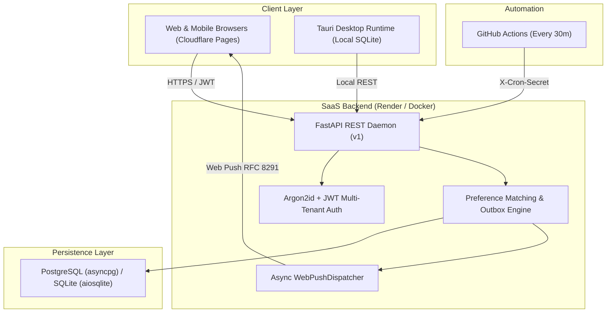

# HawkOffer 🦅

> A website-first, multi-user SaaS career intelligence and automated job-monitoring platform — engineered with a strict zero-budget philosophy and desktop runtime compatibility.

HawkOffer continuously monitors company career portals for newly published jobs and internships matching individual user preference profiles. Built for public SaaS web deployment with dual PostgreSQL / SQLite dialect support, centralized multi-tenant scraping, cryptographic deduplication, cross-device Web Push notifications (VAPID RFC 8291), and a full Kanban application tracking pipeline.

---

## 🌟 Product Highlights

- **Website-First Multi-User SaaS**: Open the web application from anywhere, register an account, configure skills and target preferences, and receive real-time notifications even when your browser is closed.
- **Strict Zero-Budget Architecture**: Operates at **$0.00/month operational costs** utilizing production free-tier infrastructure (Cloudflare Pages, Render / Fly.io container runtime, Supabase / Neon PostgreSQL, and GitHub Actions cron). No paid APIs or mandatory subscriptions.
- **Centralized Scraping & Fair Matching**: Monitored company career portals are scraped once per cycle across the entire platform, deduplicated centrally, and evaluated against subscribed user preference profiles.
- **Cross-Platform Delivery**: Instant RFC 8291 / 8292 Web Push notifications on desktop and mobile browsers, alongside native desktop toasts in Tauri desktop mode.
- **Multi-ATS Adapter Architecture**: Native support for major ATS platforms (Greenhouse, Lever, Ashby, Workday) using lightweight feeds and APIs with headless automation fallbacks.
- **Application Tracking Pipeline**: Complete 5-stage Kanban board (`Saved`, `Applied`, `Interviewing`, `Offer`, `Archived`) to manage your job search end-to-end.
- **Privacy & Dual-Engine Persistence**: Seamlessly switches between cloud PostgreSQL (asyncpg) and local SQLite (aiosqlite) with zero code modifications.

---

## 🛠️ Technology Stack

| Layer | Technology | Purpose |
| :--- | :--- | :--- |
| **Frontend Web** | React 18, TypeScript, Vite, TailwindCSS | Modern SaaS dashboard, Kanban pipeline, and Web Push client |
| **Edge Hosting** | Cloudflare Pages | Global edge CDN, automated Git builds, zero-downtime SPA routing |
| **Backend Container** | FastAPI, Uvicorn, Python 3.11-slim | Async REST API v1, multi-tenant auth, background outbox dispatcher |
| **Persistence Layer** | PostgreSQL 16 (Cloud) / SQLite (Desktop) | Dual-dialect schema migrations via Alembic asyncpg/aiosqlite |
| **Background Cron** | GitHub Actions (`monitor-cron.yml`) | Zero-cost 30-min scheduled runner authenticated via `CRON_SECRET` |
| **Web Push Alerts** | VAPID (RFC 8291 / 8292), Service Worker | Multi-device encrypted push delivery to Chrome, Safari, Firefox |
| **Desktop Runtime** | Tauri (Rust) | Optional standalone desktop packaging with system tray |

---

## 📐 System Architecture



For comprehensive architecture and deployment guides, see:
- 📖 [docs/DEPLOYMENT.md](docs/DEPLOYMENT.md) — Zero-Budget Cloud Deployment Guide
- 📐 [docs/SAAS_ARCHITECTURE.md](docs/SAAS_ARCHITECTURE.md) — Multi-Tenant SaaS Architecture Specifications
- 🗺️ [docs/SAAS_ROADMAP.md](docs/SAAS_ROADMAP.md) — Complete SaaS Roadmap and Milestone Log

---

## 🗺️ Project Status & Development Roadmap

- [x] **Milestone 1–9**: Desktop Foundation, ATS Adapters, Ingestion, and Tauri Packaging
- [x] **Milestone 10–11**: AI Semantic Resume & Job Matching Foundation
- [x] **Milestone 12**: SaaS Architecture Audit & Roadmap Formulation
- [x] **Milestone 13**: Multi-Tenant Schema & Dual-Dialect PostgreSQL/SQLite Foundation
- [x] **Milestone 14**: Authentication, Security & Tenant Isolation (Argon2id + JWT)
- [x] **Milestone 15 & 15.1**: Centralized Monitoring, Fan-Out Matching & Hardening
- [x] **Milestone 16, 16.1 & 16.2**: Web Push Notifications (VAPID RFC 8291) & Anti-SSRF Protection
- [x] **Milestone 17**: Public SaaS Web Dashboard, Company Catalog & Application Tracker
- [x] **Milestone 18**: Zero-Budget Deployment Automation & Cloud Readiness (Cloudflare Pages, Render, Supabase, Docker, GitHub Actions Cron)
- [x] **Milestone 19**: First Public Deployment & Production Validation (Startup Handshake, Automated Smoke Testing & Hardening)

For detailed task breakdowns and acceptance criteria, see [docs/ROADMAP.md](docs/ROADMAP.md).

---

## 🧪 Developer Guide: Running Tests & Migrations

### Running Automated Production Smoke Tests
To verify a local daemon, Docker container, or live cloud deployment:

```bash
# Verify local instance
python scripts/smoke_test.py --api-url http://127.0.0.1:8765/api/v1 --cron-secret <secret>

# Verify live deployment (Render + Cloudflare Pages)
python scripts/smoke_test.py \
    --api-url https://hawkoffer-api.onrender.com/api/v1 \
    --web-url https://hawkoffer.pages.dev \
    --cron-secret <secret>
```

### Running Backend Tests
Activate the virtual environment in `backend/` and execute `pytest`:

```bash
cd backend
.\.venv\Scripts\activate

# Run all automated tests
pytest

# Run tests with coverage report
pytest --cov=app --cov-report=term-missing

# Run end-to-end pipeline integration tests
pytest tests/test_e2e_pipeline.py
```

### Running Frontend Tests & Dev Server
HawkOffer's desktop UI runs on React 18, TypeScript, Vite, and Tailwind CSS with Tauri 2.x packaging:

```bash
cd frontend

# Install dependencies
npm install

# Start local development server (port 1420)
npm run dev

# Run Vitest test suite
npm test

# Typecheck and build production artifacts
npm run lint
npm run build
```

### Building Desktop Release Packages
To compile the standalone backend binary and production frontend bundle into distribution artifacts:

```bash
# Automated release build pipeline
.\backend\.venv\Scripts\python.exe scripts/build_release.py
```
This produces the standalone `hawkoffer-backend.exe` (~24 MB) and packages it for Tauri sidecar distribution. See [docs/RELEASE.md](docs/RELEASE.md) for full distribution instructions.

### Running Database Migrations
Database schemas are managed with Alembic:

```bash
cd backend

# Upgrade to latest schema (head)
alembic upgrade head

# Downgrade one revision
alembic downgrade -1
```

### Code Quality & Static Typing
HawkOffer enforces strict linting and typing standards:

```bash
cd backend

# Linting with Ruff
ruff check app/ tests/

# Code formatting check
ruff format --check app/ tests/

# Static type checking with MyPy
mypy app/ tests/
```

---

## 🛡️ Ethical Scraping & Compliance Standards

HawkOffer is built as an ethical, respectful personal monitoring tool:
- **Respects Standards**: Adheres to `robots.txt` directives and site terms.
- **No Evasion**: Does **not** bypass authentication, CAPTCHAs, Cloudflare challenges, or anti-bot protections.
- **Rate-Limited**: Employs non-aggressive polling intervals and randomized schedule jitter ($\pm 15\%$) to eliminate burst traffic.
- **Feed-First Philosophy**: Always prefers official public APIs, RSS feeds, and JSON endpoints before attempting HTML scraping or browser automation.

---

## 💻 Contributing

We welcome community feedback, feature requests, and adapter contributions! Please check [docs/ROADMAP.md](docs/ROADMAP.md) to see what is currently in progress before submitting pull requests.

---

## 📄 License

This project is licensed under the [MIT License](LICENSE).
