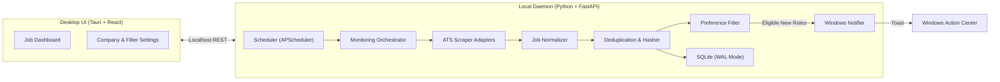

# HawkOffer 🦅

> An open-source, local-first, AI-powered career monitoring desktop application.

HawkOffer continuously monitors company career portals for newly published jobs and internships matching your personal preferences. It runs quietly in the background on Windows, standardizes opportunities across diverse ATS platforms, eliminates duplicate alerts, and delivers native desktop notifications the moment relevant roles open.

---

## 🌟 Product Highlights

- **Local-First & Private**: Your target lists, preferences, and discovered listings live in a local SQLite database on your machine. No mandatory accounts, external trackers, or cloud subscriptions.
- **Multi-ATS Adapter Architecture**: Native support for major Applicant Tracking Systems (Greenhouse, Lever, Ashby, Workday) utilizing public APIs and lightweight feeds first, falling back to headless automation (Playwright) only when necessary.
- **Smart Deduplication & Change Detection**: Cryptographic fingerprinting (SHA-256) ensures you never receive duplicate notifications for the same role, while tracking updates when descriptions or requirements change.
- **Customizable Filtering**: Filter by exact or partial job titles, remote/hybrid status, experience level, target cities, and negative exclusion keywords (e.g., exclude "Senior" or "Staff").
- **Native Windows Notifications**: Actionable desktop toasts allow you to open new postings immediately in your default browser.
- **Extensible for AI**: Designed from day one with decoupled interfaces for local semantic resume-to-job matching in upcoming releases.

---

## 🛠️ Technology Stack

| Layer | Technology | Purpose |
| :--- | :--- | :--- |
| **Desktop Framework** | [Tauri](https://tauri.app/) (Rust) | Lightweight desktop window management, system tray, and native shell |
| **Frontend UI** | React 18, TypeScript, Vite, TailwindCSS | Modern, responsive desktop dashboard and configuration interface |
| **Backend / API** | FastAPI, Uvicorn | Local REST service coordinating storage, settings, and monitoring |
| **Monitoring Engine** | Python 3.11+ | Core scraping, normalization, and filtering engine |
| **Scheduler** | APScheduler | Background interval and cron scheduling with randomized jitter |
| **Network & Parsing** | HTTPX, BeautifulSoup4 | Fast async HTTP requests and HTML parsing for static feeds |
| **Browser Automation** | Playwright (Python) | Headless fallback for dynamic, client-rendered Single Page Applications |
| **Persistence** | SQLite with WAL mode, SQLAlchemy, Alembic | Embedded, zero-configuration local database with migrations |
| **Desktop Alerts** | Windows Native Toasts (`windows-toasts`) | Interactive desktop notifications with deep links |

---

## 📐 System Architecture

HawkOffer separates responsibilities cleanly into 10 decoupled modules:

For complete technical specifications, database schema, and API route definitions, see [docs/ARCHITECTURE.md](docs/ARCHITECTURE.md).

---

## 🗺️ Project Status & Development Roadmap

HawkOffer is being built incrementally, milestone by milestone:

- [x] **Milestone 0: Architecture & Foundation Design** *(Current)*
- [ ] **Milestone 1**: Core Data Models & SQLite Persistence Layer
- [ ] **Milestone 2**: Scraper Adapters (Greenhouse, Lever, Ashby) & Normalization Engine
- [ ] **Milestone 3**: Playwright Fallback Adapter & Deduplication Engine
- [ ] **Milestone 4**: Background Scheduler & Windows Native Notifications
- [ ] **Milestone 5**: FastAPI REST Daemon & Service Layer
- [ ] **Milestone 6**: React Desktop Dashboard & Settings UI
- [ ] **Milestone 7**: Tauri Integration, System Tray & Windows Packaging
- [ ] **Milestone 8**: AI-Powered Resume & Job Semantic Matching

For detailed task breakdowns and acceptance criteria, see [docs/ROADMAP.md](docs/ROADMAP.md).

---

## 🛡️ Ethical Scraping & Compliance Standards

HawkOffer is built as an ethical, respectful personal monitoring tool:
- **Respects Standards**: Adheres to `robots.txt` directives and site terms.
- **No Evasion**: Does **not** bypass authentication, CAPTCHAs, Cloudflare challenges, or anti-bot protections.
- **Rate-Limited**: Employs non-aggressive polling intervals and randomized schedule jitter ($\pm 15\%$) to eliminate burst traffic.
- **Feed-First Philosophy**: Always prefers official public APIs, RSS feeds, and JSON endpoints before attempting HTML scraping or browser automation.

---

## 💻 Contributing

We welcome community feedback, feature requests, and adapter contributions! Please check [docs/ROADMAP.md](docs/ROADMAP.md) to see what is currently in progress before submitting pull requests.

---

## 📄 License

This project is licensed under the [MIT License](LICENSE).
