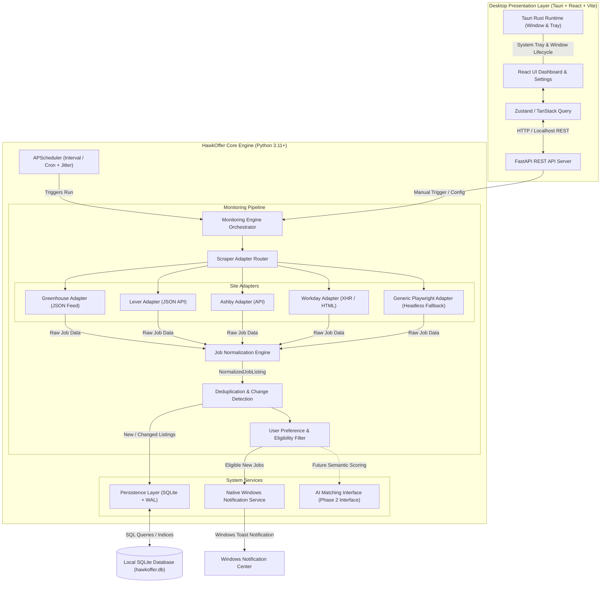
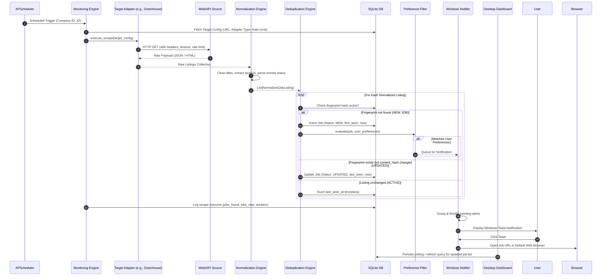
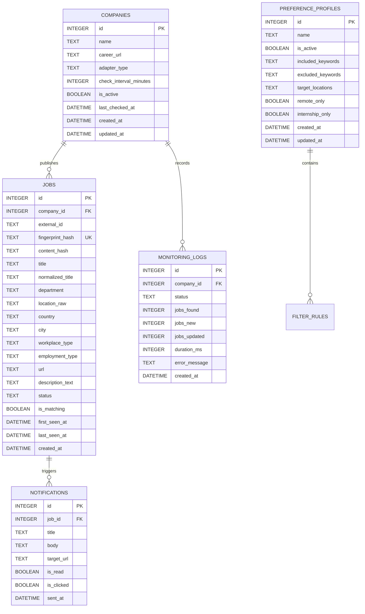
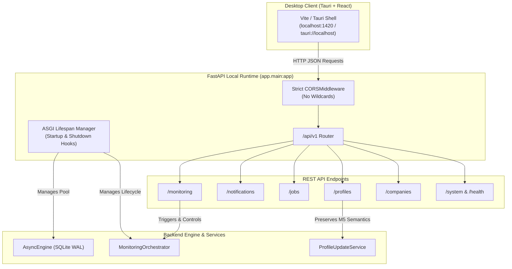
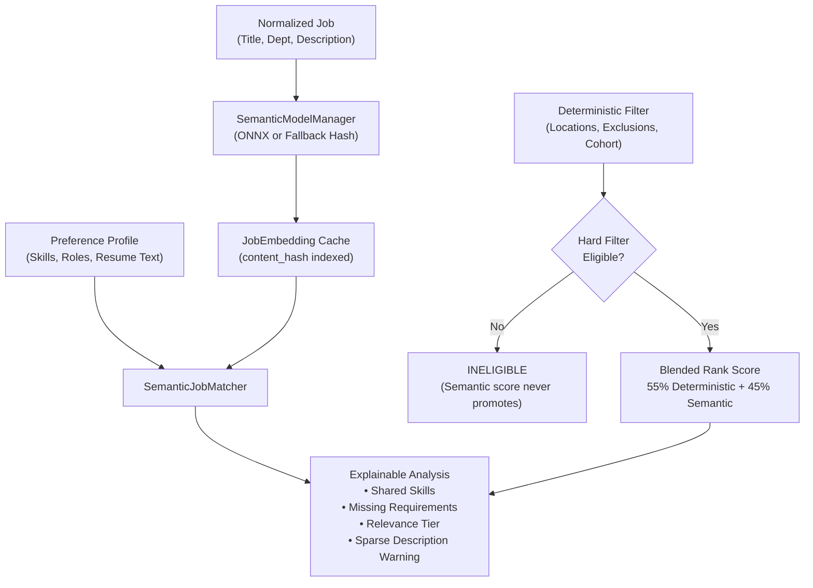

# HawkOffer Technical Architecture

This document defines the technical architecture, component design, data flow, schema specifications, and engineering guidelines for **HawkOffer**, an open-source, local-first career monitoring desktop application.

---

## 1. Architectural Overview & Design Philosophy

HawkOffer is designed as a **local-first, desktop-native career discovery daemon and dashboard**. It operates quietly on the user's local machine, continuously monitoring target company career sites, standardizing listings, filtering for matching criteria, and issuing native Windows desktop alerts without requiring third-party cloud infrastructure or paid APIs.

### Core Architectural Principles

- **Local-First & Privacy-Centric**: User preferences, targets, and job records remain strictly on the user's machine in an embedded SQLite database.
- **Resource Efficiency**: Heavy headless browsers (Playwright) are executed only when static HTTP requests or public ATS feeds fail or are unavailable.
- **Strict Separation of Concerns**: Modular adapter pattern decouples career site parsing from monitoring logic, database persistence, and notification dispatch.
- **Respectful Automation**: Respects `robots.txt`, implements randomized jitter and rate-limiting, handles exponential backoffs, and forbids CAPTCHA-bypassing or unauthorized credential scraping.
- **SaaS-Ready Interfaces**: All core abstractions (Storage, Notifications, Scheduler) use protocol/interface boundaries so local implementations can later be swapped for cloud-native backends (PostgreSQL, Celery, Webhooks/Email).



---

## 2. Component Responsibilities

The system is partitioned into **10 independent modules**:

### 1. Career Website Monitoring Engine (`hawkoffer.engine`)
- **Responsibilities**:
  - Orchestrates periodic and on-demand check runs for active company targets.
  - Controls concurrency (limits simultaneous network operations to prevent CPU/network saturation).
  - Handles per-target error handling, transient retry loops, and exponential backoff.
  - Emits telemetry and execution logs into the database for user visibility.

### 2. Website-Specific Scraper Adapters (`hawkoffer.adapters`)
- **Responsibilities**:
  - Implements a unified abstract base class (`BaseCareerAdapter`).
  - Prioritizes public JSON APIs and feeds (e.g., Greenhouse API, Lever Postings API, Ashby API) over browser rendering.
  - Employs static HTTP fetching (`httpx`) and DOM parsing (`BeautifulSoup4`) for lightweight career portals.
  - Degrades gracefully to headless browser automation (`Playwright`) exclusively for dynamic Single Page Applications (SPAs) or JavaScript-rendered boards.
  - Enforces per-domain rate limiting and custom user-agent headers.

### 3. Job Normalization and Extraction (`hawkoffer.normalizer`)
- **Responsibilities**:
  - Ingests diverse raw payloads (JSON structures, HTML nodes) and validates them into typed Pydantic models.
  - Cleans and standardizes attributes:
    - Normalizes job titles (e.g., strips tags like `"[Remote]"` or `"Req-12345"`).
    - Extracts structured employment types (Full-time, Internship, Co-op, Contract).
    - Normalizes locations into country, state/province, city, and workplace type (Remote, Hybrid, On-site).
    - Resolves absolute tracking-free URLs (stripping `utm_*` and session query parameters).
    - Cleans HTML descriptions into plain text or structured markdown.

### 4. Job Deduplication and Change Detection (`hawkoffer.deduplication`)
- **Responsibilities**:
  - Generates deterministic fingerprints using cryptographic hashes (SHA-256 of normalized `company_id + normalized_title + location + clean_url`).
  - Generates a content hash (SHA-256 of normalized description/requirements) to detect modifications in active listings.
  - Manages listing lifecycle states:
    - `NEW`: First observed.
    - `ACTIVE`: Persistently detected without content alteration.
    - `UPDATED`: Detected with changed description, title, or compensation.
    - `CLOSED`: Target site no longer lists this job across $N$ consecutive monitoring runs.

### 5. Configurable Monitoring Scheduler (`hawkoffer.scheduler`)
- **Responsibilities**:
  - Built on `APScheduler` (AsyncIOScheduler) running inside the daemon process.
  - Manages target-specific execution schedules (e.g., check Company A every 30 minutes, Company B every 2 hours).
  - Applies random jitter ($\pm 10\text{–}20\%$) to schedules to prevent burst traffic and mimic organic access patterns.
  - Exposes pause, resume, reconfigure, and run-now methods via FastAPI endpoints.

### 6. User Preference and Eligibility Filtering (`hawkoffer.filtering`)
- **Responsibilities**:
  - Evaluates new listings against active user filter profiles.
  - Rule-based criteria:
    - **Title matching**: Positive keywords (e.g., `["Software Engineer", "Backend", "Full Stack"]`).
    - **Exclusions**: Negative keywords (e.g., `["Senior", "Lead", "Staff", "Director"]`).
    - **Experience level**: Filter for Internships, New Grad, Entry Level.
    - **Location & Remote filter**: Allowed countries, cities, or remote-only flags.
  - Returns a match verdict (`is_match: bool`, `matched_rules: list[str]`).

### 7. AI-Powered Job Matching (`hawkoffer.ai` - Future Phase)
- **Responsibilities** (Isolated Interface):
  - Defined via an abstract interface `JobMatcherProtocol`.
  - In V1, this returns a stub or baseline keyword score.
  - In future milestones, will support local LLM inferences (via Ollama or local ONNX embeddings) to compare listing requirements against the user's parsed resume and provide match explanations.

### 8. Database and Persistence Layer (`hawkoffer.storage`)
- **Responsibilities**:
  - Embedded SQLite database managed through SQLAlchemy (async mode) or lightweight `aiosqlite`.
  - Configures SQLite for high concurrency using **WAL (Write-Ahead Logging)** mode and immediate busy timeouts.
  - Manages database schema migrations via Alembic.
  - Provides a clean Repository Pattern (`CompanyRepository`, `JobRepository`, `LogRepository`, `PreferenceRepository`).

### 9. Desktop Notification Service (`hawkoffer.notifications`)
- **Responsibilities**:
  - Dispatches native Windows toast notifications using `windows-toasts` (or Tauri native notification APIs).
  - Includes actionable click handlers (opens job URL directly in the user's default browser).
  - Enforces notification throttling and anti-spam grouping (e.g., if a company publishes 10 jobs at once, emits 1 summary notification: *"Company X posted 10 new opportunities"*).

### 10. Desktop Dashboard and Settings (`frontend` + `src-tauri`)
- **Responsibilities**:
  - Modern, responsive desktop UI built with React, Vite, and TypeScript.
  - Packaged via Tauri for minimal memory footprint compared to Electron.
  - Provides screens for:
    - **Job Feed**: Filterable, searchable list of discovered opportunities with status tags.
    - **Company Targets**: Add/edit career sites, select adapter type, set monitoring frequency.
    - **Preferences**: Customize keywords, locations, notifications, and scheduler intervals.
    - **Audit Logs & Health**: Monitor daemon health, error logs, and scrape success rates.
  - Handles system tray integration (minimizes to tray, runs background monitoring).

---

## 3. Proposed Repository Structure

```
HawkOffer/
├── .github/
│   └── workflows/
│       ├── lint-and-test.yml          # Automated CI for Python & Frontend
│       └── release.yml                # Tauri build and binary release
├── docs/
│   ├── ARCHITECTURE.md                # System architecture specification
│   ├── ROADMAP.md                     # Phased implementation roadmap
│   └── adapters/                      # Documentation for authoring new adapters
├── backend/                           # Python Local Daemon & Core Engine
│   ├── pyproject.toml                 # Poetry or PDM / Flit project configuration
│   ├── requirements.txt               # Direct runtime dependencies
│   ├── requirements-dev.txt           # Testing & linting tooling (pytest, ruff, mypy)
│   ├── alembic/                       # Database migrations
│   │   ├── env.py
│   │   └── versions/
│   ├── hawkoffer/
│   │   ├── __init__.py
│   │   ├── main.py                    # Application entry point (FastAPI + Scheduler lifecycle)
│   │   ├── config.py                  # Pydantic Settings (paths, timeouts, defaults)
│   │   ├── adapters/                  # Career platform scraper adapters
│   │   │   ├── __init__.py
│   │   │   ├── base.py                # BaseCareerAdapter abstract base class
│   │   │   ├── registry.py            # Adapter registry & auto-detection
│   │   │   ├── greenhouse.py          # Greenhouse public API adapter
│   │   │   ├── lever.py               # Lever public API adapter
│   │   │   ├── ashby.py               # Ashby API adapter
│   │   │   ├── workday.py             # Workday career portal adapter
│   │   │   └── generic_playwright.py  # Playwright fallback adapter
│   │   ├── engine/                    # Monitoring orchestrator
│   │   │   ├── __init__.py
│   │   │   ├── runner.py              # Single target execution runner
│   │   │   └── orchestrator.py        # Concurrent target coordinator
│   │   ├── normalizer/                # Data standardization & extraction
│   │   │   ├── __init__.py
│   │   │   ├── models.py              # Raw & Normalized Pydantic models
│   │   │   └── extractor.py           # Text/HTML cleanup & attribute parser
│   │   ├── deduplication/             # Fingerprinting & state tracking
│   │   │   ├── __init__.py
│   │   │   └── hasher.py              # SHA-256 fingerprint & content hasher
│   │   ├── filtering/                 # User preference evaluation
│   │   │   ├── __init__.py
│   │   │   ├── rules.py               # Keyword, location & boolean rules
│   │   │   └── evaluator.py           # Eligibility evaluator
│   │   ├── scheduler/                 # APScheduler integration
│   │   │   ├── __init__.py
│   │   │   └── manager.py             # Job scheduler and jitter controller
│   │   ├── notifications/             # Desktop notification dispatcher
│   │   │   ├── __init__.py
│   │   │   └── windows.py             # Windows native toast wrapper
│   │   ├── storage/                   # Database & persistence
│   │   │   ├── __init__.py
│   │   │   ├── database.py            # SQLite connection, engine & session factory
│   │   │   ├── models.py              # SQLAlchemy ORM models
│   │   │   └── repositories/          # Data access repositories
│   │   │       ├── company_repo.py
│   │   │       ├── job_repo.py
│   │   │       └── log_repo.py
│   │   ├── api/                       # FastAPI REST endpoints
│   │   │   ├── __init__.py
│   │   │   ├── routes/
│   │   │   │   ├── targets.py         # Target company CRUD & trigger
│   │   │   │   ├── jobs.py            # Discovered jobs query & status updates
│   │   │   │   ├── preferences.py     # User filter preferences
│   │   │   │   └── system.py          # Health, scheduler status, logs
│   │   │   └── schemas.py             # Request & Response Pydantic DTOs
│   │   └── ai/                        # Future AI matching interfaces
│   │       ├── __init__.py
│   │       └── protocol.py            # JobMatcherProtocol abstraction
│   └── tests/
│       ├── conftest.py
│       ├── test_adapters.py
│       ├── test_normalizer.py
│       ├── test_deduplication.py
│       ├── test_filtering.py
│       └── test_api.py
├── frontend/                          # React + TypeScript + Vite UI
│   ├── package.json
│   ├── tsconfig.json
│   ├── vite.config.ts
│   ├── index.html
│   └── src/
│       ├── main.tsx
│       ├── App.tsx
│       ├── components/                # UI component library (shadcn / tailwind)
│       │   ├── layout/                # Shell, Header, Sidebar
│       │   ├── jobs/                  # JobCard, JobTable, JobDetailsModal
│       │   ├── targets/               # TargetModal, TargetList
│       │   └── common/
│       ├── hooks/                     # Custom React hooks (useJobs, useTargets)
│       ├── services/                  # API client talking to FastAPI localhost
│       │   └── api.ts
│       ├── types/                     # TypeScript interfaces matching API DTOs
│       └── stores/                    # Client state management (Zustand)
├── src-tauri/                         # Tauri Desktop Shell (Rust)
│   ├── Cargo.toml
│   ├── tauri.conf.json                # Window, tray, and sidecar configuration
│   └── src/
│       └── main.rs                    # System tray, sidecar process supervisor
├── .gitignore
├── LICENSE
└── README.md
```

---

## 4. End-to-End Data Flow

The following sequence illustrates the complete lifecycle from automated trigger to native notification:



---

## 5. Database Schema Proposal (SQLite)

The persistence layer uses SQLite configured with **Write-Ahead Logging (WAL)**:
`PRAGMA journal_mode=WAL; PRAGMA synchronous=NORMAL; PRAGMA foreign_keys=ON;`

### Entity Relationship Diagram



### Table Definitions & Constraints

1. **`companies`**:
   - `id`: `INTEGER PRIMARY KEY AUTOINCREMENT`
   - `name`: `TEXT NOT NULL`
   - `career_url`: `TEXT NOT NULL`
   - `adapter_type`: `TEXT NOT NULL` (e.g., `'greenhouse'`, `'lever'`, `'ashby'`, `'generic_playwright'`)
   - `check_interval_minutes`: `INTEGER NOT NULL DEFAULT 60`
   - `is_active`: `BOOLEAN NOT NULL DEFAULT 1`
   - `last_checked_at`: `DATETIME NULL`
   - `created_at`: `DATETIME NOT NULL DEFAULT CURRENT_TIMESTAMP`
   - `updated_at`: `DATETIME NOT NULL DEFAULT CURRENT_TIMESTAMP`
   - *Index*: `idx_companies_active (is_active, last_checked_at)`

2. **`jobs`**:
   - `id`: `INTEGER PRIMARY KEY AUTOINCREMENT`
   - `company_id`: `INTEGER NOT NULL REFERENCES companies(id) ON DELETE CASCADE`
   - `external_id`: `TEXT NULL` (ATS internal identifier)
   - `fingerprint_hash`: `TEXT NOT NULL UNIQUE` (SHA-256 of company + title + location + clean URL)
   - `content_hash`: `TEXT NOT NULL` (SHA-256 of description and requirements)
   - `title`: `TEXT NOT NULL`
   - `normalized_title`: `TEXT NOT NULL`
   - `department`: `TEXT NULL`
   - `location_raw`: `TEXT NULL`
   - `country`: `TEXT NULL`
   - `city`: `TEXT NULL`
   - `workplace_type`: `TEXT NOT NULL DEFAULT 'unspecified'` (`'remote'`, `'hybrid'`, `'onsite'`, `'unspecified'`)
   - `employment_type`: `TEXT NOT NULL DEFAULT 'unspecified'` (`'full_time'`, `'internship'`, `'contract'`, `'unspecified'`)
   - `url`: `TEXT NOT NULL`
   - `description_text`: `TEXT NULL`
   - `status`: `TEXT NOT NULL DEFAULT 'NEW'` (`'NEW'`, `'ACTIVE'`, `'UPDATED'`, `'CLOSED'`)
   - `is_matching`: `BOOLEAN NOT NULL DEFAULT 0` (Set true if evaluated positively by filter engine)
   - `first_seen_at`: `DATETIME NOT NULL DEFAULT CURRENT_TIMESTAMP`
   - `last_seen_at`: `DATETIME NOT NULL DEFAULT CURRENT_TIMESTAMP`
   - *Indices*:
     - `idx_jobs_fingerprint (fingerprint_hash)`
     - `idx_jobs_company_status (company_id, status)`
     - `idx_jobs_matching (is_matching, first_seen_at DESC)`

3. **`preference_profiles`**:
   - `id`: `INTEGER PRIMARY KEY AUTOINCREMENT`
   - `name`: `TEXT NOT NULL DEFAULT 'Default Profile'`
   - `is_active`: `BOOLEAN NOT NULL DEFAULT 1`
   - `included_keywords`: `TEXT NOT NULL DEFAULT '[]'` (JSON array of strings)
   - `excluded_keywords`: `TEXT NOT NULL DEFAULT '[]'` (JSON array of strings)
   - `target_locations`: `TEXT NOT NULL DEFAULT '[]'` (JSON array of strings)
   - `remote_only`: `BOOLEAN NOT NULL DEFAULT 0`
   - `internship_only`: `BOOLEAN NOT NULL DEFAULT 0`
   - `created_at`: `DATETIME NOT NULL DEFAULT CURRENT_TIMESTAMP`
   - `updated_at`: `DATETIME NOT NULL DEFAULT CURRENT_TIMESTAMP`

4. **`notifications`**:
   - `id`: `INTEGER PRIMARY KEY AUTOINCREMENT`
   - `job_id`: `INTEGER NOT NULL REFERENCES jobs(id) ON DELETE CASCADE`
   - `title`: `TEXT NOT NULL`
   - `body`: `TEXT NOT NULL`
   - `target_url`: `TEXT NOT NULL`
   - `is_read`: `BOOLEAN NOT NULL DEFAULT 0`
   - `is_clicked`: `BOOLEAN NOT NULL DEFAULT 0`
   - `sent_at`: `DATETIME NOT NULL DEFAULT CURRENT_TIMESTAMP`
   - *Index*: `idx_notifications_unread (is_read, sent_at DESC)`

5. **`monitoring_logs`**:
   - `id`: `INTEGER PRIMARY KEY AUTOINCREMENT`
   - `company_id`: `INTEGER NOT NULL REFERENCES companies(id) ON DELETE CASCADE`
   - `status`: `TEXT NOT NULL` (`'SUCCESS'`, `'FAILED'`, `'RATE_LIMITED'`, `'SKIPPED'`)
   - `jobs_found`: `INTEGER NOT NULL DEFAULT 0`
   - `jobs_new`: `INTEGER NOT NULL DEFAULT 0`
   - `jobs_updated`: `INTEGER NOT NULL DEFAULT 0`
   - `duration_ms`: `INTEGER NOT NULL`
   - `error_message`: `TEXT NULL`
   - `created_at`: `DATETIME NOT NULL DEFAULT CURRENT_TIMESTAMP`
   - *Index*: `idx_logs_company_date (company_id, created_at DESC)`

6. **`job_discovery_outbox`** (M5 Phase 3):
   - `id`: `INTEGER PRIMARY KEY AUTOINCREMENT`
   - `job_id`: `INTEGER NOT NULL UNIQUE REFERENCES jobs(id) ON DELETE CASCADE`
   - `status`: `VARCHAR(20) NOT NULL` (`'PENDING'`, `'PROCESSING'`, `'PROCESSED'`, `'FAILED'`)
   - `lease_token`: `VARCHAR(36) NULL` (UUIDv4 lease identifier)
   - `lease_expires_at`: `DATETIME NULL`
   - `attempt_count`: `INTEGER NOT NULL DEFAULT 0`
   - `processed_at`: `DATETIME NULL`
   - `last_error`: `TEXT NULL`
   - `created_at`: `DATETIME NOT NULL DEFAULT CURRENT_TIMESTAMP`
   - *Indices*:
     - `ix_job_discovery_outbox_job_id (job_id UNIQUE)`
     - `ix_job_discovery_outbox_status (status)`
     - `ix_job_discovery_outbox_lease_token (lease_token)`
     - `ix_outbox_claim_pending (status, id)` WHERE `status = 'PENDING'`
     - `ix_outbox_claim_expired (status, lease_expires_at, id)` WHERE `status = 'PROCESSING'`

7. **`notification_backlog`** (M5 Phase 3):
   - `id`: `INTEGER PRIMARY KEY AUTOINCREMENT`
   - `job_id`: `INTEGER NOT NULL REFERENCES jobs(id) ON DELETE CASCADE`
   - `profile_id`: `INTEGER NOT NULL REFERENCES preference_profiles(id) ON DELETE CASCADE`
   - `profile_revision`: `INTEGER NOT NULL`
   - `score`: `INTEGER NOT NULL` (0–100 integer matching score)
   - `status`: `VARCHAR(20) NOT NULL` (`'QUEUED'`, `'PROCESSING'`, `'PROCESSED'`, `'STALE'`, `'DROPPED'`)
   - `lease_token`: `VARCHAR(36) NULL` (UUIDv4 lease identifier)
   - `lease_expires_at`: `DATETIME NULL`
   - `attempt_count`: `INTEGER NOT NULL DEFAULT 0`
   - `processed_at`: `DATETIME NULL`
   - `created_at`: `DATETIME NOT NULL DEFAULT CURRENT_TIMESTAMP`
   - *Constraints & Indices*:
     - `uq_backlog_job_profile_rev UNIQUE (job_id, profile_id, profile_revision)`
     - `ix_notification_backlog_job_id (job_id)`
     - `ix_notification_backlog_profile_id (profile_id)`
     - `ix_notification_backlog_status (status)`
     - `ix_notification_backlog_lease_token (lease_token)`
     - `ix_backlog_queued_relevance (score DESC, created_at ASC, id ASC)` WHERE `status = 'QUEUED'`
     - `ix_backlog_queued_fifo (created_at ASC, id ASC)` WHERE `status = 'QUEUED'`
     - `ix_backlog_processing_relevance (score DESC, created_at ASC, id ASC)` WHERE `status = 'PROCESSING'`
     - `ix_backlog_processing_fifo (created_at ASC, id ASC)` WHERE `status = 'PROCESSING'`

8. **`profile_reevaluation_tasks`** (M5 Phase 3):
   - `id`: `INTEGER PRIMARY KEY AUTOINCREMENT`
   - `profile_id`: `INTEGER NOT NULL REFERENCES preference_profiles(id) ON DELETE CASCADE`
   - `profile_revision`: `INTEGER NOT NULL`
   - `max_job_id`: `INTEGER NOT NULL` (Frozen upper bound for keyset pagination)
   - `last_processed_job_id`: `INTEGER NOT NULL DEFAULT 0` (Progress cursor)
   - `status`: `VARCHAR(20) NOT NULL` (`'PENDING'`, `'RUNNING'`, `'COMPLETED'`, `'SUPERSEDED'`, `'CANCELLED'`)
   - `attempt_count`: `INTEGER NOT NULL DEFAULT 0`
   - `lease_token`: `VARCHAR(36) NULL` (UUIDv4 lease identifier)
   - `lease_expires_at`: `DATETIME NULL`
   - `completed_at`: `DATETIME NULL`
   - `last_error`: `TEXT NULL`
   - `created_at`: `DATETIME NOT NULL DEFAULT CURRENT_TIMESTAMP`
   - *Constraints & Indices*:
     - `uq_active_task_per_profile UNIQUE (profile_id)` WHERE `status IN ('PENDING', 'RUNNING')`
     - `ix_profile_reevaluation_tasks_profile_id (profile_id)`
     - `ix_profile_reevaluation_tasks_status (status)`

9. **`system_drain_state`** (M5 Phase 3):
   - `id`: `INTEGER PRIMARY KEY` (Singleton row, id=1 enforced)
   - `drain_counter`: `INTEGER NOT NULL DEFAULT 0`
   - `updated_at`: `DATETIME NOT NULL DEFAULT CURRENT_TIMESTAMP`

---

## 6. API Endpoint Proposal (FastAPI Daemon)

The FastAPI daemon runs locally (bound to `127.0.0.1:8765`).

### Target Management (`/api/targets`)
- `GET /api/targets`: List all configured company monitoring targets with last run summary.
- `POST /api/targets`: Register a new career site target (Validates URL, autodetects adapter).
- `GET /api/targets/{id}`: Retrieve details and scrape history for a target.
- `PUT /api/targets/{id}`: Update target config (URL, interval, active status).
- `DELETE /api/targets/{id}`: Remove target and optionally prune associated jobs.
- `POST /api/targets/{id}/trigger`: Manually trigger an immediate check run for this target.
- `POST /api/targets/detect-adapter`: Test a URL and probe headers/DOM to auto-recommend the best adapter.

### Job Discovery (`/api/jobs`)
- `GET /api/jobs`: Query discovered jobs (Supports filters: `search`, `company_id`, `workplace_type`, `is_matching`, `status`, pagination).
- `GET /api/jobs/{id}`: Get full job details, normalized description, and change timeline.
- `PATCH /api/jobs/{id}`: Mark job as viewed, bookmarked, or dismissed.

### Filter Preferences (`/api/preferences`)
- `GET /api/preferences`: Retrieve the active user filter criteria.
- `PUT /api/preferences`: Update keyword inclusion/exclusion rules, location preferences, and flags.
- `POST /api/preferences/test`: Test preference filters against existing jobs to preview matches.

### System & Scheduler (`/api/system`)
- `GET /api/system/status`: Daemon health, active scheduler jobs, next run times, SQLite DB size.
- `POST /api/system/scheduler/pause`: Pause all background monitoring jobs.
- `POST /api/system/scheduler/resume`: Resume scheduled monitoring.
- `GET /api/system/logs`: Retrieve recent scrape logs and error diagnostics.

---

## 7. Adapter Architecture & Extensibility

All career platform scrapers inherit from `BaseCareerAdapter`:

```python
from abc import ABC, abstractmethod
from typing import List, Optional
from pydantic import BaseModel

class RawScrapedJob(BaseModel):
    external_id: Optional[str] = None
    raw_title: str
    raw_location: Optional[str] = None
    raw_department: Optional[str] = None
    url: str
    raw_description: Optional[str] = None
    published_at: Optional[str] = None

class BaseCareerAdapter(ABC):
    name: str
    requires_playwright: bool = False
    
    @abstractmethod
    async def can_handle(self, url: str) -> bool:
        """Determines if this adapter supports the given career site URL."""
        pass

    @abstractmethod
    async def fetch_jobs(self, target_url: str, config: dict) -> List[RawScrapedJob]:
        """Fetches and extracts raw job items from the target platform."""
        pass
```

### Adapter Priority Hierarchy
1. **Official / Public JSON API Feed** (Greenhouse boards API, Lever v0 API, Ashby public postings): Fast, zero rendering overhead, structured data, least prone to UI breaking changes.
2. **Static HTTP + BeautifulSoup** (HTML career portals where jobs are rendered in server-side HTML): Fast, low CPU overhead.
3. **Headless Playwright** (Complex client-side SPAs or dynamic JavaScript catalogs): Used as a fallback. Spawns headless browser, waits for network idle/job container selector, extracts items, and immediately destroys browser context to release RAM.

---

## 8. Technical Risks & Mitigations

| Technical Risk | Impact | Mitigation Strategy |
| :--- | :--- | :--- |
| **Dynamic SPAs & Anti-Bot Protection** | Scraper fails to load job listings or gets blocked (403/429). | 1. Prioritize ATS public APIs and RSS/JSON feeds.<br>2. Strictly respect `robots.txt` and rate limits.<br>3. Randomized request delays ($\pm 15\%$).<br>4. Realistic browser headers without evasion tricks.<br>5. Fall back cleanly with helpful diagnostic logs instead of crashing. |
| **High Memory Footprint on Windows** | Constant background execution consumes excessive RAM. | 1. Default to lightweight `httpx` async requests.<br>2. Avoid keeping Playwright browser instances alive in memory; launch on-demand and dispose immediately.<br>3. Package frontend with lightweight Tauri rather than heavy Electron. |
| **Alert Fatigue / Duplicate Notifications** | User gets bombarded with repeated alerts for the same role. | 1. SHA-256 fingerprinting on normalized titles, locations, and clean URLs.<br>2. Track notification dispatch in database.<br>3. Batch multiple new listings detected in the same run into a single summary toast. |
| **Career Site Schema Breakage** | Site redesign breaks HTML scraper. | 1. Isolate site logic inside modular adapters.<br>2. Comprehensive error logging (`monitoring_logs`).<br>3. Unit tests with recorded HTML fixtures.<br>4. Future plugin system allowing users to update individual adapters without reinstalling the app. |
| **Packaging & Python Runtime on Windows** | User installation failure due to missing Python or dependencies. | 1. Compile/package Python core into a standalone executable (PyInstaller) bundled as a Tauri sidecar.<br>2. Include pre-packaged browser binaries or install on-demand. |

---

## 9. Extensibility to Future SaaS

While HawkOffer is built as a **local-first desktop tool**, its modular interfaces guarantee clean migration to a cloud multi-tenant architecture:

- **Storage**: SQLAlchemy repository interfaces allow swapping SQLite for PostgreSQL with zero changes to business logic.
- **Scheduler**: The `APScheduler` runner can be substituted with Celery / Redis or Google Cloud Tasks.
- **Notifications**: The `NotificationService` interface supports adding Discord webhooks, Telegram bots, or transactional emails alongside desktop toasts.
- **Multi-Tenancy**: Data models are designed with future `user_id` foreign keys in mind.

---

## 10. M5 Phase 3 Background Processing Pipeline Architecture

Milestone 5 Phase 3 introduces a robust, decoupled, transactional background processing pipeline designed for local concurrency and reliability.

```mermaid
flowchart TD
    subgraph Ingestion ["Phase A: Ingestion & Transactional Outbox"]
        Scraper["Career Scraper"] --> Normalizer["Job Normalizer"]
        Normalizer -->|Atomic Transaction| IngestTx["IngestionService (begin_nested)"]
        IngestTx -->|Insert/Update| JobsTable[("jobs")]
        IngestTx -->|If NEW: Insert| OutboxTable[("job_discovery_outbox (PENDING)")]
    end

    subgraph Discovery ["Phase B: Discovery Worker"]
        DiscWorker["JobDiscoveryWorker"] -->|Claim Batch (BEGIN IMMEDIATE)| OutboxTable
        DiscWorker -->|Read Active Profiles & Snapshot| ProfilesTable[("preference_profiles")]
        DiscWorker -->|Filter Outside DB Lock| Engine["M4 JobFilteringEngine"]
        DiscWorker -->|Fenced Commit| BacklogTable[("notification_backlog (QUEUED)")]
        DiscWorker -->|Mark PROCESSED| OutboxTable
    end

    subgraph Reeval ["Phase C: Profile Reevaluation Pipeline"]
        ProfUpdate["ProfileUpdateService"] -->|Meaningful Update (revision+1)| ProfilesTable
        ProfUpdate -->|Invalidate QUEUED| BacklogTable
        ProfUpdate -->|Supersede Active Tasks| TaskTable[("profile_reevaluation_tasks")]
        ProfUpdate -->|Enqueue Task (Frozen max_job_id)| TaskTable
        ReevalWorker["ProfileReevaluationWorker"] -->|Keyset Pagination| JobsTable
        ReevalWorker -->|Fenced Commit| BacklogTable
    end

    subgraph Drain ["Phase D: Backlog Drain & Notification Promotion"]
        DrainWorker["BacklogDrainWorker"] -->|Modulo-5 Claim (BEGIN IMMEDIATE)| BacklogTable
        DrainWorker -->|Atomic Counter Advance| DrainState[("system_drain_state")]
        DrainWorker -->|Verify Revision & Deduplicate| NotifRepo["NotificationRepository"]
        DrainWorker -->|Promote Atomically| NotifsTable[("notifications (UNREAD)")]
    end

    subgraph Orchestration ["Phase E: Scheduler Orchestration"]
        Orchestrator["MonitoringOrchestrator (AsyncIOScheduler)"]
        Orchestrator --> DiscWorker
        Orchestrator --> ReevalWorker
        Orchestrator --> DrainWorker
    end
```

### 10.1 Component Responsibilities & Lifecycle

1. **Transactional Outbox Ingestion (`IngestionService`)**:
   - Ingests normalized job postings from ATS scrapers.
   - For every genuinely new job, commits both the `Job` record and a corresponding `JobDiscoveryOutbox` record with status `PENDING` inside the same transaction savepoint.
   - Idempotently prevents duplicate outbox records when existing jobs are refreshed.
   - If an error occurs, the savepoint rolls back both the `Job` and `JobDiscoveryOutbox` insertions.

2. **Job Discovery Worker (`JobDiscoveryWorker`)**:
   - **Phase A (Claim)**: Acquires a bounded batch of eligible `PENDING` (or expired `PROCESSING`) outbox records under `BEGIN IMMEDIATE` write lock, stamping each with a unique UUIDv4 `lease_token` and `lease_expires_at`.
   - **Phase B (Snapshot Evaluation)**: Evaluates current active `PreferenceProfile` records and matches them using `JobFilteringEngine` *outside database write transactions*.
   - **Phase C (Fenced Commit)**: In an individual write transaction per outbox record, verifies the lease token still matches the worker. If valid, writes matching candidates into `notification_backlog` and marks the outbox record `PROCESSED`. If stale, safely skips the record without overwriting concurrent reclaimers.

3. **Profile Revision & Historical Reevaluation (`ProfileUpdateService` & `ProfileReevaluationWorker`)**:
   - **Revision Management**: When a user modifies filtering preferences, `ProfileUpdateService` compares existing vs. new criteria. Meaningful updates increment `revision += 1`, mark previous `QUEUED` backlog candidates for that profile as `STALE`, supersede active tasks, and enqueue a new `ProfileReevaluationTask` bound to the frozen `max_job_id`.
   - **Keyset Pagination**: `ProfileReevaluationWorker` processes historical jobs using ordered keyset pagination (`id > last_processed_job_id AND id <= max_job_id ORDER BY id ASC LIMIT chunk_size`), eliminating offset degradation.
   - **Heartbeats & Fencing**: Employs an asynchronous heartbeat loop renewing the lease during long-running tasks. Stale lease fencing protects chunk commits and failure recording against stale workers.

4. **Backlog Drain & Notification Promotion (`BacklogDrainWorker`)**:
   - **Modulo-5 Fairness Algorithm**: Implements sequential slot allocation via a persistent counter stored in singleton `SystemDrainState(id=1)`. Slots 0, 1, 2, and 3 allocate the highest-scoring candidate (`RELEVANCE`), while slot 4 allocates the oldest candidate (`FIFO`). If the primary bucket is empty, it dynamically falls back to the secondary bucket.
   - **Atomic Allocation**: Candidate selection and counter increment occur atomically under `BEGIN IMMEDIATE`.
   - **Promotion**: Verifies candidate profile revision against the live profile. If current, promotes the candidate into a user-facing `Notification` record and marks the backlog item `PROCESSED`.
   - **Deduplication**: Deduplicates against existing notifications for `(profile_id, job_id, notification_type)`, including legacy `DESKTOP_TOAST` aliasing.

5. **Scheduler Integration & Lifecycle Orchestration (`MonitoringOrchestrator`)**:
   - Single orchestrator owning the primary `AsyncIOScheduler` instance.
   - **Closed Lifecycle Gate on Startup**: All manual and scheduled worker triggers are rejected until prerequisites (`SystemDrainState` validation, stale scan recovery, company schedules) complete.
   - **Active Shutdown Tracking (`_active_shutdowns`)**: Reference-counted shutdown tracking guarantees that startup admission remains strictly closed throughout the entire shutdown operation (waiting for startup, stopping scheduler, removing jobs, and draining in-flight workers).
   - **Cancellation Resilience**: If shutdown is cancelled, APScheduler is stopped (`wait=False`), jobs are cleared, gate remains closed, and generation advances on zero active shutdowns to permit future clean restarts.

### 10.2 Database Indexing & Query Plans

All critical worker queries leverage SQLite partial indexes to achieve $O(\log N)$ lookups with **zero temporary b-trees**:
- `ix_outbox_claim_pending`: `(status, id)` WHERE `status = 'PENDING'`.
- `ix_outbox_claim_expired`: `(status, lease_expires_at, id)` WHERE `status = 'PROCESSING'`.
- `ix_backlog_queued_relevance`: `(score DESC, created_at ASC, id ASC)` WHERE `status = 'QUEUED'`.
- `ix_backlog_queued_fifo`: `(created_at ASC, id ASC)` WHERE `status = 'QUEUED'`.
- Keyset Pagination on `jobs`: Direct scan on `INTEGER PRIMARY KEY` (`rowid > :cursor AND rowid <= :max_id`).
- Notification Deduplication: `uq_notifications_job_profile_type` unique index search.

### 10.3 Known Limitations & Concurrency Boundaries

- **Local SQLite Concurrency**: Designed for single-desktop execution. Uses `BEGIN IMMEDIATE` transactions to prevent SQLite busy deadlocks during write operations, combined with in-process `asyncio.Lock`s. Does not support multi-process concurrent writers across independent OS processes or clustered nodes.
- **Outbox Retention**: Outbox records are preserved for the lifecycle of their associated `Job` records to guarantee the exactly-one-outbox-event-per-job invariant.
- **Downgrade Boundary**: Alembic downgrades below `8de4342be7a1` drop the outbox, backlog, and reevaluation task tables while preserving all user-facing notification history in the `notifications` table.

---

## 11. REST API Architecture & Application Runtime (Milestone 6)

Milestone 6 establishes the local REST API layer that enables a future desktop UI (Tauri + React) to interact with HawkOffer's underlying persistence and monitoring engine.



### 11.1 Application Composition & Lifespan Management

The application runtime is constructed using a factory pattern (`app.main:create_app`) with explicit dependency injection for test isolation:

1. **Startup Lifecycle (`@asynccontextmanager lifespan`)**:
   - **Database Schema Validation**: If `init_database=True`, runs `init_db()` to create or verify SQLite tables.
   - **Session Factory Configuration**: Attaches the async sessionmaker to `app.state.session_factory`.
   - **Orchestrator Startup**: If `start_scheduler=True`, starts the `MonitoringOrchestrator`. It validates prerequisites (`SystemDrainState(id=1)`, stale scan recovery, company schedules) and opens the lifecycle gate only after scheduler startup succeeds.
2. **Graceful Shutdown**:
   - Waits for active startup tasks, closes worker gates, stops APScheduler, and cleanly drains in-flight workers.
   - Disposes the SQLAlchemy engine connection pool (`engine.dispose()`).

### 11.2 Security & Network Isolation

- **Localhost Binding**: The REST service binds strictly to `127.0.0.1` (or Windows loopback) and does not listen on `0.0.0.0`.
- **Restricted CORS Policy**: Wildcard origins (`*`) are disallowed. Only designated Tauri and Vite developer origins are whitelisted:
  - `http://127.0.0.1:1420` & `http://localhost:1420` (Tauri dev server)
  - `http://127.0.0.1:5173` & `http://localhost:5173` (Vite dev server)
  - `tauri://localhost` (Production Tauri webview origin)

### 11.3 Router Subsystems & Behavior

1. **System & Health (`/api/v1/health`, `/api/v1/system/status`)**:
   - Diagnostic checks verifying database responsiveness (`SELECT 1`) and orchestrator running state.
   - Aggregated entity counts (companies, jobs, unread notifications) and pipeline scheduling status.
2. **Companies (`/api/v1/companies`)**:
   - Full CRUD lifecycle with URL validation and duplicate detection (409 Conflict).
   - Activation and deactivation endpoints that immediately re-synchronize scheduler company jobs.
   - Out-of-band scan trigger (`POST /{id}/trigger`) with lifecycle gate enforcement.
3. **Preference Profiles (`/api/v1/profiles`)**:
   - Full CRUD for user preference filters.
   - **Critical Revision Preservation**: Profile modifications route through `ProfileUpdateService.update_profile(profile_id, payload)`. This preserves M5 Phase 3 guarantees: incrementing `revision += 1`, invalidating queued backlog entries as `STALE`, superseding pending reevaluations, and scheduling a new keyset `ProfileReevaluationTask`.
4. **Jobs (`/api/v1/jobs`)**:
   - Paginated job discovery queries with dynamic filtering by `company_id`, `status`, `job_type`, `employment_type`, `graduation_year`, and case-insensitive keyword search.
   - Fast scalar counting (`select(func.count()).select_from(Job)`) avoiding memory overhead.
5. **Notifications (`/api/v1/notifications`)**:
   - Paginated alert feeds with filter toggles (`include_dismissed`, `status`, `profile_id`).
   - Idempotent state transitions: `/read`, `/unread`, `/dismiss`, `/restore`.
   - Batch operations (`/batch/read`, `/batch/dismiss`) for bulk UI actions.
   - Real-time unread badge count (`/unread-count`).
6. **Monitoring & Pipeline (`/api/v1/monitoring`)**:
   - Worker triggers for manual pipeline runs: discovery, historical reevaluation, and backlog drain.
   - Scheduler pause and resume endpoints for individual background worker jobs or target company scans.
   - Rejection reporting when orchestrator is shutting down or unavailable.

---

## 12. Local AI Semantic Job Matching Subsystem (Milestone 10)

Milestone 10 introduces a lightweight, 100% local semantic matching layer that compares user resume and experience profiles with normalized job descriptions, providing explainable relevance rankings while strictly preserving deterministic hard filters.



### 12.1 Deterministic Precedence Principle
- **Hard Filter Inviolability**: Hard constraints (location restrictions, excluded title/content keywords, graduation cohort constraints) remain absolute. If a job fails any hard constraint, its status is definitively `INELIGIBLE`.
- **Zero Semantic Overrides**: Semantic similarity cannot promote an ineligible job into `ELIGIBLE` or `NEEDS_REVIEW`.
- **Candidate Ranking Formula**: For eligible postings, the final ranking score blends deterministic matching criteria and semantic cosine similarity:
  $$\text{Blended Score} = 0.55 \times \text{Deterministic Score} + 0.45 \times \text{Semantic Score}$$

### 12.2 Embedding Architecture & Fallback Engine
- **Target Model**: `sentence-transformers/all-MiniLM-L6-v2` in ONNX format (~22 MB quantized, 384 dimensions).
- **Inference Runtime**: `onnxruntime` + `tokenizers` running entirely on CPU. Zero PyTorch dependency to prevent multi-gigabyte desktop bundle bloat.
- **Graceful Deterministic Fallback**: `FallbackEmbeddingService` provides immediate 384-dimensional non-negative feature-hashed subword/n-gram embeddings prior to downloading neural weights, ensuring zero downtime and fully offline operation.
- **On-Demand Lifecycle**: Model weights are downloaded on demand to `%LOCALAPPDATA%\HawkOffer\HawkOffer\models\all-MiniLM-L6-v2\` with transparent user controls in the application header.

### 12.3 Database Schema & Invalidation Strategy
- **`job_embeddings` Table**:
  - `job_id`: Foreign key to `jobs.id` (CASCADE delete).
  - `model_version`: Identifier of the embedding architecture (`all-MiniLM-L6-v2-onnx-v1` or `deterministic-hash-384-v1`).
  - `content_hash`: SHA-256 hash of job title, location, department, and description.
  - `embedding`: JSON-serialized float array (384 dimensions).
  - Unique constraint on `(job_id, model_version)`.
- **Automatic Invalidation**: When a monitored job posting updates and changes its `content_hash`, existing cached embeddings are recognized as stale and automatically recomputed.
- **Profile Revision Invalidation**: Updating `resume_text` or `semantic_enabled` increments the profile revision, supersedes existing backlog items, and enqueues background historical reevaluation.

### 12.4 Explainability & User Experience
Every match provides full transparency:
- **Relevance Tier**: Categorized into `Strong Match` ($\ge 70\%$), `Moderate Match` ($\ge 45\%$), or `Low Match` ($< 45\%$).
- **Shared Skills**: Extracted chips showing overlapping technologies and competencies.
- **Missing Requirements**: Highlighted skills required by the employer that were not identified in the profile.
- **Sparse Description Detection**: Flags descriptions under 40 characters with adjusted confidence notes.

### 12.5 Integrity & Lifecycle Hardening (Milestone 10.1 Audit)
- **Asset Integrity Checks**:
  - `MIN_MODEL_SIZE_BYTES` (15 MB) and `MIN_TOKENIZER_SIZE_BYTES` (100 KB) enforce minimum physical file sizes.
  - Zero-byte or truncated assets left by interrupted downloads or disk corruption are detected during startup inspection, automatically unlinked, and transitioned to `NOT_DOWNLOADED` with seamless fallback activation.
- **Atomic Two-Phase Promotion**:
  - Downloads stream to staging files (`model.onnx.tmp`, `tokenizer.json.tmp`).
  - Prior to replacing active model files, an end-to-end test inference pass is executed against the temporary files. Only upon producing a valid 384-dimensional vector are the files atomically promoted via file system rename.
- **Inference Optimization & Text Sanitization**:
  - Max token length capped at 512 with dynamic padding to batch max length, reducing unnecessary matrix operations on short job titles.
  - Empty or whitespace strings are routed to static zero vectors `[0.0] * 384` without invoking tokenizer or tensor runtime.
- **Asset Endpoints**:
  - Primary quantized model asset: `https://huggingface.co/Xenova/all-MiniLM-L6-v2/resolve/main/onnx/model_quantized.onnx` (22.9 MB INT8).
  - Secondary fallback asset: `https://huggingface.co/sentence-transformers/all-MiniLM-L6-v2/resolve/main/onnx/model.onnx` (90.4 MB FP32).

### 12.6 Scoring Limitations and Fallback Trade-offs
- **Lexical Subword Baseline in Fallback Mode**:
  - The deterministic fallback service hashes character 3-grams and word tokens into 384 dimensions. Due to shared English subwords (e.g., "-ing", "-tion", "-er"), completely unrelated career descriptions yield a baseline lexical similarity of ~20–28%.
  - Relevant roles achieve 45–65% similarity in fallback mode, preserving monotonic rank ordering while waiting for neural weights.
- **Authoritative Hard Filter Overrides**:
  - If a job violates hard filter rules (location mismatch, excluded keywords, graduation year bounds), its `blended_score` is forced to `0.0` and its `relevance_tier` is locked to `"INELIGIBLE"`. Semantic similarity is strictly secondary to candidate eligibility.


