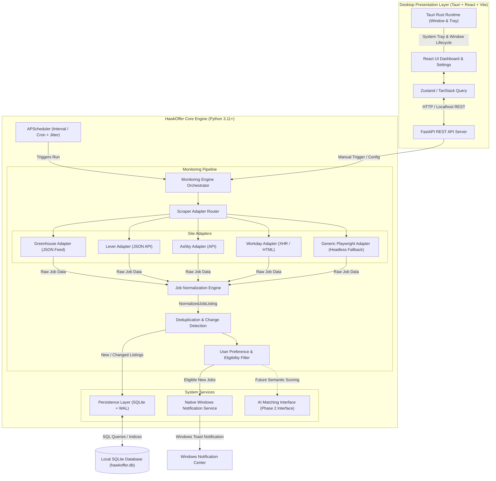
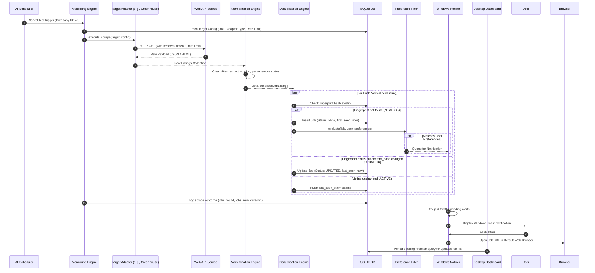
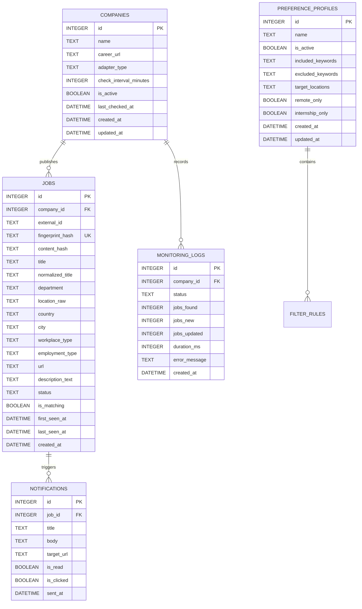

# HawkOffer Technical Architecture

This document defines the technical architecture, component design, data flow, schema specifications, and engineering guidelines for **HawkOffer**, an open-source, local-first career monitoring desktop application.

---

## 1. Architectural Overview & Design Philosophy

HawkOffer is designed as a **local-first, desktop-native career discovery daemon and dashboard**. It operates quietly on the user's local machine, continuously monitoring target company career sites, standardizing listings, filtering for matching criteria, and issuing native Windows desktop alerts without requiring third-party cloud infrastructure or paid APIs.

### Core Architectural Principles

- **Local-First & Privacy-Centric**: User preferences, targets, and job records remain strictly on the user's machine in an embedded SQLite database.
- **Resource Efficiency**: Heavy headless browsers (Playwright) are executed only when static HTTP requests or public ATS feeds fail or are unavailable.
- **Strict Separation of Concerns**: Modular adapter pattern decouples career site parsing from monitoring logic, database persistence, and notification dispatch.
- **Respectful Automation**: Respects `robots.txt`, implements randomized jitter and rate-limiting, handles exponential backoffs, and forbids CAPTCHA-bypassing or unauthorized credential scraping.
- **SaaS-Ready Interfaces**: All core abstractions (Storage, Notifications, Scheduler) use protocol/interface boundaries so local implementations can later be swapped for cloud-native backends (PostgreSQL, Celery, Webhooks/Email).



---

## 2. Component Responsibilities

The system is partitioned into **10 independent modules**:

### 1. Career Website Monitoring Engine (`hawkoffer.engine`)
- **Responsibilities**:
  - Orchestrates periodic and on-demand check runs for active company targets.
  - Controls concurrency (limits simultaneous network operations to prevent CPU/network saturation).
  - Handles per-target error handling, transient retry loops, and exponential backoff.
  - Emits telemetry and execution logs into the database for user visibility.

### 2. Website-Specific Scraper Adapters (`hawkoffer.adapters`)
- **Responsibilities**:
  - Implements a unified abstract base class (`BaseCareerAdapter`).
  - Prioritizes public JSON APIs and feeds (e.g., Greenhouse API, Lever Postings API, Ashby API) over browser rendering.
  - Employs static HTTP fetching (`httpx`) and DOM parsing (`BeautifulSoup4`) for lightweight career portals.
  - Degrades gracefully to headless browser automation (`Playwright`) exclusively for dynamic Single Page Applications (SPAs) or JavaScript-rendered boards.
  - Enforces per-domain rate limiting and custom user-agent headers.

### 3. Job Normalization and Extraction (`hawkoffer.normalizer`)
- **Responsibilities**:
  - Ingests diverse raw payloads (JSON structures, HTML nodes) and validates them into typed Pydantic models.
  - Cleans and standardizes attributes:
    - Normalizes job titles (e.g., strips tags like `"[Remote]"` or `"Req-12345"`).
    - Extracts structured employment types (Full-time, Internship, Co-op, Contract).
    - Normalizes locations into country, state/province, city, and workplace type (Remote, Hybrid, On-site).
    - Resolves absolute tracking-free URLs (stripping `utm_*` and session query parameters).
    - Cleans HTML descriptions into plain text or structured markdown.

### 4. Job Deduplication and Change Detection (`hawkoffer.deduplication`)
- **Responsibilities**:
  - Generates deterministic fingerprints using cryptographic hashes (SHA-256 of normalized `company_id + normalized_title + location + clean_url`).
  - Generates a content hash (SHA-256 of normalized description/requirements) to detect modifications in active listings.
  - Manages listing lifecycle states:
    - `NEW`: First observed.
    - `ACTIVE`: Persistently detected without content alteration.
    - `UPDATED`: Detected with changed description, title, or compensation.
    - `CLOSED`: Target site no longer lists this job across $N$ consecutive monitoring runs.

### 5. Configurable Monitoring Scheduler (`hawkoffer.scheduler`)
- **Responsibilities**:
  - Built on `APScheduler` (AsyncIOScheduler) running inside the daemon process.
  - Manages target-specific execution schedules (e.g., check Company A every 30 minutes, Company B every 2 hours).
  - Applies random jitter ($\pm 10\text{–}20\%$) to schedules to prevent burst traffic and mimic organic access patterns.
  - Exposes pause, resume, reconfigure, and run-now methods via FastAPI endpoints.

### 6. User Preference and Eligibility Filtering (`hawkoffer.filtering`)
- **Responsibilities**:
  - Evaluates new listings against active user filter profiles.
  - Rule-based criteria:
    - **Title matching**: Positive keywords (e.g., `["Software Engineer", "Backend", "Full Stack"]`).
    - **Exclusions**: Negative keywords (e.g., `["Senior", "Lead", "Staff", "Director"]`).
    - **Experience level**: Filter for Internships, New Grad, Entry Level.
    - **Location & Remote filter**: Allowed countries, cities, or remote-only flags.
  - Returns a match verdict (`is_match: bool`, `matched_rules: list[str]`).

### 7. AI-Powered Job Matching (`hawkoffer.ai` - Future Phase)
- **Responsibilities** (Isolated Interface):
  - Defined via an abstract interface `JobMatcherProtocol`.
  - In V1, this returns a stub or baseline keyword score.
  - In future milestones, will support local LLM inferences (via Ollama or local ONNX embeddings) to compare listing requirements against the user's parsed resume and provide match explanations.

### 8. Database and Persistence Layer (`hawkoffer.storage`)
- **Responsibilities**:
  - Embedded SQLite database managed through SQLAlchemy (async mode) or lightweight `aiosqlite`.
  - Configures SQLite for high concurrency using **WAL (Write-Ahead Logging)** mode and immediate busy timeouts.
  - Manages database schema migrations via Alembic.
  - Provides a clean Repository Pattern (`CompanyRepository`, `JobRepository`, `LogRepository`, `PreferenceRepository`).

### 9. Desktop Notification Service (`hawkoffer.notifications`)
- **Responsibilities**:
  - Dispatches native Windows toast notifications using `windows-toasts` (or Tauri native notification APIs).
  - Includes actionable click handlers (opens job URL directly in the user's default browser).
  - Enforces notification throttling and anti-spam grouping (e.g., if a company publishes 10 jobs at once, emits 1 summary notification: *"Company X posted 10 new opportunities"*).

### 10. Desktop Dashboard and Settings (`frontend` + `src-tauri`)
- **Responsibilities**:
  - Modern, responsive desktop UI built with React, Vite, and TypeScript.
  - Packaged via Tauri for minimal memory footprint compared to Electron.
  - Provides screens for:
    - **Job Feed**: Filterable, searchable list of discovered opportunities with status tags.
    - **Company Targets**: Add/edit career sites, select adapter type, set monitoring frequency.
    - **Preferences**: Customize keywords, locations, notifications, and scheduler intervals.
    - **Audit Logs & Health**: Monitor daemon health, error logs, and scrape success rates.
  - Handles system tray integration (minimizes to tray, runs background monitoring).

---

## 3. Proposed Repository Structure

```
HawkOffer/
├── .github/
│   └── workflows/
│       ├── lint-and-test.yml          # Automated CI for Python & Frontend
│       └── release.yml                # Tauri build and binary release
├── docs/
│   ├── ARCHITECTURE.md                # System architecture specification
│   ├── ROADMAP.md                     # Phased implementation roadmap
│   └── adapters/                      # Documentation for authoring new adapters
├── backend/                           # Python Local Daemon & Core Engine
│   ├── pyproject.toml                 # Poetry or PDM / Flit project configuration
│   ├── requirements.txt               # Direct runtime dependencies
│   ├── requirements-dev.txt           # Testing & linting tooling (pytest, ruff, mypy)
│   ├── alembic/                       # Database migrations
│   │   ├── env.py
│   │   └── versions/
│   ├── hawkoffer/
│   │   ├── __init__.py
│   │   ├── main.py                    # Application entry point (FastAPI + Scheduler lifecycle)
│   │   ├── config.py                  # Pydantic Settings (paths, timeouts, defaults)
│   │   ├── adapters/                  # Career platform scraper adapters
│   │   │   ├── __init__.py
│   │   │   ├── base.py                # BaseCareerAdapter abstract base class
│   │   │   ├── registry.py            # Adapter registry & auto-detection
│   │   │   ├── greenhouse.py          # Greenhouse public API adapter
│   │   │   ├── lever.py               # Lever public API adapter
│   │   │   ├── ashby.py               # Ashby API adapter
│   │   │   ├── workday.py             # Workday career portal adapter
│   │   │   └── generic_playwright.py  # Playwright fallback adapter
│   │   ├── engine/                    # Monitoring orchestrator
│   │   │   ├── __init__.py
│   │   │   ├── runner.py              # Single target execution runner
│   │   │   └── orchestrator.py        # Concurrent target coordinator
│   │   ├── normalizer/                # Data standardization & extraction
│   │   │   ├── __init__.py
│   │   │   ├── models.py              # Raw & Normalized Pydantic models
│   │   │   └── extractor.py           # Text/HTML cleanup & attribute parser
│   │   ├── deduplication/             # Fingerprinting & state tracking
│   │   │   ├── __init__.py
│   │   │   └── hasher.py              # SHA-256 fingerprint & content hasher
│   │   ├── filtering/                 # User preference evaluation
│   │   │   ├── __init__.py
│   │   │   ├── rules.py               # Keyword, location & boolean rules
│   │   │   └── evaluator.py           # Eligibility evaluator
│   │   ├── scheduler/                 # APScheduler integration
│   │   │   ├── __init__.py
│   │   │   └── manager.py             # Job scheduler and jitter controller
│   │   ├── notifications/             # Desktop notification dispatcher
│   │   │   ├── __init__.py
│   │   │   └── windows.py             # Windows native toast wrapper
│   │   ├── storage/                   # Database & persistence
│   │   │   ├── __init__.py
│   │   │   ├── database.py            # SQLite connection, engine & session factory
│   │   │   ├── models.py              # SQLAlchemy ORM models
│   │   │   └── repositories/          # Data access repositories
│   │   │       ├── company_repo.py
│   │   │       ├── job_repo.py
│   │   │       └── log_repo.py
│   │   ├── api/                       # FastAPI REST endpoints
│   │   │   ├── __init__.py
│   │   │   ├── routes/
│   │   │   │   ├── targets.py         # Target company CRUD & trigger
│   │   │   │   ├── jobs.py            # Discovered jobs query & status updates
│   │   │   │   ├── preferences.py     # User filter preferences
│   │   │   │   └── system.py          # Health, scheduler status, logs
│   │   │   └── schemas.py             # Request & Response Pydantic DTOs
│   │   └── ai/                        # Future AI matching interfaces
│   │       ├── __init__.py
│   │       └── protocol.py            # JobMatcherProtocol abstraction
│   └── tests/
│       ├── conftest.py
│       ├── test_adapters.py
│       ├── test_normalizer.py
│       ├── test_deduplication.py
│       ├── test_filtering.py
│       └── test_api.py
├── frontend/                          # React + TypeScript + Vite UI
│   ├── package.json
│   ├── tsconfig.json
│   ├── vite.config.ts
│   ├── index.html
│   └── src/
│       ├── main.tsx
│       ├── App.tsx
│       ├── components/                # UI component library (shadcn / tailwind)
│       │   ├── layout/                # Shell, Header, Sidebar
│       │   ├── jobs/                  # JobCard, JobTable, JobDetailsModal
│       │   ├── targets/               # TargetModal, TargetList
│       │   └── common/
│       ├── hooks/                     # Custom React hooks (useJobs, useTargets)
│       ├── services/                  # API client talking to FastAPI localhost
│       │   └── api.ts
│       ├── types/                     # TypeScript interfaces matching API DTOs
│       └── stores/                    # Client state management (Zustand)
├── src-tauri/                         # Tauri Desktop Shell (Rust)
│   ├── Cargo.toml
│   ├── tauri.conf.json                # Window, tray, and sidecar configuration
│   └── src/
│       └── main.rs                    # System tray, sidecar process supervisor
├── .gitignore
├── LICENSE
└── README.md
```

---

## 4. End-to-End Data Flow

The following sequence illustrates the complete lifecycle from automated trigger to native notification:



---

## 5. Database Schema Proposal (SQLite)

The persistence layer uses SQLite configured with **Write-Ahead Logging (WAL)**:
`PRAGMA journal_mode=WAL; PRAGMA synchronous=NORMAL; PRAGMA foreign_keys=ON;`

### Entity Relationship Diagram



### Table Definitions & Constraints

1. **`companies`**:
   - `id`: `INTEGER PRIMARY KEY AUTOINCREMENT`
   - `name`: `TEXT NOT NULL`
   - `career_url`: `TEXT NOT NULL`
   - `adapter_type`: `TEXT NOT NULL` (e.g., `'greenhouse'`, `'lever'`, `'ashby'`, `'generic_playwright'`)
   - `check_interval_minutes`: `INTEGER NOT NULL DEFAULT 60`
   - `is_active`: `BOOLEAN NOT NULL DEFAULT 1`
   - `last_checked_at`: `DATETIME NULL`
   - `created_at`: `DATETIME NOT NULL DEFAULT CURRENT_TIMESTAMP`
   - `updated_at`: `DATETIME NOT NULL DEFAULT CURRENT_TIMESTAMP`
   - *Index*: `idx_companies_active (is_active, last_checked_at)`

2. **`jobs`**:
   - `id`: `INTEGER PRIMARY KEY AUTOINCREMENT`
   - `company_id`: `INTEGER NOT NULL REFERENCES companies(id) ON DELETE CASCADE`
   - `external_id`: `TEXT NULL` (ATS internal identifier)
   - `fingerprint_hash`: `TEXT NOT NULL UNIQUE` (SHA-256 of company + title + location + clean URL)
   - `content_hash`: `TEXT NOT NULL` (SHA-256 of description and requirements)
   - `title`: `TEXT NOT NULL`
   - `normalized_title`: `TEXT NOT NULL`
   - `department`: `TEXT NULL`
   - `location_raw`: `TEXT NULL`
   - `country`: `TEXT NULL`
   - `city`: `TEXT NULL`
   - `workplace_type`: `TEXT NOT NULL DEFAULT 'unspecified'` (`'remote'`, `'hybrid'`, `'onsite'`, `'unspecified'`)
   - `employment_type`: `TEXT NOT NULL DEFAULT 'unspecified'` (`'full_time'`, `'internship'`, `'contract'`, `'unspecified'`)
   - `url`: `TEXT NOT NULL`
   - `description_text`: `TEXT NULL`
   - `status`: `TEXT NOT NULL DEFAULT 'NEW'` (`'NEW'`, `'ACTIVE'`, `'UPDATED'`, `'CLOSED'`)
   - `is_matching`: `BOOLEAN NOT NULL DEFAULT 0` (Set true if evaluated positively by filter engine)
   - `first_seen_at`: `DATETIME NOT NULL DEFAULT CURRENT_TIMESTAMP`
   - `last_seen_at`: `DATETIME NOT NULL DEFAULT CURRENT_TIMESTAMP`
   - *Indices*:
     - `idx_jobs_fingerprint (fingerprint_hash)`
     - `idx_jobs_company_status (company_id, status)`
     - `idx_jobs_matching (is_matching, first_seen_at DESC)`

3. **`preference_profiles`**:
   - `id`: `INTEGER PRIMARY KEY AUTOINCREMENT`
   - `name`: `TEXT NOT NULL DEFAULT 'Default Profile'`
   - `is_active`: `BOOLEAN NOT NULL DEFAULT 1`
   - `included_keywords`: `TEXT NOT NULL DEFAULT '[]'` (JSON array of strings)
   - `excluded_keywords`: `TEXT NOT NULL DEFAULT '[]'` (JSON array of strings)
   - `target_locations`: `TEXT NOT NULL DEFAULT '[]'` (JSON array of strings)
   - `remote_only`: `BOOLEAN NOT NULL DEFAULT 0`
   - `internship_only`: `BOOLEAN NOT NULL DEFAULT 0`
   - `created_at`: `DATETIME NOT NULL DEFAULT CURRENT_TIMESTAMP`
   - `updated_at`: `DATETIME NOT NULL DEFAULT CURRENT_TIMESTAMP`

4. **`notifications`**:
   - `id`: `INTEGER PRIMARY KEY AUTOINCREMENT`
   - `job_id`: `INTEGER NOT NULL REFERENCES jobs(id) ON DELETE CASCADE`
   - `title`: `TEXT NOT NULL`
   - `body`: `TEXT NOT NULL`
   - `target_url`: `TEXT NOT NULL`
   - `is_read`: `BOOLEAN NOT NULL DEFAULT 0`
   - `is_clicked`: `BOOLEAN NOT NULL DEFAULT 0`
   - `sent_at`: `DATETIME NOT NULL DEFAULT CURRENT_TIMESTAMP`
   - *Index*: `idx_notifications_unread (is_read, sent_at DESC)`

5. **`monitoring_logs`**:
   - `id`: `INTEGER PRIMARY KEY AUTOINCREMENT`
   - `company_id`: `INTEGER NOT NULL REFERENCES companies(id) ON DELETE CASCADE`
   - `status`: `TEXT NOT NULL` (`'SUCCESS'`, `'FAILED'`, `'RATE_LIMITED'`, `'SKIPPED'`)
   - `jobs_found`: `INTEGER NOT NULL DEFAULT 0`
   - `jobs_new`: `INTEGER NOT NULL DEFAULT 0`
   - `jobs_updated`: `INTEGER NOT NULL DEFAULT 0`
   - `duration_ms`: `INTEGER NOT NULL`
   - `error_message`: `TEXT NULL`
   - `created_at`: `DATETIME NOT NULL DEFAULT CURRENT_TIMESTAMP`
   - *Index*: `idx_logs_company_date (company_id, created_at DESC)`

---

## 6. API Endpoint Proposal (FastAPI Daemon)

The FastAPI daemon runs locally (bound to `127.0.0.1:8765`).

### Target Management (`/api/targets`)
- `GET /api/targets`: List all configured company monitoring targets with last run summary.
- `POST /api/targets`: Register a new career site target (Validates URL, autodetects adapter).
- `GET /api/targets/{id}`: Retrieve details and scrape history for a target.
- `PUT /api/targets/{id}`: Update target config (URL, interval, active status).
- `DELETE /api/targets/{id}`: Remove target and optionally prune associated jobs.
- `POST /api/targets/{id}/trigger`: Manually trigger an immediate check run for this target.
- `POST /api/targets/detect-adapter`: Test a URL and probe headers/DOM to auto-recommend the best adapter.

### Job Discovery (`/api/jobs`)
- `GET /api/jobs`: Query discovered jobs (Supports filters: `search`, `company_id`, `workplace_type`, `is_matching`, `status`, pagination).
- `GET /api/jobs/{id}`: Get full job details, normalized description, and change timeline.
- `PATCH /api/jobs/{id}`: Mark job as viewed, bookmarked, or dismissed.

### Filter Preferences (`/api/preferences`)
- `GET /api/preferences`: Retrieve the active user filter criteria.
- `PUT /api/preferences`: Update keyword inclusion/exclusion rules, location preferences, and flags.
- `POST /api/preferences/test`: Test preference filters against existing jobs to preview matches.

### System & Scheduler (`/api/system`)
- `GET /api/system/status`: Daemon health, active scheduler jobs, next run times, SQLite DB size.
- `POST /api/system/scheduler/pause`: Pause all background monitoring jobs.
- `POST /api/system/scheduler/resume`: Resume scheduled monitoring.
- `GET /api/system/logs`: Retrieve recent scrape logs and error diagnostics.

---

## 7. Adapter Architecture & Extensibility

All career platform scrapers inherit from `BaseCareerAdapter`:

```python
from abc import ABC, abstractmethod
from typing import List, Optional
from pydantic import BaseModel

class RawScrapedJob(BaseModel):
    external_id: Optional[str] = None
    raw_title: str
    raw_location: Optional[str] = None
    raw_department: Optional[str] = None
    url: str
    raw_description: Optional[str] = None
    published_at: Optional[str] = None

class BaseCareerAdapter(ABC):
    name: str
    requires_playwright: bool = False
    
    @abstractmethod
    async def can_handle(self, url: str) -> bool:
        """Determines if this adapter supports the given career site URL."""
        pass

    @abstractmethod
    async def fetch_jobs(self, target_url: str, config: dict) -> List[RawScrapedJob]:
        """Fetches and extracts raw job items from the target platform."""
        pass
```

### Adapter Priority Hierarchy
1. **Official / Public JSON API Feed** (Greenhouse boards API, Lever v0 API, Ashby public postings): Fast, zero rendering overhead, structured data, least prone to UI breaking changes.
2. **Static HTTP + BeautifulSoup** (HTML career portals where jobs are rendered in server-side HTML): Fast, low CPU overhead.
3. **Headless Playwright** (Complex client-side SPAs or dynamic JavaScript catalogs): Used as a fallback. Spawns headless browser, waits for network idle/job container selector, extracts items, and immediately destroys browser context to release RAM.

---

## 8. Technical Risks & Mitigations

| Technical Risk | Impact | Mitigation Strategy |
| :--- | :--- | :--- |
| **Dynamic SPAs & Anti-Bot Protection** | Scraper fails to load job listings or gets blocked (403/429). | 1. Prioritize ATS public APIs and RSS/JSON feeds.<br>2. Strictly respect `robots.txt` and rate limits.<br>3. Randomized request delays ($\pm 15\%$).<br>4. Realistic browser headers without evasion tricks.<br>5. Fall back cleanly with helpful diagnostic logs instead of crashing. |
| **High Memory Footprint on Windows** | Constant background execution consumes excessive RAM. | 1. Default to lightweight `httpx` async requests.<br>2. Avoid keeping Playwright browser instances alive in memory; launch on-demand and dispose immediately.<br>3. Package frontend with lightweight Tauri rather than heavy Electron. |
| **Alert Fatigue / Duplicate Notifications** | User gets bombarded with repeated alerts for the same role. | 1. SHA-256 fingerprinting on normalized titles, locations, and clean URLs.<br>2. Track notification dispatch in database.<br>3. Batch multiple new listings detected in the same run into a single summary toast. |
| **Career Site Schema Breakage** | Site redesign breaks HTML scraper. | 1. Isolate site logic inside modular adapters.<br>2. Comprehensive error logging (`monitoring_logs`).<br>3. Unit tests with recorded HTML fixtures.<br>4. Future plugin system allowing users to update individual adapters without reinstalling the app. |
| **Packaging & Python Runtime on Windows** | User installation failure due to missing Python or dependencies. | 1. Compile/package Python core into a standalone executable (PyInstaller) bundled as a Tauri sidecar.<br>2. Include pre-packaged browser binaries or install on-demand. |

---

## 9. Extensibility to Future SaaS

While HawkOffer is built as a **local-first desktop tool**, its modular interfaces guarantee clean migration to a cloud multi-tenant architecture:

- **Storage**: SQLAlchemy repository interfaces allow swapping SQLite for PostgreSQL with zero changes to business logic.
- **Scheduler**: The `APScheduler` runner can be substituted with Celery / Redis or Google Cloud Tasks.
- **Notifications**: The `NotificationService` interface supports adding Discord webhooks, Telegram bots, or transactional emails alongside desktop toasts.
- **Multi-Tenancy**: Data models are designed with future `user_id` foreign keys in mind.
