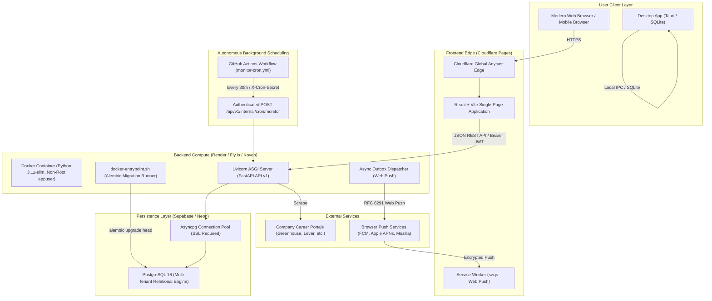

# HawkOffer — Production Deployment & Cloud Readiness Guide

## 1. Architectural Overview

HawkOffer is designed as a **website-first, multi-user SaaS job intelligence platform** that operates under a **strict zero-budget philosophy ($0.00/month operational costs)** on battle-tested, free-tier cloud infrastructure, while retaining full backwards compatibility with the local desktop/Tauri runtime.



---

## 2. Recommended Zero-Budget Provider Matrix

| Component | Recommended Provider | Free Tier Specification | Cost |
| :--- | :--- | :--- | :--- |
| **Frontend Web** | **Cloudflare Pages** | Unlimited bandwidth, global Anycast CDN, automatic HTTPS, custom domains, automated Git builds | **$0.00/mo** |
| **Backend API** | **Render / Fly.io / Koyeb** | 512 MB RAM, 0.1 CPU, custom domains, automatic TLS, Docker container runtime, healthcheck restarts | **$0.00/mo** |
| **PostgreSQL Database** | **Supabase / Neon** | Managed PostgreSQL 15/16, 500 MB storage, connection pooling, SSL/TLS encryption, automated backups | **$0.00/mo** |
| **Scheduled Monitoring** | **GitHub Actions** | 2,000 free runner minutes/month, automated cron schedules (`*/30 * * * *`), secret masking | **$0.00/mo** |
| **Web Push Dispatch** | **Direct VAPID RFC 8291** | Uses native browser push services (Google FCM, Apple APNs, Mozilla Autopush) without third-party push brokers | **$0.00/mo** |

---

## 3. Environment Configuration Reference

The application dynamically configures itself via environment variables. Copy `.env.example` to `.env` or inject these in your hosting dashboard:

| Variable | Type | Default | Production Requirement | Description |
| :--- | :--- | :--- | :--- | :--- |
| `HAWKOFFER_ENV` | `str` | `development` | **`production`** | Enforces strict authentication, prevents insecure secrets. |
| `HAWKOFFER_LOG_LEVEL` | `str` | `INFO` | `INFO` | Logging verbosity (`DEBUG`, `INFO`, `WARNING`, `ERROR`). |
| `HAWKOFFER_DATABASE_URL` | `str` | SQLite AppData | **Required** | PostgreSQL connection URL using `postgresql+asyncpg://`. |
| `HAWKOFFER_API_HOST` | `str` | `127.0.0.1` | `0.0.0.0` | Host interface for backend server binding. |
| `HAWKOFFER_API_PORT` | `int` | `8765` | `8000` / `$PORT` | Port number. Automatically respects `$PORT` in containers. |
| `HAWKOFFER_AUTH_REQUIRED` | `bool` | `false` | **`true`** | Enforces JWT authentication on user routes. |
| `HAWKOFFER_JWT_SECRET_KEY` | `str` | Insecure dev key | **Required (>=32 chars)** | Cryptographic signing key for HS256 authentication tokens. |
| `HAWKOFFER_CRON_SECRET` | `str` | Insecure dev key | **Required** | Secret key for authenticating external monitoring triggers. |
| `HAWKOFFER_VAPID_PUBLIC_KEY` | `str` | `""` | Optional / Recommended | URL-safe base64 uncompressed P-256 public key for Web Push. |
| `HAWKOFFER_VAPID_PRIVATE_KEY` | `str` | `""` | Optional / Recommended | URL-safe base64 P-256 private key for Web Push signing. |
| `HAWKOFFER_VAPID_CLAIMS_SUB` | `str` | `mailto:...` | `mailto:your-email` | RFC 8292 contact email for push notification services. |
| `HAWKOFFER_CORS_ORIGINS` | `str` | Desktop defaults | **Required** | Comma-separated list of allowed frontend web origins. |
| `HAWKOFFER_START_INTERNAL_SCHEDULER` | `bool` | `true` | `false` (recommended) | Set to `false` when delegating to GitHub Actions cron. |
| `RUN_MIGRATIONS` | `bool` | `true` | `true` | Auto-runs `alembic upgrade head` on container entrypoint. |

---

## 4. Step-by-Step Cloud Deployment Walkthrough

### Phase A: PostgreSQL Database (Supabase or Neon)

1. **Create Free Database**:
   - Go to [Supabase](https://supabase.com) or [Neon](https://neon.tech) and create a free PostgreSQL project.
   - Select a region close to your planned backend deployment (e.g. `us-east-1` or `eu-central-1`).
2. **Obtain Asyncpg Connection String**:
   - Copy the URI connection string from the provider dashboard:
     ```
     postgresql://[user]:[password]@[host]:5432/[database]?sslmode=require
     ```
   - Convert the scheme to asyncpg:
     ```
     postgresql+asyncpg://[user]:[password]@[host]:5432/[database]?sslmode=require
     ```
   - Set this as `HAWKOFFER_DATABASE_URL` in your backend environment.

---

### Phase B: Backend Container Deployment (Render / Fly.io / Koyeb)

#### Option 1: Render Web Service (Free Tier)
1. Link your GitHub repository in the [Render Dashboard](https://dashboard.render.com).
2. Choose **Web Service** -> **Deploy from a Dockerfile**.
3. Configure settings:
   - **Root Directory**: `backend`
   - **Dockerfile Path**: `Dockerfile`
   - **Instance Type**: `Free` (0.1 CPU, 512 MB RAM)
4. Add Environment Variables:
   - `HAWKOFFER_ENV` = `production`
   - `HAWKOFFER_DATABASE_URL` = `<your-postgresql+asyncpg-url>`
   - `HAWKOFFER_AUTH_REQUIRED` = `true`
   - `HAWKOFFER_JWT_SECRET_KEY` = `<generated-32-char-random-key>`
   - `HAWKOFFER_CRON_SECRET` = `<generated-32-char-cron-secret>`
   - `HAWKOFFER_VAPID_PUBLIC_KEY` = `<vapid-public-key>`
   - `HAWKOFFER_VAPID_PRIVATE_KEY` = `<vapid-private-key>`
   - `HAWKOFFER_CORS_ORIGINS` = `https://<your-frontend-domain>.pages.dev`
   - `HAWKOFFER_START_INTERNAL_SCHEDULER` = `false`
   - `RUN_MIGRATIONS` = `true`
5. Set Health Check Path:
   - **Health Check Path**: `/api/v1/health`
6. Deploy the service. Note your public backend URL (e.g. `https://hawkoffer-api.onrender.com`).

---

### Phase C: Frontend Edge Deployment (Cloudflare Pages)

1. Open the [Cloudflare Dashboard](https://dash.cloudflare.com/) and navigate to **Workers & Pages** -> **Create application** -> **Pages** -> **Connect to Git**.
2. Select your `HawkOffer` repository.
3. Configure Build Settings:
   - **Framework Preset**: `Vite`
   - **Root Directory**: `frontend`
   - **Build Command**: `npm run build`
   - **Build Output Directory**: `dist`
4. Add Environment Variables:
   - `VITE_API_BASE_URL` = `https://hawkoffer-api.onrender.com/api/v1`
5. Click **Save and Deploy**.
6. Cloudflare Pages automatically preserves SPA client-side routes via `frontend/public/_redirects` (`/* /index.html 200`).

---

### Phase D: Scheduled Monitoring Trigger (GitHub Actions)

Because free-tier container hosts (like Render) spin down after 15 minutes of inbound inactivity, internal scheduling inside the container is paused during sleep. The repository includes an external, zero-cost cron runner via GitHub Actions:

1. Navigate to your repository on GitHub: **Settings** -> **Secrets and variables** -> **Actions**.
2. Under **Repository Secrets**, click **New repository secret**:
   - **Name**: `CRON_SECRET`
   - **Value**: The exact same secret set in `HAWKOFFER_CRON_SECRET` on your backend.
3. Under **Repository Variables**, click **New repository variable**:
   - **Name**: `API_BASE_URL`
   - **Value**: `https://hawkoffer-api.onrender.com` (your backend base URL without trailing slash).
4. Verify Workflow:
   - Navigate to the **Actions** tab on GitHub.
   - Select **HawkOffer Scheduled Monitoring**.
   - Click **Run workflow** (via `workflow_dispatch`) to verify on-demand execution.
   - The workflow executes every 30 minutes via scheduled cron (`*/30 * * * *`).

---

## 5. Self-Hosted Deployment via Docker Compose

For developers or organizations self-hosting on a Virtual Private Server (VPS), Raspberry Pi, or local Linux server:

```bash
# 1. Clone repository
git clone https://github.com/aadesh-2006/HawkOffer.git
cd HawkOffer

# 2. Copy and configure production secrets
cp .env.example .env
nano .env

# 3. Launch database and application containers in detached mode
docker compose -f docker-compose.prod.yml up -d --build

# 4. View logs and monitor health status
docker compose -f docker-compose.prod.yml logs -f backend
docker compose -f docker-compose.prod.yml ps
```

---

## 6. Safe Database Migrations Strategy

- **Automated Startup Migration**: The container entrypoint `backend/scripts/docker-entrypoint.sh` executes `alembic upgrade head` before launching Uvicorn when `RUN_MIGRATIONS=true`.
- **Async Execution Engine**: `backend/alembic/env.py` uses SQLAlchemy's `create_async_engine` with `asyncpg` for PostgreSQL and `aiosqlite` for SQLite, avoiding any requirement for synchronous database drivers (`psycopg2`).
- **Single-Replica Safety**: Migrations run during the container startup phase before web traffic is served. If running multi-replica horizontal autoscaling, set `RUN_MIGRATIONS=false` on web worker containers and execute `alembic upgrade head` as a one-off pre-deploy release task.

---

## 7. Backup and Recovery Procedures

### Logical Backups (PostgreSQL)
To produce an encrypted, zero-downtime backup of the PostgreSQL database:

```bash
# Export compressed binary custom-format dump
pg_dump -Fc -v --no-owner --no-privileges -f "hawkoffer_$(date +%Y%m%d_%H%M%S).dump" "$HAWKOFFER_DATABASE_URL"

# Restore database from dump
pg_restore -v --clean --no-owner --no-privileges -d "$HAWKOFFER_DATABASE_URL" "hawkoffer_20261104_000000.dump"
```

### Zero-Budget Automated Backup Recommendation
Set up a weekly GitHub Actions workflow that executes `pg_dump` and uploads the encrypted archive to Cloudflare R2 (which provides 10 GB free storage with $0 egress fees).

---

## 8. Operational Limits of Free-Tier Hosting & Mitigations

1. **Cold Starts (Render Free Tier)**:
   - *Behavior*: Free tier containers spin down after 15 minutes without inbound requests. The next incoming request takes ~30-50 seconds to warm up.
   - *Mitigation*: The scheduled GitHub Actions cron job triggers every 30 minutes, keeping the container warm during daytime hours while executing centralized company scrapes.
2. **Execution Timeouts**:
   - *Behavior*: Reverse proxies terminate HTTP requests taking longer than 100-180 seconds.
   - *Mitigation*: The monitoring pipeline executes incrementally with individual per-company scraping timeouts (`timeout=30s`). The GitHub Actions curl caller uses `--max-time 180`.
3. **Database Connection Limits**:
   - *Behavior*: Free serverless databases (Neon/Supabase) enforce connection limits (e.g., 20-50 concurrent connections).
   - *Mitigation*: HawkOffer uses a bounded async connection pool (`pool_size=5`, `max_overflow=10`) configured in `app/database/session.py`.
