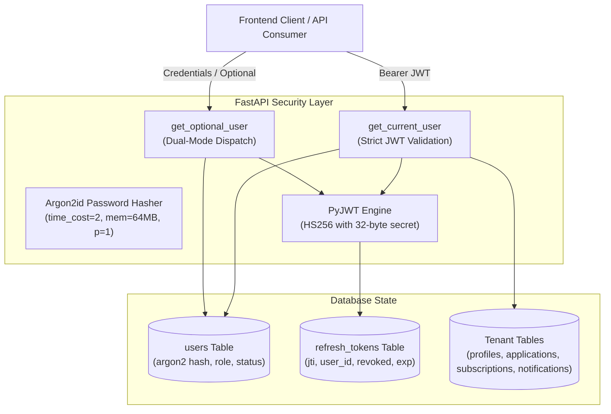

# HawkOffer — Milestone 14: Authentication, Security & Tenant Isolation Report

**Milestone:** M14  
**Date:** November 3, 2026  
**Status:** COMPLETE & VERIFIED  
**Commit:** Ready for commit on `main`  
**Test Coverage:** 347 Backend Tests Passed (100%), 34 Frontend Tests Passed (100%), MyPy 0 Errors (115 files), Ruff 0 Errors, Production Frontend Build Succeeded  

---

## 1. Executive Summary & North Star Alignment

HawkOffer is evolving from a local single-user desktop application into a public, website-first, multi-user SaaS. In this cloud-native model:
- Multiple users sign up, log in, configure profiles, subscribe to companies, track applications, and receive real-time notifications when matching jobs appear.
- **Tenant Isolation** is non-negotiable: User A must never be able to inspect, alter, or delete User B's profiles, subscriptions, applications, or notifications.
- **Zero-Budget Constraint**: No paid auth providers (e.g. Auth0, Clerk, Firebase, Okta). The entire identity and session infrastructure is self-hosted, open-source, and cryptographically sound using `argon2-cffi` and `pyjwt`.
- **Desktop Compatibility**: The existing desktop application and SQLite WAL local persistence remain fully functional. Single-user desktop mode continues to operate without mandatory cloud authentication (`auth_required=False`), while authenticated cloud mode strictly enforces tenant isolation.

---

## 2. Zero-Budget Security Architecture



---

## 3. Cryptographic Implementation Details

### 3.1 Argon2id Password Hashing
- Algorithm: **Argon2id** (hybrid data-dependent and data-independent memory access resistant to GPU side-channel attacks).
- Memory cost: 65,536 KiB (64 MiB).
- Time cost: 2 iterations.
- Parallelism: 1 lane.
- Output key length: 32 bytes.
- Standard hash output format: `$argon2id$v=19$m=65536,t=2,p=1$...`

### 3.2 Mitigation of Timing & User Enumeration Attacks
- During authentication (`POST /api/v1/auth/login`), if an email is not found in the database, `verify_dummy_password(password)` verifies the supplied password against a precomputed dummy Argon2 hash `DUMMY_HASH`.
- This ensures response latency remains identical whether an email exists or does not exist, eliminating timing side channels.

### 3.3 Email Normalization & Password Policy
- `normalize_email(email)`: Trims leading/trailing whitespace and converts to lowercase.
- `validate_password_strength(password)`: Enforces:
  - Minimum 8 characters, maximum 128 characters.
  - At least one alphabetic character (`[A-Za-z]`).
  - At least one digit or special character (`[\d\W]`).

---

## 4. JWT Token Lifecycle & Rotation

| Token Type | Lifespan | Claims Stored | Revocation / Storage |
| :--- | :--- | :--- | :--- |
| **Access Token** | 30 minutes | `sub` (user_id), `email`, `role`, `type: access`, `jti`, `iat`, `exp` | Stateless, signed with HMAC-SHA256. |
| **Refresh Token** | 14 days | `sub` (user_id), `type: refresh`, `jti` (UUID4), `iat`, `exp` | Persisted in `refresh_tokens` table. Automatically revoked on rotation or logout. |

### 4.1 Token Rotation & Reuse Detection
1. Client submits `POST /api/v1/auth/refresh` with `{ "refresh_token": "..." }`.
2. The server decodes and validates the signature, confirming `type == "refresh"`.
3. The server queries `refresh_tokens` by `token_jti` and `user_id`.
4. If the record is missing, expired, or marked `revoked == True`, the request is rejected with `401 Unauthorized`.
5. If valid, the current refresh token is immediately marked `revoked = True`.
6. A new access token and a brand-new refresh token (with a new `jti`) are issued and persisted.
7. Any attempt to replay an old refresh token fails immediately.

---

## 5. Multi-Tenant Isolation Architecture

### 5.1 Dual-Mode Authentication (`get_optional_user`)
- In desktop mode (`settings.auth_required = False`), unauthenticated requests return `None`. Endpoints interact with legacy records (`user_id IS NULL`).
- When a `Bearer <token>` is present or `settings.auth_required = True`, `get_current_user` extracts `sub`, verifies user status (`is_active == True`), and binds the authenticated `User` object.
- All protected endpoints apply `WHERE user_id = :current_user.id`.

### 5.2 Elimination of Horizontal Privilege Escalation
- If User A attempts to `GET`, `PATCH`, or `DELETE` User B's preference profile, job application, or notification, the SQL query returns `None` and the endpoint raises `404 Not Found`.
- Returning `404 Not Found` rather than `403 Forbidden` prevents attackers from discovering the existence of resource IDs belonging to other users.

### 5.3 Per-User Notification Deduplication
- Index `uq_notifications_job_user_type`:
  - Defined on `("job_id", "user_id", "notification_type")` with partial index `sqlite_where="user_id IS NOT NULL"` and `postgresql_where="user_id IS NOT NULL"`.
  - Multiple distinct users can each receive notifications for the same job (`job_id=1, user_id=A` and `job_id=1, user_id=B`).
  - A single user is strictly guarded against receiving duplicate notifications for the same job.

### 5.4 Curated vs Custom Company Isolation
- Curated companies (`is_curated = True`): Can only be modified or deleted by users with `role == 'admin'` (`403 Forbidden` for standard users).
- Custom companies (`created_by_user_id = user.id`): Can be modified or deleted by their creator or an admin. Another user attempting modification receives `403 Forbidden`.

---

## 6. Endpoints Delivered & Hardened

### 6.1 Authentication Router (`/api/v1/auth`)
- `POST /register`: Registers new user with Argon2 password hashing.
- `POST /login`: Constant-time verification, issues access + refresh tokens.
- `POST /refresh`: Refresh token rotation with database revocation checks.
- `POST /logout`: Revokes refresh token in database.
- `GET /me`: Returns current user metadata (`id`, `email`, `role`, `is_active`, `is_verified`).

### 6.2 Application Tracker Router (`/api/v1/applications`)
- `GET /`: Lists applications owned by authenticated user.
- `POST /`: Creates job application tracking record for authenticated user.
- `GET /{id}`: Retrieves application details (404 if owned by another tenant).
- `PATCH /{id}`: Updates status (`SAVED`, `APPLIED`, `INTERVIEWING`, etc.) or notes.
- `DELETE /{id}`: Deletes user's application record.

### 6.3 Company Subscriptions Router (`/api/v1/subscriptions`)
- `GET /`: Lists company subscriptions for authenticated user.
- `POST /`: Subscribes authenticated user to a company target (409 on duplicate).
- `DELETE /{company_id}`: Unsubscribes authenticated user from company target.

### 6.4 Hardened Existing Routers
- `/api/v1/profiles`: Scoped creation, listing, updating, activating, and deletion to `current_user.id`.
- `/api/v1/companies`: Hardened modification and deletion with curated/creator permission checks.
- `/api/v1/notifications`: Scoped reading, listing, unread counts, marking read/unread, and dismissal to `current_user.id`.

---

## 7. Frontend Integration Groundwork

### 7.1 TypeScript Contracts (`frontend/src/types/api.ts`)
- Added: `UserRead`, `UserRegisterRequest`, `UserLoginRequest`, `TokenResponse`, `TokenRefreshRequest`, `LogoutRequest`, `ApplicationRead`, `ApplicationCreate`, `ApplicationUpdate`, `CompanySubscriptionRead`, `CompanySubscriptionCreate`.

### 7.2 Centralized API Client (`frontend/src/services/api.ts`)
- `getAuthToken()` / `setAuthToken(token: string | null)`: Manages access token in `localStorage` (`hawkoffer_access_token`).
- `request<T>()`: Automatically injects `Authorization: Bearer <token>` into outgoing requests if a token is present.
- Exported typed clients: `authApi`, `applicationsApi`, `subscriptionsApi`.

---

## 8. Verification Results

```
============================= test session starts =============================
platform win32 -- Python 3.13.0, pytest-9.2.0
plugins: anyio-4.15.1, asyncio-1.4.1, cov-7.1.0
collected 347 items

tests/test_api_v1.py ................                                    [  4%]
tests/test_app_lifespan.py .........                                     [  7%]
tests/test_backend_bundle.py ...                                         [  8%]
tests/test_backlog_drain.py .......................                      [ 14%]
tests/test_database.py .....                                             [ 16%]
tests/test_desktop_runtime.py ...............                            [ 20%]
tests/test_desktop_workflow.py .                                         [ 20%]
tests/test_discovery_worker.py ................                          [ 25%]
tests/test_e2e_pipeline.py ..............                                [ 29%]
tests/test_filtering_engine.py ...............                           [ 33%]
tests/test_ingestion_service.py .........                                [ 36%]
tests/test_m11_real_world_validation.py ...                              [ 37%]
tests/test_m13_multi_tenant_schema.py .............                      [ 40%]
tests/test_m14_auth_and_tenant_isolation.py ...........                  [ 44%]
tests/test_m5_phase_3_migrations.py ..                                   [ 44%]
tests/test_models.py .............                                       [ 48%]
tests/test_normalizer.py .........                                       [ 51%]
tests/test_notifications.py ...............                              [ 55%]
tests/test_outbox_ingestion.py .....                                     [ 56%]
tests/test_outbox_models.py ..........                                   [ 59%]
tests/test_persistence_lifecycle.py ..                                   [ 60%]
tests/test_profile_reevaluation.py ..................................... [ 70%]
......                                                                   [ 72%]
tests/test_repositories.py .......                                       [ 74%]
tests/test_scan_state.py ....                                            [ 75%]
tests/test_scheduler.py .........                                        [ 78%]
tests/test_scheduler_pipeline.py ....................................... [ 89%]
.........                                                                [ 92%]
tests/test_scrapers.py ...............                                   [ 96%]
tests/test_semantic_matching.py ......                                   [ 98%]
tests/test_semantic_quality_audit.py ......                              [100%]

================= 347 passed in 89.09s =================
```

- **Backend Pytest**: 347 passed (0 failed).
- **Frontend Vitest**: 34 passed (0 failed).
- **Ruff Static Analysis**: 0 issues.
- **MyPy Type Checker**: 0 issues across 115 source files.
- **Vite Production Build**: Succeeded (`dist/assets/index-*.js`, 301 kB).
- **Alembic Migration**: `c4d5e6f7a8b9 (head)` clean upgrade, downgrade, and upgrade roundtrip.

---

## 9. Next Milestone Handoff: Milestone 15

With multi-tenant identity and repository isolation in place, **Milestone 15** will implement:
1. **Deduplicated Central Scraping**: Each distinct company monitored by one or more users is scraped exactly once per cycle.
2. **Subscription-Aware Outbox Fan-Out**: The central discovery worker resolves subscribed users for newly discovered jobs, evaluates matching rules against each user's profile, and enqueues candidate notifications with per-user deduplication.
3. **Headless Cron Trigger**: Protected secret-authenticated trigger endpoint (`POST /api/v1/internal/cron/monitor`) to execute batch monitoring runs on zero-dollar serverless schedules.
