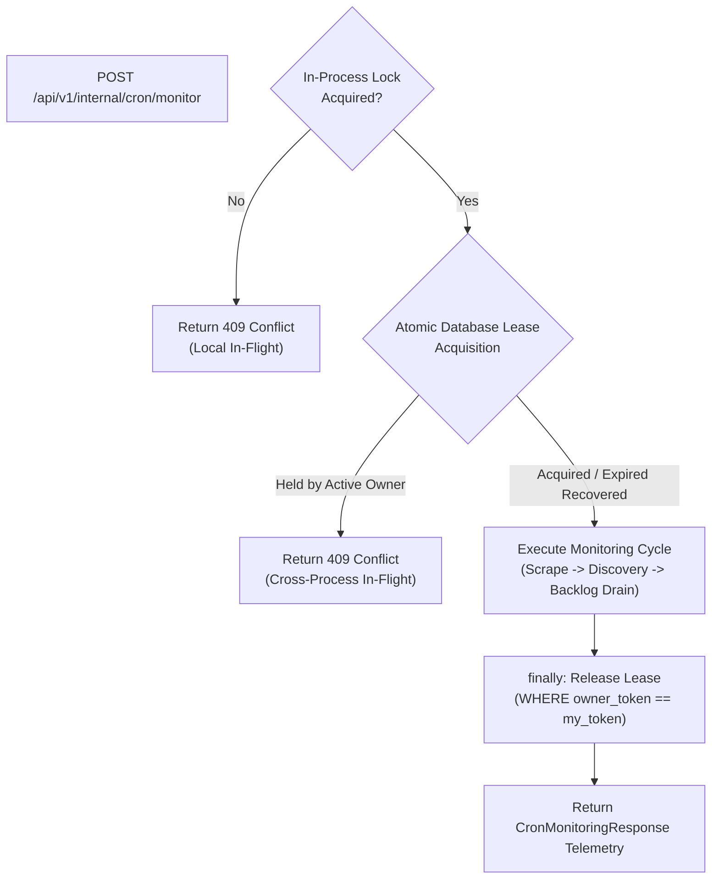

# Milestone 15.1: Production Safety & Multi-Tenant Monitoring Hardening

**Milestone:** M15.1 — Production Safety & Multi-Tenant Monitoring Hardening  
**Status:** COMPLETED & VERIFIED  
**Repository:** https://github.com/aadesh-2006/HawkOffer  
**Engine:** Python 3.13 / FastAPI / SQLAlchemy / Dual Dialect (SQLite WAL & PostgreSQL)  

---

## 1. Executive Summary & Objectives

Following the completion of Milestone 15 (Centralized Monitoring & Outbox Fan-Out), Milestone 15.1 performs a targeted production-readiness hardening pass on security, concurrency, tenant isolation, and reliability before introducing Web Push notifications in Milestone 16.

### Key Hardening Areas Addressed
1. **Cron Secret Security**: Removed predictable production fallback tokens, enforced 32-character minimum secret strength, added fail-closed protection (HTTP 503) against weak or missing secrets in production, eliminated secret logging, and preserved frictionless desktop development.
2. **Cross-Process Lease Coordination**: Implemented a zero-cost database-backed distributed lease engine (`DistributedLease`) supporting atomic acquisition, crash recovery via expiration TTL, unique owner tokens, and protection against stale lease release across arbitrary application containers.
3. **Desktop Profile Isolation**: Established an explicit boundary between single-user desktop operation and multi-tenant cloud SaaS. In SaaS mode (`auth_required=True`), legacy unauthenticated desktop profiles (`user_id IS NULL`) are strictly suppressed. In dual/mixed environments, desktop profiles are isolated from private SaaS companies.
4. **Target Selection Semantics**: Hardened `CompanyRepository.list_active_monitored_targets()` to ensure accidental full-catalog fallbacks never occur in SaaS mode, excluded inactive users from monitoring demand, and made curated company monitoring without subscribers explicitly configurable.
5. **Execution Reliability & Observability**: Wrapped orchestrator cycle execution in deterministic `finally` blocks to guarantee lease release, surfaced pipeline stage failures (Discovery, Backlog Drain) accurately as `partial_failure` or `failed`, and sanitized error outputs.

---

## 2. Technical Architecture & Hardening Details

### 2.1 Cron Secret Security Hardening
- **Configuration** (`backend/app/core/config.py`):
  - In development/test environments, `cron_secret` defaults to `"hawkoffer-dev-cron-secret-token"` if omitted, ensuring local desktop and unit tests run without manual `.env` configuration.
  - In production (`env in ("production", "prod")`), `cron_secret` defaults to `None`.
  - Added `KNOWN_INSECURE_CRON_SECRETS` rejecting common defaults (`"hawkoffer-dev-cron-secret-token"`, `"changeme"`, `"admin"`, etc.).
  - Added `Settings.validate_production_cron_secret()`: enforces non-null, length $\ge 32$, and rejection of known weak tokens.
- **Authentication Dependency** (`backend/app/api/v1/internal.py`):
  - In production, if `validate_production_cron_secret()` fails, immediately fails closed with `503 Service Unavailable` ("Cron endpoint is disabled due to missing or weak server secret configuration").
  - Compares credentials using `secrets.compare_digest` in constant time against timing attacks.
  - Logs only generic authentication failures; secret values are strictly redacted.

### 2.2 Cross-Process Distributed Leases (`DistributedLeaseService`)
To coordinate monitoring runs across multiple application containers without introducing paid brokers (Redis, AWS SQS), we implemented a database-backed distributed lease mechanism (`distributed_leases` table).



- **Database Model** (`backend/app/models/lease.py`):
  - Table: `distributed_leases`
  - Columns: `name` (PK), `owner_token`, `acquired_at`, `expires_at`, `released_at`.
  - Migration: `alembic/versions/d5e6f7a8b9c0_m15_1_distributed_leases.py`.
- **Atomic Acquisition**:
  ```sql
  UPDATE distributed_leases
  SET owner_token = :token, acquired_at = :now, expires_at = :expires_at, released_at = NULL
  WHERE name = :name AND (released_at IS NOT NULL OR expires_at <= :now)
  ```
  If 0 rows updated, attempts atomic `INSERT`; handles concurrent insert collisions via `IntegrityError` rollback.
- **Safe Recovery & Expiration**:
  If a worker container crashes while holding the lease, the lease automatically expires after `settings.monitoring_lease_ttl_seconds` (default 300s). Subsequent cycles recover the lease cleanly without manual intervention.
- **Stale Owner Release Protection**:
  ```sql
  UPDATE distributed_leases
  SET released_at = :now
  WHERE name = :name AND owner_token = :owner_token AND released_at IS NULL
  ```
  If an expired former owner attempts to release after another process has acquired the lease, the token mismatch ensures the newer owner's lease is untouched.

### 2.3 Desktop Profile Isolation & Boundary Rules
- **Problem Addressed**: Legacy unauthenticated profiles (`user_id IS NULL`) previously joined every company's subscriber list, creating cross-tenant leakage in shared databases.
- **Implementation** (`backend/app/services/discovery_worker.py`):
  - **SaaS Deployment (`auth_required=True`)**: Unauthenticated desktop profiles are strictly suppressed (`legacy_profiles = []`). All job evaluations require authenticated tenant ownership.
  - **Desktop / Mixed Environment (`auth_required=False`)**: Legacy profiles only evaluate against companies that are curated (`is_curated = True`) or created locally (`created_by_user_id IS NULL`). Private companies created by SaaS users (`created_by_user_id IS NOT NULL`) never fan out to desktop profiles.

### 2.4 Monitoring Target Selection Semantics
- **File**: `backend/app/repositories/company_repo.py`
- **Rules**:
  1. **Desktop Mode (`auth_required=False`)**: If zero user subscriptions exist in the entire database, falls back to `list_active()` to preserve desktop out-of-the-box monitoring.
  2. **SaaS Mode (`auth_required=True`)**: Accidental full-catalog fallback is eliminated. If zero subscriptions exist, returns empty list.
  3. **Inactive User Exclusion**: Joins `User.is_active.is_(True)`; companies whose only subscribers are inactive users are never targeted.
  4. **Curated Companies without Subscribers**: Governed by `settings.monitor_curated_without_subscribers` (default `False`). In multi-tenant environments, unsubscribed curated companies are not scraped unnecessarily unless explicitly enabled.

### 2.5 Cron Reliability & Observability
- **File**: `backend/app/scheduler/orchestrator.py`
- **Guarantee**: Lease release is wrapped in a `try ... finally` block ensuring the lease is always released upon completion, cancellation, or exception.
- **Pipeline Stage Observability**: If `JobDiscoveryWorker` or `BacklogDrainWorker` fails or returns `None`, the orchestrator logs the error and returns status `"partial_failure"` with error diagnostics rather than falsely reporting `"completed"`.
- **Sanitized Outputs**: Error messages contain only sanitized component names and reasons; tokens and user data are never leaked.

---

## 3. Verification & Test Evidence

### 3.1 Milestone 15.1 Dedicated Test Suite (`tests/test_m15_1_monitoring_hardening.py`)
13 tests passed (100% pass rate in 7.52s):
1. `test_production_cron_secret_strength_validation`: Validates rejection of missing, short (< 32 chars), and default secrets in production.
2. `test_cron_endpoint_fails_closed_in_production`: Validates HTTP 503 response when production secret is weak/missing, 401 on bad credentials, and 200 on valid credentials.
3. `test_distributed_lease_mutual_exclusion`: Validates single active owner across two competing simulated processes.
4. `test_distributed_lease_expiration_and_crash_recovery`: Validates automatic takeover after simulated crash past TTL expiry.
5. `test_stale_former_owner_cannot_release_newer_owner_lease`: Validates that an expired owner cannot release a newer owner's active lease.
6. `test_desktop_profile_isolated_from_private_saas_company`: Validates desktop profiles never receive jobs from private SaaS companies.
7. `test_saas_mode_strictly_suppresses_legacy_desktop_profiles`: Validates complete suppression of `user_id IS NULL` profiles when `auth_required=True`.
8. `test_curated_companies_without_subscribers_behavior`: Validates toggle behavior for `monitor_curated_without_subscribers`.
9. `test_inactive_subscribers_do_not_trigger_monitoring`: Validates companies with inactive subscribers only are not targeted.
10. `test_saas_user_with_no_subscriptions_receives_no_notifications`: Validates users without subscriptions receive zero alerts.
11. `test_cron_endpoint_cross_process_lease_conflict_409`: Validates HTTP 409 Conflict when distributed lease is held.
12. `test_partial_pipeline_stage_failure_reporting`: Validates `partial_failure` status and error collection when internal worker stages fail.
13. `test_alembic_m15_1_migration_lifecycle`: Validates clean upgrade to head, downgrade of m15.1, and re-upgrade to head.

### 3.2 Full Regression Suite
- **Backend Test Suite**: **370 passed** (357 existing + 13 new M15.1 tests).
- **Frontend Vitest Suite**: **34 passed** across 9 test files.
- **Ruff Code Linter**: **0 errors** across all application and test files.
- **MyPy Static Typing**: **0 errors** across 121 source files.
- **Frontend Production Build**: Clean TypeScript compilation and Vite bundle generation.

---

## 4. Remaining Limitations & Handoff to M16

### Zero-Cost Concurrency Guarantees & Edge Cases
- **Database Time Synchronization**: The distributed lease relies on `datetime.now(UTC)` stored in the database. In multi-container cloud deployments, container clocks must be synchronized via NTP (standard across cloud providers like Render, AWS, Fly.io).
- **PostgreSQL Runtime Notice**: Unit and integration tests were executed under SQLite WAL. PostgreSQL query compilation and schema compatibility were validated via Alembic migrations and dialect compilation tests; live cloud PostgreSQL execution will be validated in M18.

### Readiness for Milestone 16
With production secret validation, cross-process lease coordination, and strict multi-tenant boundary isolation fully verified, the monitoring architecture is hardened and ready for **Milestone 16: Web Push Notifications (RFC 8291/8292) & Background Dispatch**.
