# Milestone 16.1: Web Push Reliability & Security Hardening Report

**Milestone:** M16.1 — Web Push Reliability & Security Hardening  
**Status:** COMPLETED & VERIFIED  
**Repository:** https://github.com/aadesh-2006/HawkOffer  
**Local Project:** `C:\Users\Aadesh\.gemini\antigravity\scratch\HawkOffer`  
**Baseline Commit:** `f085a01`  
**Test Suite Status:** 393 Backend Tests Passing (100%), 34 Frontend Tests Passing (100%), 0 MyPy Errors, 0 Ruff Warnings, Clean Production Build (4.20s)

---

## 1. Executive Summary & Hardening Objectives

Following the completion of Milestone 16 (Web Push Notifications RFC 8291/8292), Milestone 16.1 performs a rigorous security and distributed-systems hardening pass on the Web Push infrastructure.

### Hardened Capabilities
1. **Subscription Ownership & Anti-Takeover**: Eliminates silent subscription reassignment. If an endpoint is already registered by another account, the request is rejected with `HTTP 409 Conflict`.
2. **Anti-SSRF Endpoint Validation**: Enforces strict `https://` schemes, rejects embedded URL credentials, and rejects `localhost`, loopback, link-local, and private IP destinations (`10.0.0.0/8`, `172.16.0.0/12`, `192.168.0.0/16`, `169.254.0.0/16`).
3. **Atomic Claiming with In-Flight Revalidation**: Eliminates worker race overwrites by re-validating all eligibility predicates within the `UPDATE ... RETURNING` statement.
4. **Lease Heartbeats & Stale Owner Fencing**: Workers renew the lease TTL prior to outbound push provider calls. All state finalizations verify the expected claim token, preventing stale workers from overwriting newer state.
5. **Abandoned Processing Recovery**: Notifications left in `PROCESSING` by crashed or terminated workers are automatically reclaimed once their lease expires.
6. **Explicit Device-Level Delivery Semantics**: Clear distinction between `DELIVERED`, `TRANSIENT_FAILURE`, `PERMANENTLY_INVALID`, and `EXHAUSTED`. Transient failures are never mislabeled as terminal if retries remain.
7. **Cryptographic VAPID Keypair Verification**: Uses `cryptography` to confirm that the public key point on SECP256R1 mathematically corresponds to the configured private key.
8. **Decoupled In-App Invariant**: In-app `Notification` read/unread state is strictly decoupled from push delivery and is never modified by push successes or failures.

---

## 2. Subscription Ownership & Endpoint Security

### Anti-Takeover Rule (`backend/app/api/v1/push.py`)
In multi-tenant SaaS environments, push endpoints represent device credentials generated by the browser. If User A registers an endpoint on a shared workstation or mobile browser, User B must never be able to silently reassign User A's subscription to their account.
- **Same User**: If `existing.user_id == current_user.id`, the registration updates keys, user agent, and timestamps idempotently.
- **Different User**: If `existing.user_id != current_user.id`, the request is rejected immediately:
  ```json
  HTTP 409 Conflict
  {
    "detail": "Subscription endpoint is already registered by another account"
  }
  ```
- **Race Condition Resilience**: If two concurrent registration requests race to insert the same endpoint, the database unique constraint raises `IntegrityError`. The transaction rolls back and re-checks the winning row against `current_user.id`, ensuring consistent ownership.

### Strict URL Validation & Anti-SSRF (`backend/app/schemas/push.py`)
To prevent Server-Side Request Forgery (SSRF) and credential leakage:
- Scheme must be strictly `https://`.
- User credentials (`user:pass@`) in the URL are rejected.
- Hostname cannot be `localhost`, `127.0.0.1`, or `::1`.
- Raw IP addresses in private or reserved ranges (`ip.is_private`, `ip.is_loopback`, `ip.is_reserved`, `ip.is_link_local`) are rejected with `HTTP 422 Unprocessable Entity`.

### Log Redaction & Response Hygiene
- Endpoints are masked in all backend logs using `redact_endpoint(url)`: `https://fcm.googleapis.com/...{suffix}`.
- Raw client encryption secrets (`p256dh` and `auth`) are never logged.
- `PushSubscriptionRead` omits raw encryption secrets from public REST API responses.

---

## 3. Atomic Notification Claiming & Lease Lifecycle

### Atomic Claiming Algorithm
The previous implementation performed a `SELECT` followed by a non-fenced `UPDATE`, which allowed concurrent workers to claim overlapping batches.
The hardened `WebPushDispatcher._claim_pending_notifications()` executes a single, atomic update query:

```sql
UPDATE notifications
SET delivery_status = 'PROCESSING',
    delivery_lease_token = :token,
    delivery_lease_expires_at = :lease_expires
WHERE id IN (:candidate_ids)
  AND user_id IS NOT NULL
  AND (
      delivery_status IN ('PENDING', 'RETRY')
      OR (delivery_status = 'PROCESSING' AND delivery_lease_expires_at <= :now)
  )
  AND (next_delivery_attempt_at IS NULL OR next_delivery_attempt_at <= :now)
  AND (delivery_lease_expires_at IS NULL OR delivery_lease_expires_at <= :now)
RETURNING id;
```
By re-validating the eligibility predicates inside the update, only notifications that satisfy all conditions at lock acquisition are claimed.

### Lease Heartbeats & Stale Fencing
1. **Pre-Send Heartbeat**: Before initiating outbound HTTP calls to Google, Mozilla, or Apple gateways, `_process_notification()` executes an atomic renewal:
   ```sql
   UPDATE notifications
   SET delivery_lease_expires_at = :now + :lease_ttl
   WHERE id = :notif_id
     AND delivery_lease_token = :token
     AND delivery_status = 'PROCESSING'
   RETURNING id;
   ```
   If this returns empty (e.g., because a worker hung and another worker reclaimed the notification), processing is halted immediately.
2. **Fenced Final State Update**: When finalizing (`SENT`, `RETRY`, `FAILED`), the update checks `WHERE id = :notif_id AND delivery_lease_token = :token`. Expired workers are barred from overwriting state.

### Abandoned Worker Recovery
If an API container or worker crashes mid-dispatch while a notification is `PROCESSING`, the clause:
`(delivery_status = 'PROCESSING' AND delivery_lease_expires_at <= :now)`
ensures any healthy worker automatically reclaims the notification once its lease expires, guaranteeing delivery continuity without human intervention.

---

## 4. Device-Level Delivery State Machine

HawkOffer explicitly tracks delivery state per registered device:

```mermaid
stateDiagram-v2
    [*] --> PENDING: Notification Promoted
    PENDING --> IN_PROGRESS: Claimed by Dispatcher
    IN_PROGRESS --> DELIVERED: Provider returns 201 Created
    IN_PROGRESS --> TRANSIENT_FAILURE: Provider returns 429 / 5xx / Timeout (attempts < max)
    IN_PROGRESS --> PERMANENTLY_INVALID: Provider returns 404 / 410 (Pruned from DB)
    TRANSIENT_FAILURE --> IN_PROGRESS: Scheduled Retry
    IN_PROGRESS --> EXHAUSTED: attempts >= max_attempts

    DELIVERED --> [*]: Preserved; Never Retried
    EXHAUSTED --> [*]: Retry Limit Reached
    PERMANENTLY_INVALID --> [*]: Subscription Deleted
```



### Summary Notification-Level Status
- **`SENT`**: All active devices successfully received the push (`DELIVERED`).
- **`RETRY`**: One or more devices experienced a `TRANSIENT_FAILURE` and notification attempts `< push_max_attempts`. Scheduled with exponential backoff:
  $$\text{delay} = \min(300, 10 \cdot 2^{\text{attempts}} + \text{jitter})$$
- **`FAILED`**: Maximum delivery attempts exhausted.
- **`NOT_REQUIRED`**: User has 0 push subscriptions, or all registered subscriptions were permanently pruned due to HTTP 404/410.

---

## 5. Cryptographic VAPID Validation

Located in `backend/app/core/vapid.py`:
- `verify_vapid_keypair_match(pub_key, priv_key)`:
  1. Parses private key using `cryptography.hazmat.primitives.serialization.load_pem_private_key()` or scalar point derivation.
  2. Verifies curve is strictly NIST P-256 (`SECP256R1`).
  3. Decodes public key: confirms 65 bytes uncompressed point starting with byte `0x04`.
  4. Derives the expected public key from the private key and confirms bitwise match.
- In production (`settings.env == "production"`), missing or mismatched VAPID keys raise `RuntimeError` during startup, failing closed.
- Persistent VAPID keys must be configured via environment variables `HAWKOFFER_VAPID_PUBLIC_KEY` and `HAWKOFFER_VAPID_PRIVATE_KEY` to survive cloud container deployments.

---

## 6. Distributed Systems Realities & Exactly-Once Limitations

### The Fallacy of Exactly-Once Delivery
In distributed asynchronous messaging across third-party browser push gateways (Google FCM, Mozilla Autopush, Apple APNs), **guaranteed exactly-once delivery is theoretically and practically impossible**:
1. If an application worker sends an RFC 8291 encrypted frame and the gateway accepts it (HTTP 201), but the worker crashes before committing `DELIVERED` to the database, a subsequent retry will re-send the push frame.
2. An HTTP 201 response from a push gateway indicates that the gateway accepted the frame for routing, not that the user's physical device has decrypted or displayed it.

### HawkOffer's Reliable At-Least-Once Strategy
1. **Device-Level Deduplication**: Devices that successfully received a push are filtered out before retry batches, preventing duplicate delivery across healthy devices.
2. **Service Worker Replacement Tags**: Every push payload specifies `tag: job-{id}`. If a duplicate push frame does arrive at the browser (e.g. after a worker crash), the browser notification system automatically replaces the prior notification card in-place rather than presenting duplicate alerts.

---

## 7. Quality Assurance & Test Verification Matrix

### Disclosure of Testing Methodology
- **Mocked Provider Tests**: All automated push dispatch tests (`tests/test_m16_web_push.py` and `tests/test_m16_1_push_hardening.py`) mock the synchronous `pywebpush.webpush` HTTP boundary to simulate HTTP 201, 404, 410, 429, 500, 503, and timeouts. This verifies database transactions, state machines, and cryptographic signing deterministically without depending on external network availability or live browser sessions.
- **Browser Feature Tests**: The frontend push client (`pushService.ts`) and Service Worker (`public/sw.js`) are tested against the W3C Push API specification, with explicit bypass verification for Tauri WebView2 desktop environments.

### Test Execution Summary
- **Backend Test Suite**: `pytest tests -q`
  - Result: **393 passed**, 141 warnings (deprecation warnings in third-party libraries) in 145.21s.
  - Pass Rate: **100%**.
- **M16 & M16.1 Dedicated Push Tests**:
  - `test_m16_web_push.py`: 12 passed.
  - `test_m16_1_push_hardening.py`: 11 passed.
  - Total: **23 targeted push tests passed**.
- **Frontend Test Suite**: `npm test -- --run`
  - Result: **34 passed across 9 test files** in 7.89s.
- **Static Analysis & Type Checking**:
  - Ruff: `ruff check app tests` -> **All checks passed!**
  - MyPy: `mypy app tests` -> **Success: no issues found in 126 source files**.
- **Production Build**: `npm run build`
  - Vite: **Built cleanly in 4.20s** (dist/index.html 0.62 kB, assets/index.js 306.35 kB [gzip: 79.10 kB]).

---

## 8. Completion & Readiness for Milestone 17

With Milestone 16.1 complete, the multi-tenant Web Push subsystem is cryptographically validated, hardened against concurrency races and endpoint takeovers, and fully verified across all test suites.

**Milestone 17: Public SaaS Web Dashboard & Application Tracking can now safely begin.**
