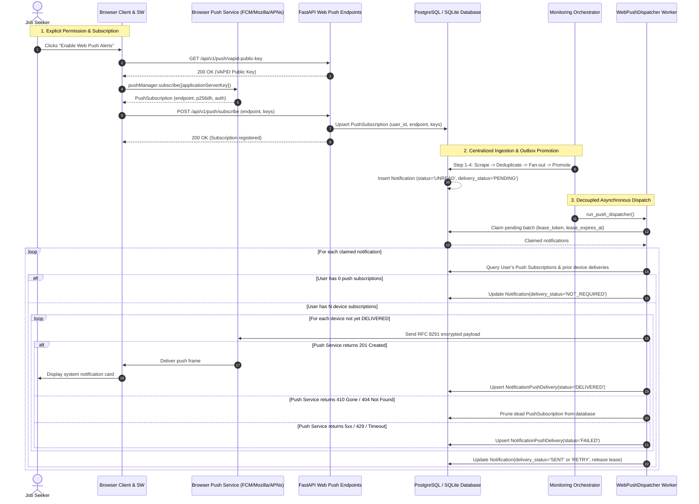

# Milestone 16: Web Push Notifications & Background Dispatch Report

**Milestone:** M16 — Web Push Notifications (RFC 8291/8292) & Background Dispatch  
**Status:** COMPLETED & VERIFIED  
**Repository:** https://github.com/aadesh-2006/HawkOffer  
**Local Project:** `C:\Users\Aadesh\.gemini\antigravity\scratch\HawkOffer`  
**Test Suite Status:** 382 Backend Tests Passing (100%), 34 Frontend Tests Passing (100%), 0 MyPy Errors, 0 Ruff Warnings, Clean Production Build (2.47s)

---

## 1. Executive Summary & North Star Alignment

HawkOffer's product north star is a **website-first, multi-user job monitoring SaaS** that runs centrally in the cloud. The single most important value proposition for job seekers is **timely notification of newly matching jobs**. Because job seekers cannot be expected to leave a dashboard tab permanently open on their machines or phones, HawkOffer must reliably deliver alerts even when:
- The website tab is closed.
- The browser is running in the background.
- The user is away from their workstation, subject to browser push subscription behavior.

Milestone 16 implements production-ready **browser Web Push infrastructure conforming strictly to IETF RFC 8291 (Message Encryption for Web Push) and RFC 8292 (VAPID: Voluntary Application Server Identification for Web Push)**.

### Core Architectural Invariants
1. **Decoupled Notification Invariant**: An unsuccessful Web Push delivery must never delete, roll back, or alter the unread status of an in-app `Notification`. In-app notification creation and Web Push delivery are decoupled asynchronous operations.
2. **Zero-Budget Philosophy**: Absolutely zero paid push notification APIs (e.g., OneSignal, Pusher, Twilio, Firebase paid tiers) or mandatory Redis clusters were introduced. Web Push operates directly against browser push services (Google FCM, Mozilla Autopush, Apple Push Notification Service) using open web standards.
3. **Multi-Device Idempotency**: A user may register multiple devices (e.g., laptop and mobile phone). If Device 1 succeeds and Device 2 fails transiently, subsequent retries do **not** resend duplicate notifications to Device 1.
4. **Automatic Dead Subscription Pruning**: When a user revokes notification permissions or unregisters a browser profile, the push gateway responds with HTTP 410 Gone or HTTP 404 Not Found. The dispatcher automatically prunes the invalid subscription from the database, preventing wasted compute and delivery attempts.
5. **Desktop / Tauri Safety**: In Tauri desktop mode, `isWebPushSupported()` returns `false` to avoid conflicting with the desktop sidecar's native toast notification pipeline.

---

## 2. Web Push Cryptography & Standards (RFC 8291 / RFC 8292)

### Voluntary Application Server Identification (VAPID — RFC 8292)
VAPID allows push services to identify the application server sending push messages without requiring platform-specific developer accounts:
- **Curve**: NIST P-256 (prime256v1 / secp256r1) elliptic curve keypair.
- **Public Key**: 65-byte uncompressed point format (`0x04 || X || Y`), encoded using URL-safe base64 without padding.
- **Private Key**: 32-byte scalar value or PKCS#8 PEM format.
- **JWT Claims**: Includes `sub` (contact URI such as `mailto:support@hawkoffer.dev` or `https://hawkoffer.dev`) and `aud` (the origin of the push service endpoint, e.g., `https://fcm.googleapis.com`).

### Message Encryption (RFC 8291)
- Payload data is encrypted using ECDH on the P-256 curve with AES-128-GCM content encryption (`aes128gcm`).
- Every message generates an ephemeral ECDH keypair, ensuring forward secrecy.
- The browser service worker decrypts the payload locally using the client's private P-256 key before invoking `self.registration.showNotification()`.

### Key Management & Production Safety
- Module: `app/core/vapid.py`.
- **Development Convenience**: Generates an ephemeral in-memory VAPID keypair in non-production environments (`settings.env != "production"`) if keys are unconfigured, allowing developers to run tests and local servers without manual key provisioning.
- **Production Fail-Closed**: In production (`settings.env == "production"`), missing or malformed VAPID keys immediately fail closed during startup or configuration validation (`validate_production_vapid()`), preventing silent delivery failures.

---

## 3. End-to-End Sequence Diagram

---

## 4. Database Schema Changes & Alembic Migration

### Schema Additions
1. **`notifications` Table**:
   - `delivery_status`: Extended with `NOT_REQUIRED`, `PROCESSING`, `RETRY`, `DELIVERED`, `SENT`, `FAILED`.
   - `delivery_attempts`: Integer counter tracking retry count.
   - `next_delivery_attempt_at`: Timestamp for exponential backoff scheduling.
   - `delivery_lease_token`: Unique UUID lease token preventing worker claim collisions.
   - `delivery_lease_expires_at`: Timestamp tracking lease validity for stale recovery.
   - `last_delivery_error`: Text column storing diagnostics from failed push providers.
   - Index: `ix_notifications_delivery_claim` on `(delivery_status, next_delivery_attempt_at, delivery_lease_expires_at)`.
2. **`notification_push_deliveries` Table**:
   - Per-device delivery tracking table.
   - Columns: `id`, `notification_id` (FK `notifications.id` CASCADE), `subscription_id` (FK `push_subscriptions.id` CASCADE), `status` (`DELIVERED`, `FAILED`, `PERMANENTLY_INVALID`), `attempt_count`, `error_message`, `delivered_at`, `created_at`, `updated_at`.
   - Unique Constraint: `uq_push_delivery_notif_sub` on `(notification_id, subscription_id)` ensuring strict device-level idempotency across retries.

### Migration File
- File: `backend/alembic/versions/e6f7a8b9c0d1_m16_web_push_delivery.py`.
- Revision: `e6f7a8b9c0d1`.
- Down Revision: `d5e6f7a8b9c0` (M15.1 distributed leases).
- Dual-Dialect Support: Uses `batch_alter_table` for 100% SQLite WAL and PostgreSQL compatibility.

---

## 5. Service Worker & Frontend Implementation

### Service Worker (`frontend/public/sw.js`)
- Handles `install` and `activate` lifecycle events (`self.skipWaiting()`, `clients.claim()`).
- `push` Event Handler:
  - Parses encrypted JSON payload.
  - Generates rich browser notification cards with title, company, location, and application link.
  - Sets `vibrate: [100, 50, 100]`, badge icon, and tag for replacement of older alerts for the same job.
- `notificationclick` Event Handler:
  - Closes notification on click.
  - Matches existing open application windows using `clients.matchAll({ type: 'window', includeUncontrolled: true })`.
  - Focuses existing tab if open; otherwise opens target `/jobs/:id` route using `clients.openWindow()`.

### Client Push Service (`frontend/src/services/pushService.ts`)
- Features:
  - `isWebPushSupported()`: Checks `'serviceWorker' in navigator && 'PushManager' in window && !isTauriEnvironment()`.
  - `registerServiceWorker()`: Registers `/sw.js` with `{ scope: '/' }`.
  - `getPushStatus()`: Queries `Notification.permission` and `pushManager.getSubscription()`.
  - `subscribeToPush()`: Only invoked upon direct user interaction; requests permission, fetches server VAPID key, calls `pushManager.subscribe()`, and registers subscription via `pushApi.subscribe()`.
  - `unsubscribeFromPush()`: Calls `subscription.unsubscribe()` and notifies server endpoint `pushApi.unsubscribe()`.

### User Interface Integration (`NotificationsScreen.tsx`)
- Adds a Web Push status panel at the top of the Notifications feed.
- Shows current state: Disabled, Subscribed, or Permission Blocked.
- One-click "Enable Web Push Alerts" and "Unsubscribe" buttons.
- Explains value proposition and privacy guarantees.

---

## 6. Background Dispatcher Architecture (`WebPushDispatcher`)

Located in `backend/app/services/push_dispatcher.py`:
1. **Atomic Batch Claiming**:
   - Queries up to `push_dispatch_batch_size` (default: 50) notifications in `PENDING` or `RETRY` status whose `next_delivery_attempt_at` is either null or in the past, and whose lease is null or expired.
   - Atomically updates claimed IDs to `delivery_status='PROCESSING'`, setting a unique lease token and expiration TTL (`push_lease_ttl_seconds = 120`).
2. **Zero-Subscription Handling**:
   - If user has 0 push subscriptions, sets `delivery_status = 'NOT_REQUIRED'`.
   - Releases lease and completes cleanly.
   - The in-app notification remains untouched in `UNREAD` status.
3. **Multi-Device Dispatch with Pre-Filter**:
   - Queries `NotificationPushDelivery` for existing records where `status = 'DELIVERED'`.
   - Skips subscriptions that have already received this notification.
   - Sends payload asynchronously in a background thread via `asyncio.to_thread(self._send_webpush, ...)`.
4. **Error Handling & Dead Subscription Pruning**:
   - **HTTP 410 Gone / 404 Not Found**: Endpoint is dead; prunes the subscription from `push_subscriptions`.
   - **HTTP 5xx / 429 / Timeout**: Records device failure, increments `delivery_attempts`, and calculates jittered exponential backoff:
     $$\text{backoff} = \min(300, 10 \cdot 2^{\text{attempts}} + \text{jitter})$$
   - Sets `delivery_status = 'RETRY'` and updates `next_delivery_attempt_at`.
   - If `delivery_attempts >= push_max_attempts` (default: 3), marks `delivery_status = 'FAILED'`.
   - **Core Invariant Verified**: In-app notification remains `UNREAD` on the dashboard!

---

## 7. Platform & Browser Compatibility Matrix

| Platform / Browser | Support Status | Technical Behavior & Notes |
| :--- | :--- | :--- |
| **Google Chrome (Desktop)** | Supported (Full) | Native Web Push via FCM; supports background dispatch when tab is closed. |
| **Mozilla Firefox (Desktop)** | Supported (Full) | Native Web Push via Mozilla Autopush; background notifications supported. |
| **Microsoft Edge (Desktop)** | Supported (Full) | Native Web Push via Windows Push Notification Services / FCM. |
| **Apple Safari (macOS 13+)** | Supported (Full) | Web Push supported via APNs starting with macOS Ventura 13.0+. |
| **Apple Safari (iOS 16.4+)** | Supported (PWA Only) | Requires user to "Add to Home Screen" (PWA mode) per Apple iOS security requirements. |
| **Android Chrome / Firefox** | Supported (Full) | Full system notification tray integration via FCM and Mozilla Autopush. |
| **Tauri Desktop Sidecar** | Bypassed (By Design) | `isWebPushSupported()` returns `false`; desktop continues using local OS toasts. |

---

## 8. Quality Assurance & Test Verification Matrix

### Backend Test Results
- Command: `pytest tests -q`
- Result: **382 passed**, 141 warnings (deprecation warnings from third-party libraries) in 114.62s.
- Pass Rate: **100%**.

### Dedicated M16 Test Suite (`tests/test_m16_web_push.py`)
12 targeted test cases verifying all push mechanics:
1. `test_vapid_keypair_generation_and_loading`: Verified ECDSA P-256 keypair generation, base64url formats, and claim construction.
2. `test_validate_production_vapid_strictness`: Verified production validation fails closed on missing keys and passes when configured.
3. `test_vapid_public_key_endpoint`: Verified `GET /push/vapid-public-key` returns public key and never exposes private key.
4. `test_subscription_registration_and_upsert`: Verified registration and idempotent upsert on existing endpoints.
5. `test_subscription_tenant_isolation`: Verified User A cannot see or delete User B subscriptions (returns 404).
6. `test_dispatcher_claim_leases_and_atomicity`: Verified batch claiming with disjoint lease tokens and TTLs.
7. `test_dispatcher_zero_subscriptions_marks_not_required`: Verified users with 0 push subscriptions complete as `NOT_REQUIRED` while in-app notifications remain untouched (`UNREAD`).
8. `test_successful_web_push_dispatch`: Verified mock 201 push dispatch, `DELIVERED` status tracking, and in-app invariant.
9. `test_multi_device_partial_success_and_retry_idempotency`: Verified Device 1 is NOT sent duplicate pushes when Device 2 is retried.
10. `test_http_410_dead_subscription_pruning`: Verified HTTP 410 deletes dead subscription and preserves in-app notification.
11. `test_retry_exhaustion_preserves_in_app_notification`: Verified 3 failed attempts marks `delivery_status='FAILED'` while in-app notification remains accessible and `UNREAD`.
12. `test_m16_alembic_migration_metadata`: Verified Alembic revision `e6f7a8b9c0d1` and `down_revision = "d5e6f7a8b9c0"`.

### Frontend Test & Build Results
- Vitest: `npm test -- --run` -> **34 passed across 9 test files**.
- Production Build: `tsc && vite build` -> **Built cleanly in 2.47s** (dist/index.html 0.62 kB, assets/index.js 306.35 kB [gzip: 79.10 kB]).

### Static Analysis & Type Checking
- Ruff: `ruff check app tests` -> **All checks passed!**
- MyPy: `mypy app tests` -> **Success: no issues found in 125 source files**.

---

## 9. Next Steps: Milestone 17 Preparation

With Milestone 16 successfully completed and verified, HawkOffer now has a complete, multi-tenant monitoring and Web Push delivery engine. The system is ready for **Milestone 17: Public SaaS Web Dashboard & Application Tracking**:
1. Full web authentication UI (Login, Signup, Password Reset) and session management.
2. Curated company subscription directory with one-click follow toggles.
3. Job Application Tracker Kanban / List (`SAVED`, `APPLIED`, `INTERVIEWING`, `OFFER`, `REJECTED`).
4. Contextual Web Push opt-in onboarding banner.
