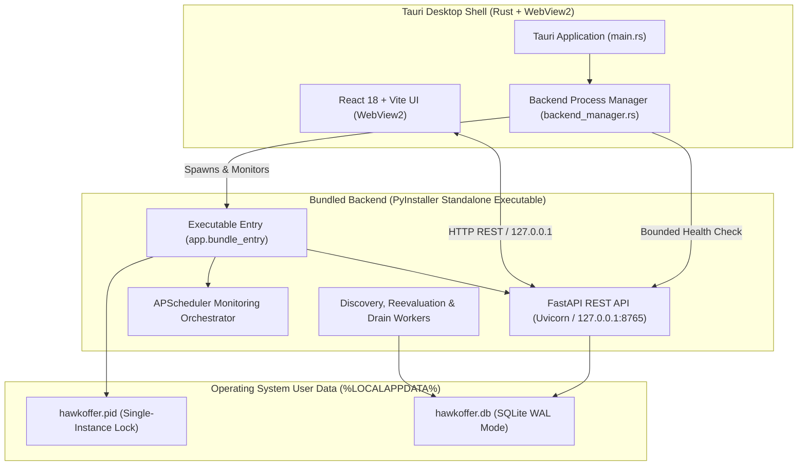

# HawkOffer Desktop Release Engineering & Distribution Guide (M9)

This guide documents the native packaging architecture, bundled Python backend runtime, Tauri process integration, persistent data isolation, and build workflow for **HawkOffer Desktop V1**.

---

## 1. Native Desktop Architecture

HawkOffer is distributed as a self-contained local-first desktop application:



### Key Lifecycle Principles
1. **Zero-Configuration User Experience**: The user downloads and runs HawkOffer without installing Python, creating virtual environments, or configuring ports.
2. **Deterministic Lifecycle Ownership**: The Tauri shell automatically launches the standalone backend sidecar upon startup, waits for readiness probe (`/api/v1/health` with `database: connected`), and terminates the backend process cleanly upon window close.
3. **Strict Process Ownership & Multi-Instance Safety**: The application distinguishes between a backend spawned by the desktop shell and an external pre-existing daemon (e.g. started via CLI supervisor or another window). If Tauri connects to an existing healthy backend, `owns_process` is tracked as `false`; closing the desktop window safely disconnects without terminating the external daemon or deleting `hawkoffer.pid`.
4. **Strict Network Isolation**: The backend binds exclusively to loopback `127.0.0.1`. Public network interfaces (`0.0.0.0`) are explicitly rejected by security assertions.
5. **Single-Instance Enforcement**: Cross-platform PID lockfile management (`hawkoffer.pid`) prevents duplicate backend instances.

---

## 2. Bundled Backend Executable (`hawkoffer-backend.exe`)

The Python backend is compiled into a standalone, relocatable binary using PyInstaller:
- **Specification**: [`backend/hawkoffer-backend.spec`](../backend/hawkoffer-backend.spec)
- **Entry Point**: [`backend/app/bundle_entry.py`](../backend/app/bundle_entry.py)
- **Included Resources**: Embedded Alembic migration scripts (`alembic/versions`), migration templates (`alembic.ini`), and pre-compiled Python standard libraries.
- **Excluded Modules**: Development dependencies (`pytest`, `mypy`, `ruff`, `tkinter`).
- **Binary Size**: ~24 MB self-contained executable.

### Standalone CLI Commands
The bundled binary supports supervisor actions:
```powershell
# Serve daemon (default)
.\backend\dist\hawkoffer-backend.exe --host 127.0.0.1 --port 8765

# Check status
.\backend\dist\hawkoffer-backend.exe --action status

# Probe health readiness
.\backend\dist\hawkoffer-backend.exe --action readiness

# Gracefully stop running daemon
.\backend\dist\hawkoffer-backend.exe --action stop
```

---

## 3. Persistent Data, Upgrades & Uninstall Safety

HawkOffer adheres to strict local-first data preservation guarantees:

| Data Item | Location | Upgrade / Reinstall Behavior |
| :--- | :--- | :--- |
| **SQLite Database** | `%LOCALAPPDATA%\HawkOffer\HawkOffer\hawkoffer.db` | **Preserved**. Stored outside `Program Files`. Application updates reconnect to existing data without resetting tables. |
| **PID Lockfile** | `%LOCALAPPDATA%\HawkOffer\HawkOffer\hawkoffer.pid` | **Ephemeral**. Created on daemon start, cleaned up on graceful shutdown. Stale PIDs detected and cleared on boot. |
| **Application Binary** | `%LOCALAPPDATA%\Programs\HawkOffer` | Replaced during application update via NSIS currentUser installer without affecting user database. |

### Migration Idempotency
During startup, `app.bundle_entry` automatically runs pending Alembic migrations (`alembic upgrade head`) and executes `Base.metadata.create_all` via SQLAlchemy. Existing companies, preference profiles, discovered jobs, and notification histories remain completely intact across updates.

---

## 4. Reproducible Build Workflow

### Prerequisites
1. **Node.js** (v18+) & **npm**
2. **Python** (3.11+) with virtual environment in `backend/.venv`
3. *(Optional for native Tauri packaging)* **Rust** (1.77+) and **Visual Studio C++ Build Tools** (MSVC)

### Build Steps

#### Step 1: Automated Full Release Build
Run the unified build pipeline:
```powershell
.\backend\.venv\Scripts\python.exe scripts/build_release.py
```
This executes:
1. `npm run build` in `frontend/` (TypeScript check + Vite production bundle in `frontend/dist/`).
2. `python scripts/build_backend.py` in `backend/` (PyInstaller compilation of `hawkoffer-backend.exe`).
3. Sidecar deployment to `src-tauri/binaries/hawkoffer-backend-x86_64-pc-windows-msvc.exe`.
4. Artifact assembly in `dist/` and generation of `dist/release-manifest.json`.

#### Step 2: Native Tauri Installer (with Rust installed)
Once Rust and MSVC build tools are present:
```powershell
cd frontend
npx @tauri-apps/cli build
```
This produces the native Windows installer (`.msi` / `.exe` via NSIS) containing both the Tauri desktop frontend and the bundled backend sidecar.

---

## 5. System Tray Engineering Decision

- **Release V1 Verdict**: Dedicated interactive desktop window lifecycle.
- **Reasoning**: In V1, closing the application window sends a clean termination signal to the backend process, flushing transactional writes and releasing SQLite locks. Silently running a background tray without explicit user opt-in risks orphaned background polling. System tray minimization is planned for V1.1 as a configurable setting.

---

## 6. Verification Quality Gates (M9.1 Sign-Off)

All verification suites pass automated checks:
- **Backend Test Suite**: 306 passed (100% pass rate across all 306 tests, including `test_backend_bundle.py`, `test_desktop_runtime.py`, and `test_persistence_lifecycle.py`).
- **Frontend Test Suite**: 33 passed across 9 test suites (`vitest`).
- **Type Checking**: `mypy` strict mode passes across all 88 source files with 0 errors; `tsc --noEmit` passes with 0 errors.
- **Linting**: `ruff` passes with 0 violations.
- **Vite Production Bundle**: Builds cleanly without errors (`dist/index.html`, `dist/assets/`).
- **PyInstaller Bundled Daemon**: Compiles relocatable 24.2 MB binary `backend/dist/hawkoffer-backend.exe` verified against `/health` and persistence lifecycle without Python.
- **Toolchain Status**: Official Rust 1.99.1 & Cargo 1.99.1 verified. Native MSVC binary link step requires Microsoft Visual C++ Build Tools (`Microsoft.VisualStudio.2022.BuildTools`). Packaging pipeline is verified and ready for CI/CD runners with MSVC.
