# HawkOffer Development Roadmap

This document outlines the phased development roadmap for **HawkOffer**. Each milestone represents an incremental, testable layer of functionality. Development proceeds strictly one milestone at a time to ensure stability, maintainability, and code quality.

---

## Milestone Overview

```mermaid
flowchart LR
    M0["M0: Architecture & Foundation"] --> M1["M1: Core Models & SQLite Persistence"]
    M1 --> M2["M2: Scraper Adapters & Normalizer"]
    M2 --> M3["M3: Deduplication & Change Detection"]
    M3 --> M4["M4: APScheduler & Multi-Attribute Filtering"]
    M4 --> M5["M5: Outbox, Keyset Reeval & Fair Drain Pipeline"]
    M5 --> M6["M6: Backend API & Application Runtime (Completed)"]
    M6 --> M7["M7: React Dashboard UI & Tauri Shell"]
    M7 --> M8["M8: Windows Packaging & Native Desktop System Tray"]
    M8 --> M9["M9: Local AI Semantic Resume Matching"]
```

---

## Milestones & Phased Execution

### Milestone 0: Architecture, Project Foundation & Guidelines (CURRENT)
- **Status**: Completed / Awaiting Approval
- **Focus**: Technical design, requirements definition, component specifications, and directory structure.
- **Deliverables**:
  - `README.md`: Product vision, technology overview, and development status.
  - `docs/ARCHITECTURE.md`: Complete system architecture, component breakdown, database schema, and API proposals.
  - `docs/ROADMAP.md`: Structured development plan with acceptance criteria.
- **Acceptance Criteria**:
  - All 10 architectural modules documented with clear boundaries.
  - Ethical scraping guidelines and constraints established.
  - Technical decisions reviewed and signed off before code authoring.

---

### Milestone 1: Python Project Setup, Data Models & Persistence Layer
- **Status**: Implemented / Ready for Review
- **Focus**: Python foundation, cross-platform configuration management, SQLite database engine, repositories, and automated test suite.
- **Tasks**:
  1. Initialize Python project environment with `pyproject.toml` (dependencies: `pydantic`, `pydantic-settings`, `sqlalchemy`, `aiosqlite`, `alembic`).
  2. Configure structured logging with standard formatting and rotation.
  3. Implement SQLAlchemy models: `Company`, `Job`, `PreferenceProfile`, `Notification`, `MonitoringLog`.
  4. Configure SQLite with WAL mode (`PRAGMA journal_mode=WAL;`).
  5. Set up initial Alembic migration scripts.
  6. Build CRUD repositories: `CompanyRepository`, `JobRepository`, `LogRepository`.
  7. Write unit tests for database transactions and repository operations using an in-memory SQLite database.
- **Acceptance Criteria**:
  - Database schema initializes correctly via Alembic migrations.
  - Repositories pass all automated unit tests (`pytest`).
  - Strict type checking with `mypy` passes with zero errors.

---

### Milestone 2: Career Scraper Adapters & Normalization Engine
- **Focus**: Building the adapter framework, initial ATS adapters (Greenhouse, Lever, Ashby), and job normalization.
- **Tasks**:
  1. Define `BaseCareerAdapter` abstract base class with standard error handling and rate-limiting.
  2. Implement `GreenhouseAdapter` using the official Greenhouse public JSON board API (`/v1/boards/{board_token}/jobs`).
  3. Implement `LeverAdapter` using the Lever Postings API (`/v0/postings/{company}`).
  4. Implement `AshbyAdapter` for public Ashby job feeds.
  5. Implement `JobNormalizer` to clean titles, parse employment types, resolve canonical URLs (strip tracking query params), and normalize locations.
  6. Implement adapter auto-detection logic based on target URL structure.
  7. Write unit tests using mocked HTTP payloads to verify robust extraction and error resilience.
- **Acceptance Criteria**:
  - Greenhouse, Lever, and Ashby adapters extract complete job listings reliably from public sample feeds.
  - Normalizer successfully resolves titles, locations, and clean URLs without tracking tokens.
  - Network timeouts and HTTP errors (404, 429, 500) are caught gracefully and logged.

---

### Milestone 3: Playwright Dynamic Scraper & Deduplication Engine
- **Focus**: Headless browser automation for dynamic job portals, content fingerprinting, and change detection.
- **Tasks**:
  1. Implement `GenericPlaywrightAdapter` using `playwright-python` with headless execution, minimal resource overhead, and explicit selector waits.
  2. Ensure Playwright browser instances are launched on-demand and closed immediately after scraping to prevent RAM leaks.
  3. Implement `JobHasher`:
     - `fingerprint_hash`: SHA-256 of normalized `(company_id + title + location + clean_url)`.
     - `content_hash`: SHA-256 of `(description_text)`.
  4. Implement `DeduplicationEngine`:
     - Compares fetched jobs against existing records in SQLite.
     - Classifies jobs into states: `NEW`, `ACTIVE`, `UPDATED`, `CLOSED`.
  5. Write tests covering state transitions and content modification detection.
- **Acceptance Criteria**:
  - Headless Playwright scraper successfully extracts job listings from client-rendered career pages.
  - Deduplication prevents duplicate entries for previously scraped jobs.
  - Changes in job description or title trigger an `UPDATED` status.

---

### Milestone 4: Scheduler Engine & Windows Native Notifications
- **Focus**: Automated background polling and native Windows alert dispatching.
- **Tasks**:
  1. Integrate `APScheduler` (`AsyncIOScheduler`) to manage target check intervals.
  2. Implement schedule jitter ($\pm 15\%$) to avoid synchronized network requests.
  3. Implement `PreferenceEvaluator` to match new listings against user keywords and location criteria.
  4. Implement `WindowsNotificationService` using native Windows toast notifications (`windows-toasts`):
     - Displays job title, company, and location.
     - Clicking the notification opens the listing in the default web browser.
  5. Implement notification throttling and batching for multi-job publishing bursts.
  6. Build automated tests verifying scheduler job lifecycle and filter evaluations.
- **Acceptance Criteria**:
  - Scheduler runs target checks periodically in the background without user intervention.
  - Toast notification appears when an eligible new job is discovered.
  - Multiple simultaneous new jobs are grouped into a clean summary notification.

---

### Milestone 5: Local FastAPI REST Daemon & Background Processing Pipeline
- **Status**: Completed (Phase 1, Phase 2, Phase 3 Units 1–8)
- **Focus**: REST endpoints, notification delivery, and the transactional background processing pipeline.
- **Phase 3 Units Completed**:
  - **Unit 1: Data Contracts & Schema Migration**: Alembic revision `8de4342be7a1` adding `revision` to `preference_profiles`, `job_discovery_outbox`, `notification_backlog`, `profile_reevaluation_tasks`, and `system_drain_state`.
  - **Unit 2: Transactional Outbox Ingestion**: Atomic emission of `JobDiscoveryOutbox` (PENDING) during new job ingestion with idempotency and rollback safety.
  - **Unit 3: Repository Lifecycle & Backlog Query Optimization**: Direct partial indexes supporting $O(\log N)$ queued and expired candidate claims without temporary b-trees.
  - **Unit 4: Outbox Discovery Worker**: Three-phase worker architecture (Phase A: `BEGIN IMMEDIATE` claim, Phase B: in-memory profile snapshot filtering, Phase C: fenced commit).
  - **Unit 5 & 5.1: Profile Revision & Keyset Reevaluation Worker**: Atomic profile revision increment, old backlog row invalidation, and bounded keyset historical reevaluation with asynchronous lease heartbeats and stale-lease fencing.
  - **Unit 6: Backlog Drain Worker & Modulo-5 Fairness**: Persistent counter sequential allocation (4 relevance slots, 1 FIFO slot with dynamic fallback), atomic candidate claims, and deduplicated notification promotion.
  - **Unit 7 – 7.5: Scheduler Lifecycle Integration & Hardening**: Unified `MonitoringOrchestrator` lifecycle with closed startup gate, durable shutdown intent, multi-shutdown reference counting (`_active_shutdowns`), and complete admission closure throughout shutdown.
  - **Unit 8: End-to-End Integration, Documentation & Final Audit**: 14 end-to-end integration tests, full migration and downgrade audits, query plan performance verification, and architecture documentation.
- **Acceptance Criteria**:
  - All 155+ test cases pass with >90% coverage.
  - Static type checking (`mypy`) passes with zero errors.
  - Linting and formatting (`ruff`) pass with zero errors.
  - Migration upgrade and downgrade verified without data loss for user notifications.

---

### Milestone 6: Backend API & Application Runtime Integration (COMPLETED)
- **Status**: Completed / Ready for Review
- **Focus**: Exposing the complete M0–M5 backend via a clean, stable local REST API and establishing the application runtime for future Tauri + React desktop consumers.
- **Tasks**:
  1. Implement FastAPI application factory (`app.main:create_app`) with configurable lifespan management, startup DB verification, orchestrator coordination, and graceful teardown.
  2. Configure localhost-only security boundaries and strict CORS origins (`http://127.0.0.1:1420`, `http://localhost:1420`, `http://127.0.0.1:5173`, `http://localhost:5173`, `tauri://localhost`).
  3. Implement standardized error handling (400 for `ValueError`, 409 for `IntegrityError`, 404 for missing resources, 503 for closed gates).
  4. Build REST API v1 router modules:
     - `system`: `/api/v1/health` and `/api/v1/system/status`.
     - `companies`: CRUD, pagination, `/activate`, `/deactivate`, on-demand `/trigger`, and `/scan-state`.
     - `profiles`: CRUD, `/activate`, `/deactivate`, integrating `ProfileUpdateService` to preserve revision increments and reevaluation tasks.
     - `jobs`: Paginated listings with search and multi-parameter filtering (`company_id`, `status`, `job_type`, `employment_type`, `graduation_year`).
     - `notifications`: Paginated feeds, unread badges (`/unread-count`), lifecycle mutations (`/read`, `/unread`, `/dismiss`, `/restore`), and batch actions (`/batch/read`, `/batch/dismiss`).
     - `monitoring`: Pipeline and scheduler runtime status, out-of-band triggers for discovery, reevaluation, and drain workers, and pause/resume controls.
  5. Add repository pagination and scalar count helpers (`list_paginated`, `count_companies`, `count_filtered`, `count_notifications`) to eliminate full table in-memory scans.
  6. Author comprehensive automated tests for lifespan, CORS, and all API endpoints (`tests/test_app_lifespan.py`, `tests/test_api_v1.py`).
- **Acceptance Criteria**:
  - All 284 backend tests pass with zero failures.
  - Strict static type checking (`mypy`) passes with zero errors in strict mode across 82 source files.
  - Linting and formatting (`ruff`) pass with zero violations.
  - Preserves M5 Phase 3 outbox, keyset reevaluation, and fairness-aware drain semantics.

---

### Milestone 7: React + Vite + TypeScript Desktop Dashboard & Tauri Shell (COMPLETED)
- **Status**: Completed / Ready for Review
- **Focus**: Usable, polished local-first desktop application UI consuming the existing FastAPI REST backend.
- **Tasks**:
  1. Scaffold frontend desktop UI using React 18, TypeScript, Vite 6, Tailwind CSS, Lucide icons, and Tauri 2.x configuration.
  2. Implement centralized typed API client (`frontend/src/services/api.ts`) and global reactive state supervisor (`AppContext`).
  3. Build reusable atomic UI components (`Badge`, `Button`, `Modal`, `EmptyState`, `LoadingSpinner`) with dark/light theme support.
  4. Develop full application views:
     - **Dashboard**: Real-time KPI statistics (`companies_count`, `total_jobs_count`, `unread_notifications_count`), background worker status monitors, quick manual trigger buttons, and recent job discoveries feed.
     - **Jobs Feed**: Multi-attribute filter controls (company, status, job type, graduation year), debounced search, responsive paginated table, and job detail inspection modal.
     - **Company Targets Manager**: CRUD interface for monitored companies, ATS platform badges, and on-demand scraping trigger with stats feedback.
     - **Preference Profiles**: Multi-tag preference editors, match score thresholds, active state toggles, and historical reevaluation notice banner.
     - **Notification Inbox**: Read/unread/dismissed tab filters, individual and batch operations, and unread count badges.
     - **Monitoring Controls**: APScheduler runtime state, lifecycle gate indicators, worker run controls, and execution results inspector.
     - **Settings & Connectivity**: Endpoint URL configuration, live health diagnostics, theme switcher, and daemon startup snippet.
  5. Author comprehensive unit and integration test suite across API service and all screen components (29 tests passing with Vitest).
- **Acceptance Criteria**:
  - All 29 frontend Vitest tests pass cleanly.
  - TypeScript compilation (`tsc --noEmit`) passes with zero errors.
  - Production build (`vite build`) outputs optimized desktop web bundle.
  - All 285 backend tests pass with zero regressions.

---

### Milestone 8: Windows Packaging, System Tray & Installer
- **Focus**: Desktop shell packaging, system tray integration, and installer creation.
- **Tasks**:
  1. Set up Tauri project with Rust runtime wrapping the React frontend.
  2. Configure system tray icon with "Open Dashboard", "Pause Monitoring", and "Quit" options.
  3. Configure window behavior: minimize to system tray instead of exiting on close.
  4. Bundle Python daemon using PyInstaller as a Tauri sidecar executable or managed background process.
  5. Create automated GitHub Actions workflow to build Windows installer (`.msi` / `.exe`).
- **Acceptance Criteria**:
  - Application installs and launches on Windows without requiring manual Python installation.
  - System tray icon operates correctly; daemon continues monitoring while window is closed.
  - Memory consumption remains lightweight during background idle periods.

---

### Milestone 9: AI-Powered Job & Resume Matching (Phase 2)
- **Focus**: Semantic job scoring, resume parsing, and personalized match recommendations.
- **Tasks**:
  1. Implement `ResumeParser` to extract skills, experience level, and keywords from local PDF/DOCX resumes.
  2. Implement local embedding generation (e.g., via `fastembed` or local Ollama instance).
  3. Calculate cosine similarity between job descriptions and resume profile.
  4. Display AI match score (0–100%) and key qualifications highlights in the desktop UI.
  5. Maintain zero cloud dependency (100% local inference).
- **Acceptance Criteria**:
  - Jobs are ranked by semantic relevance to the founder's resume.
  - All processing runs locally with zero external API fees or data leakage.

---

## Engineering Guidelines & Rules

1. **Step-by-Step Approval**: Do not advance to subsequent milestones without explicit review and approval of the current milestone's deliverables.
2. **Quality Standards**: All code must include type hints (`mypy`), comprehensive docstrings, automated unit tests (`pytest`), and linting compliance (`ruff`).
3. **Defensive Scraping**: Always test adapters with network simulation and handle schema drifts gracefully with fallback alerts.
4. **Security & Secrets**: Never commit credentials, personal tokens, or API keys. Keep all runtime state inside local application data folders.
