# HawkOffer Development Roadmap

This document outlines the phased development roadmap for **HawkOffer**. Each milestone represents an incremental, testable layer of functionality. Development proceeds strictly one milestone at a time to ensure stability, maintainability, and code quality.

---

## Milestone Overview

```mermaid
flowchart LR
    M0["M0: Architecture & Foundation (Current)"] --> M1["M1: Core Models & SQLite Persistence"]
    M1 --> M2["M2: Scraper Adapters & Normalizer"]
    M2 --> M3["M3: Deduplication & Change Detection"]
    M3 --> M4["M4: APScheduler & Windows Toasts"]
    M4 --> M5["M5: FastAPI Daemon & REST Service"]
    M5 --> M6["M6: React Dashboard & Tauri Shell"]
    M6 --> M7["M7: Integration & Desktop Packaging"]
    M7 --> M8["M8: AI Matching Engine (Phase 2)"]
```

---

## Milestones & Phased Execution

### Milestone 0: Architecture, Project Foundation & Guidelines (CURRENT)
- **Status**: Completed / Awaiting Approval
- **Focus**: Technical design, requirements definition, component specifications, and directory structure.
- **Deliverables**:
  - `README.md`: Product vision, technology overview, and development status.
  - `docs/ARCHITECTURE.md`: Complete system architecture, component breakdown, database schema, and API proposals.
  - `docs/ROADMAP.md`: Structured development plan with acceptance criteria.
- **Acceptance Criteria**:
  - All 10 architectural modules documented with clear boundaries.
  - Ethical scraping guidelines and constraints established.
  - Technical decisions reviewed and signed off before code authoring.

---

### Milestone 1: Python Project Setup, Data Models & Persistence Layer
- **Focus**: Python foundation, configuration management, SQLite database engine, and repository layer.
- **Tasks**:
  1. Initialize Python project environment with `pyproject.toml` (dependencies: `pydantic`, `pydantic-settings`, `sqlalchemy`, `aiosqlite`, `alembic`).
  2. Configure structured logging with standard formatting and rotation.
  3. Implement SQLAlchemy models: `Company`, `Job`, `PreferenceProfile`, `Notification`, `MonitoringLog`.
  4. Configure SQLite with WAL mode (`PRAGMA journal_mode=WAL;`).
  5. Set up initial Alembic migration scripts.
  6. Build CRUD repositories: `CompanyRepository`, `JobRepository`, `LogRepository`.
  7. Write unit tests for database transactions and repository operations using an in-memory SQLite database.
- **Acceptance Criteria**:
  - Database schema initializes correctly via Alembic migrations.
  - Repositories pass all automated unit tests (`pytest`).
  - Strict type checking with `mypy` passes with zero errors.

---

### Milestone 2: Career Scraper Adapters & Normalization Engine
- **Focus**: Building the adapter framework, initial ATS adapters (Greenhouse, Lever, Ashby), and job normalization.
- **Tasks**:
  1. Define `BaseCareerAdapter` abstract base class with standard error handling and rate-limiting.
  2. Implement `GreenhouseAdapter` using the official Greenhouse public JSON board API (`/v1/boards/{board_token}/jobs`).
  3. Implement `LeverAdapter` using the Lever Postings API (`/v0/postings/{company}`).
  4. Implement `AshbyAdapter` for public Ashby job feeds.
  5. Implement `JobNormalizer` to clean titles, parse employment types, resolve canonical URLs (strip tracking query params), and normalize locations.
  6. Implement adapter auto-detection logic based on target URL structure.
  7. Write unit tests using mocked HTTP payloads to verify robust extraction and error resilience.
- **Acceptance Criteria**:
  - Greenhouse, Lever, and Ashby adapters extract complete job listings reliably from public sample feeds.
  - Normalizer successfully resolves titles, locations, and clean URLs without tracking tokens.
  - Network timeouts and HTTP errors (404, 429, 500) are caught gracefully and logged.

---

### Milestone 3: Playwright Dynamic Scraper & Deduplication Engine
- **Focus**: Headless browser automation for dynamic job portals, content fingerprinting, and change detection.
- **Tasks**:
  1. Implement `GenericPlaywrightAdapter` using `playwright-python` with headless execution, minimal resource overhead, and explicit selector waits.
  2. Ensure Playwright browser instances are launched on-demand and closed immediately after scraping to prevent RAM leaks.
  3. Implement `JobHasher`:
     - `fingerprint_hash`: SHA-256 of normalized `(company_id + title + location + clean_url)`.
     - `content_hash`: SHA-256 of `(description_text)`.
  4. Implement `DeduplicationEngine`:
     - Compares fetched jobs against existing records in SQLite.
     - Classifies jobs into states: `NEW`, `ACTIVE`, `UPDATED`, `CLOSED`.
  5. Write tests covering state transitions and content modification detection.
- **Acceptance Criteria**:
  - Headless Playwright scraper successfully extracts job listings from client-rendered career pages.
  - Deduplication prevents duplicate entries for previously scraped jobs.
  - Changes in job description or title trigger an `UPDATED` status.

---

### Milestone 4: Scheduler Engine & Windows Native Notifications
- **Focus**: Automated background polling and native Windows alert dispatching.
- **Tasks**:
  1. Integrate `APScheduler` (`AsyncIOScheduler`) to manage target check intervals.
  2. Implement schedule jitter ($\pm 15\%$) to avoid synchronized network requests.
  3. Implement `PreferenceEvaluator` to match new listings against user keywords and location criteria.
  4. Implement `WindowsNotificationService` using native Windows toast notifications (`windows-toasts`):
     - Displays job title, company, and location.
     - Clicking the notification opens the listing in the default web browser.
  5. Implement notification throttling and batching for multi-job publishing bursts.
  6. Build automated tests verifying scheduler job lifecycle and filter evaluations.
- **Acceptance Criteria**:
  - Scheduler runs target checks periodically in the background without user intervention.
  - Toast notification appears when an eligible new job is discovered.
  - Multiple simultaneous new jobs are grouped into a clean summary notification.

---

### Milestone 5: Local FastAPI REST Daemon
- **Focus**: Exposing core engine controls, settings, and job data over local REST endpoints.
- **Tasks**:
  1. Build FastAPI application lifecycle connecting the scheduler, database, and monitoring engine.
  2. Implement target management endpoints (`/api/targets`): CRUD, manual scrape trigger, adapter autodetection.
  3. Implement job query endpoints (`/api/jobs`): filtering, search, pagination, bookmarking.
  4. Implement preference endpoints (`/api/preferences`): manage keywords and target locations.
  5. Implement system endpoints (`/api/system`): scheduler pause/resume, health check, log viewer.
  6. Write automated integration tests for all API routes using `httpx.AsyncClient`.
- **Acceptance Criteria**:
  - FastAPI server starts locally on `127.0.0.1:8765` with OpenAPI documentation accessible at `/docs`.
  - All endpoints return typed Pydantic responses and proper HTTP error codes.
  - Scrape runs can be triggered manually via API and return real-time status.

---

### Milestone 6: React + Vite + TypeScript Desktop Dashboard
- **Focus**: Modern, responsive user interface for managing targets, viewing discovered jobs, and configuring preferences.
- **Tasks**:
  1. Scaffold frontend project using React, Vite, TypeScript, and TailwindCSS / component library.
  2. Build API service layer and data fetching hooks using TanStack Query.
  3. Develop views:
     - **Jobs Dashboard**: Card and table views of new and active jobs with quick search and filter chips.
     - **Company Targets Manager**: Add and manage monitored companies with adapter status badges and manual "Run Now" actions.
     - **Preferences Editor**: Tag inputs for positive/negative keywords, location inputs, remote toggles.
     - **Run Logs & Diagnostics**: Scrape run history, duration, error messages, and success rates.
- **Acceptance Criteria**:
  - Frontend runs seamlessly and communicates with the local FastAPI backend.
  - Users can add companies, adjust monitoring frequency, and see newly discovered jobs in real time.

---

### Milestone 7: Tauri Integration, Background Service & Windows Packaging
- **Focus**: Desktop shell packaging, system tray integration, and installer creation.
- **Tasks**:
  1. Set up Tauri project with Rust runtime wrapping the React frontend.
  2. Configure system tray icon with "Open Dashboard", "Pause Monitoring", and "Quit" options.
  3. Configure window behavior: minimize to system tray instead of exiting on close.
  4. Bundle Python daemon using PyInstaller as a Tauri sidecar executable or managed background process.
  5. Create automated GitHub Actions workflow to build Windows installer (`.msi` / `.exe`).
- **Acceptance Criteria**:
  - Application installs and launches on Windows without requiring manual Python installation.
  - System tray icon operates correctly; daemon continues monitoring while window is closed.
  - Memory consumption remains lightweight during background idle periods.

---

### Milestone 8: AI-Powered Job & Resume Matching (Phase 2)
- **Focus**: Semantic job scoring, resume parsing, and personalized match recommendations.
- **Tasks**:
  1. Implement `ResumeParser` to extract skills, experience level, and keywords from local PDF/DOCX resumes.
  2. Implement local embedding generation (e.g., via `fastembed` or local Ollama instance).
  3. Calculate cosine similarity between job descriptions and resume profile.
  4. Display AI match score (0–100%) and key qualifications highlights in the desktop UI.
  5. Maintain zero cloud dependency (100% local inference).
- **Acceptance Criteria**:
  - Jobs are ranked by semantic relevance to the founder's resume.
  - All processing runs locally with zero external API fees or data leakage.

---

## Engineering Guidelines & Rules

1. **Step-by-Step Approval**: Do not advance to subsequent milestones without explicit review and approval of the current milestone's deliverables.
2. **Quality Standards**: All code must include type hints (`mypy`), comprehensive docstrings, automated unit tests (`pytest`), and linting compliance (`ruff`).
3. **Defensive Scraping**: Always test adapters with network simulation and handle schema drifts gracefully with fallback alerts.
4. **Security & Secrets**: Never commit credentials, personal tokens, or API keys. Keep all runtime state inside local application data folders.
