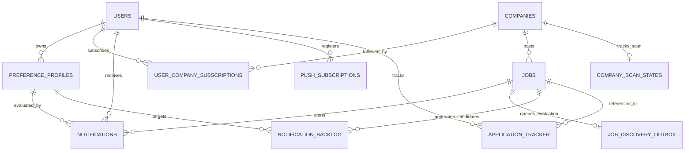
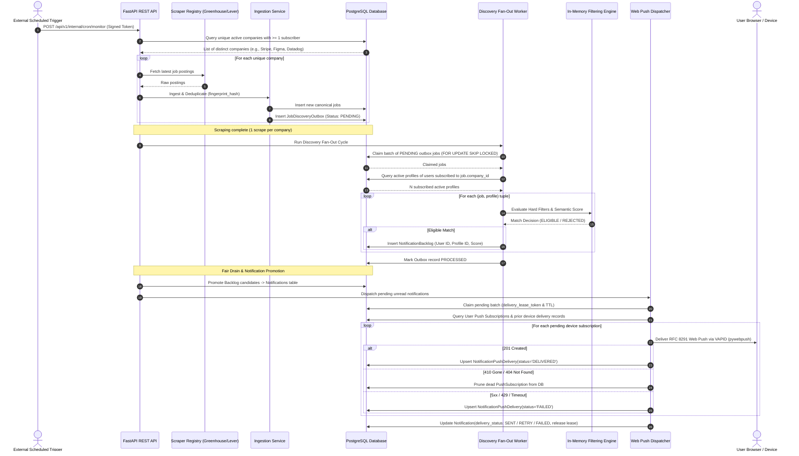
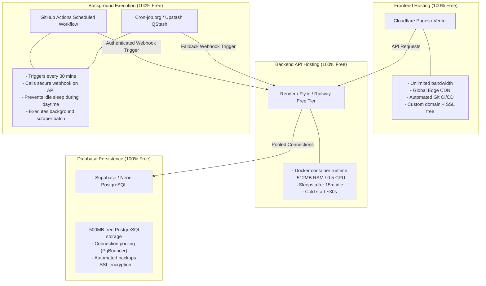

# HawkOffer SaaS Architecture Specification

**Status:** APPROVED (M13–M15.1 Implemented)  
**Version:** 2.1.0  
**Target Milestone:** M13–M18 SaaS Evolution  
**Author:** SaaS Architecture & Systems Engineering  

---

## 1. Executive Summary & North Star Vision

HawkOffer began as a local-first Windows desktop career opportunity engine. While the local runtime and packaging have achieved release-grade stability in M0–M11 (verified through native installers, single-instance mutexes, and SQLite WAL persistence), the **core product vision is a public, multi-user Web SaaS platform**.

### Product North Star
1. **Zero-Friction Access**: Users navigate to the HawkOffer web application in their browser, sign up, and manage their preferences without downloading any binaries or running local servers.
2. **Autonomous Background Ingestion**: Companies are continuously monitored on a centralized server infrastructure, completely independent of whether individual users have their browsers open.
3. **1-to-N Centralized Scraping Efficiency**: When 500 users track "Stripe" or "Anthropic", the company career portal is scraped exactly **once** per polling interval. The discovered jobs are fan-out evaluated against all active subscriber profiles in memory.
4. **Instant Actionable Web Push**: Matches and alerts are delivered directly to the user's desktop/mobile browser via standardized Web Push Notifications (RFC 8291/8292), even when the web application tab is closed.
5. **Strict Zero-Budget Principle**: The platform is engineered to operate reliably on free, open-source, and zero-dollar cloud hosting tiers (Cloudflare Pages, Supabase/Neon PostgreSQL, Render free web containers, GitHub Actions / Upstash cron runners) with $0.00/month recurring cost and zero paid API dependencies.

---

## 2. Current Desktop Architecture vs. Target SaaS Architecture

| Dimension | Current Desktop Architecture (M0–M11) | Target Multi-User SaaS Architecture (M13–M18) |
| :--- | :--- | :--- |
| **User Tenancy** | Single-user; local database assumed to belong to 1 person. | Multi-tenant; full user isolation, authentication, RBAC, and tenant-scoped data access. |
| **Frontend Shell** | Tauri 2.x desktop shell bundling WebKit/WebView2. | Web browser Single Page Application (SPA) deployed to Global Edge CDN (Cloudflare Pages / Vercel). |
| **Backend Process** | Local Python FastAPI process running as sidecar on `127.0.0.1:8765`. | Cloud-hosted FastAPI REST API container running on auto-scaling or free-tier web container. |
| **Database Engine** | Embedded SQLite with WAL mode, single writer lock. | PostgreSQL with connection pooling (Supabase / Neon), supporting concurrent reads/writes and row-level locks. |
| **Monitoring Execution** | In-process `APScheduler` running only while desktop app is open. | Centralized background cron / task worker executing 24/7 on schedules, decoupling ingestion from user sessions. |
| **Job Scraping** | Local scrapers run per-desktop instance. | Centralized scraper registry; deduplicated company scrape fan-out to $N$ user preference profiles. |
| **Notifications** | Desktop OS toast notifications (via Tauri / Windows Notification API). | Standardized RFC 8291/8292 Web Push notifications via Service Workers + in-app notification center. |
| **Data Synchronization** | Local disk `%LOCALAPPDATA%\HawkOffer\hawkoffer.db`. | Centralized cloud relational database with encrypted credentials and tenant isolation. |
| **Hardware Dependency** | User PC must be powered on and running the app. | Zero client requirements; runs autonomously in the cloud. |

---

## 3. High-Level System Architecture Diagram

```mermaid
flowchart TD
    subgraph ClientLayer["Client Layer (Cross-Platform)"]
        Browser["User Browser (Desktop / Mobile)"]
        SW["Service Worker (Web Push Handler)"]
        Browser <--> SW
    end

    subgraph EdgeCDN["Edge CDN Layer (Free Tier: Cloudflare Pages)"]
        SPA["React 18 + Vite SPA Build<br/>Static Assets & Routing"]
    end

    subgraph BackendLayer["Compute & API Layer (Free Tier: Render / Fly.io)"]
        API["FastAPI REST API v1/v2<br/>(Stateless ASGI Container)"]
        AuthMid["JWT & Tenant Isolation Middleware"]
        FanOutEng["Outbox Fan-Out Engine<br/>(1 Job -> N Profiles)"]
        PushSender["Web Push Dispatcher<br/>(pywebpush + VAPID)"]
        
        API --> AuthMid
        AuthMid --> FanOutEng
        FanOutEng --> PushSender
    end

    subgraph SchedulerLayer["Autonomous Trigger Layer (Zero-Budget Cron)"]
        GHA["GitHub Actions Scheduled Cron<br/>(Every 30–60 mins)"]
        QStash["Upstash QStash / Cron-Job.org<br/>(External Webhook Trigger)"]
        GHA -->|POST /api/v1/internal/cron/monitor| API
        QStash -->|POST /api/v1/internal/cron/monitor| API
    end

    subgraph DatabaseLayer["Data Persistence (Free Tier: Supabase / Neon)"]
        PG[(PostgreSQL Database<br/>Row-Level Isolation & Connection Pool)]
        UsersTbl[("users & auth")]
        SubTbl[("user_company_subscriptions")]
        CompTbl[("companies (canonical)")]
        JobsTbl[("jobs (canonical & deduplicated)")]
        ProfTbl[("preference_profiles (user-scoped)")]
        OutboxTbl[("job_discovery_outbox")]
        BacklogTbl[("notification_backlog")]
        NotifTbl[("notifications & push_subscriptions")]
        LeaseTbl[("distributed_leases (cross-process mutex)")]
        
        PG --- UsersTbl
        PG --- SubTbl
        PG --- CompTbl
        PG --- JobsTbl
        PG --- ProfTbl
        PG --- OutboxTbl
        PG --- BacklogTbl
        PG --- NotifTbl
        PG --- LeaseTbl
    end

    subgraph PushGatewayLayer["Push Service Gateways (Zero Cost RFC 8291)"]
        FCM["Google FCM Push Service"]
        ApplePush["Apple Push Notification Service (APNs)"]
        MozillaPush["Mozilla Autopush Service"]
    end

    Browser -->|HTTPS / Static Assets| EdgeCDN
    Browser -->|REST API Requests (JWT Auth)| API
    API <-->|SQLAlchemy asyncpg / Pool| PG
    PushSender -->|Encrypted VAPID Payload| FCM
    PushSender -->|Encrypted VAPID Payload| ApplePush
    PushSender -->|Encrypted VAPID Payload| MozillaPush
    FCM -->|Push Event| SW
    ApplePush -->|Push Event| SW
    MozillaPush -->|Push Event| SW
    SW -->|Show Notification| Browser
```

---

## 4. Multi-Tenant Data Model & Schema Design

To transition from single-user desktop to multi-user SaaS while retaining dual-dialect compatibility (allowing local test development with SQLite and cloud production with PostgreSQL), the schema must introduce explicit tenant ownership, subscription associations, and push credentials.

### Entity-Relationship Diagram



### Table Definitions & Constraints

#### 1. `users` (New Core Identity Table)
```sql
CREATE TABLE users (
    id SERIAL PRIMARY KEY,
    email VARCHAR(255) NOT NULL UNIQUE,
    hashed_password VARCHAR(255) NOT NULL,
    full_name VARCHAR(255),
    role VARCHAR(50) NOT NULL DEFAULT 'user', -- 'user', 'admin'
    is_active BOOLEAN NOT NULL DEFAULT TRUE,
    is_verified BOOLEAN NOT NULL DEFAULT FALSE,
    verification_token VARCHAR(255),
    created_at TIMESTAMP WITH TIME ZONE NOT NULL DEFAULT CURRENT_TIMESTAMP,
    updated_at TIMESTAMP WITH TIME ZONE NOT NULL DEFAULT CURRENT_TIMESTAMP
);
CREATE INDEX ix_users_email ON users(email);
CREATE INDEX ix_users_is_active ON users(is_active);
```

#### 2. `user_company_subscriptions` (New Subscription Mapping Table)
Enables users to follow curated companies or add custom companies without creating duplicate company entries.
```sql
CREATE TABLE user_company_subscriptions (
    id SERIAL PRIMARY KEY,
    user_id INTEGER NOT NULL REFERENCES users(id) ON DELETE CASCADE,
    company_id INTEGER NOT NULL REFERENCES companies(id) ON DELETE CASCADE,
    created_at TIMESTAMP WITH TIME ZONE NOT NULL DEFAULT CURRENT_TIMESTAMP,
    CONSTRAINT uq_user_company_subscription UNIQUE (user_id, company_id)
);
CREATE INDEX ix_subscriptions_user_id ON user_company_subscriptions(user_id);
CREATE INDEX ix_subscriptions_company_id ON user_company_subscriptions(company_id);
```

#### 3. `preference_profiles` (Multi-Tenant Evolution)
Existing profile schema enriched with `user_id` foreign key and tenant isolation.
```sql
-- Modified preference_profiles:
ALTER TABLE preference_profiles ADD COLUMN user_id INTEGER REFERENCES users(id) ON DELETE CASCADE;
CREATE INDEX ix_preference_profiles_user_id ON preference_profiles(user_id);
CREATE INDEX ix_preference_profiles_user_active ON preference_profiles(user_id, is_active);
```

#### 4. `companies` (Centralized Canonical Registry)
Curated company catalog shared across all tenants. Users can discover curated companies or register new ones.
```sql
-- Existing fields retained: id, name, career_url, platform, is_active, created_at, updated_at
-- Enriched with:
ALTER TABLE companies ADD COLUMN is_curated BOOLEAN NOT NULL DEFAULT FALSE;
ALTER TABLE companies ADD COLUMN created_by_user_id INTEGER REFERENCES users(id) ON DELETE SET NULL;
CREATE INDEX ix_companies_is_curated ON companies(is_curated);
```

#### 5. `notifications` (Tenant-Scoped Delivery Table)
```sql
-- Existing fields: id, job_id, profile_id, notification_type, status, delivery_status, ...
-- Enriched with user_id:
ALTER TABLE notifications ADD COLUMN user_id INTEGER REFERENCES users(id) ON DELETE CASCADE;
CREATE INDEX ix_notifications_user_id_status ON notifications(user_id, status);
CREATE INDEX ix_notifications_user_created ON notifications(user_id, created_at DESC);
```

#### 6. `push_subscriptions` (New Web Push Registration Table)
Stores standard RFC 8291 browser push subscriptions.
```sql
CREATE TABLE push_subscriptions (
    id SERIAL PRIMARY KEY,
    user_id INTEGER NOT NULL REFERENCES users(id) ON DELETE CASCADE,
    endpoint TEXT NOT NULL UNIQUE,
    p256dh VARCHAR(255) NOT NULL,
    auth VARCHAR(255) NOT NULL,
    user_agent VARCHAR(512),
    failure_count INTEGER NOT NULL DEFAULT 0,
    created_at TIMESTAMP WITH TIME ZONE NOT NULL DEFAULT CURRENT_TIMESTAMP,
    last_used_at TIMESTAMP WITH TIME ZONE NOT NULL DEFAULT CURRENT_TIMESTAMP
);
CREATE INDEX ix_push_subscriptions_user_id ON push_subscriptions(user_id);
```

#### 7. `application_tracker` (User Job Pipeline Table)
Allows users to track job applications directly from their matched notifications.
```sql
CREATE TABLE application_tracker (
    id SERIAL PRIMARY KEY,
    user_id INTEGER NOT NULL REFERENCES users(id) ON DELETE CASCADE,
    job_id INTEGER NOT NULL REFERENCES jobs(id) ON DELETE CASCADE,
    status VARCHAR(50) NOT NULL DEFAULT 'SAVED', -- 'SAVED', 'APPLIED', 'INTERVIEWING', 'OFFER', 'REJECTED'
    notes TEXT,
    applied_at TIMESTAMP WITH TIME ZONE,
    updated_at TIMESTAMP WITH TIME ZONE NOT NULL DEFAULT CURRENT_TIMESTAMP,
    created_at TIMESTAMP WITH TIME ZONE NOT NULL DEFAULT CURRENT_TIMESTAMP,
    CONSTRAINT uq_user_job_application UNIQUE (user_id, job_id)
);
CREATE INDEX ix_application_tracker_user_status ON application_tracker(user_id, status);
```

---

## 5. Centralized Ingestion & Outbox Fan-Out Engine

### 1-to-N Matching Workflow

In desktop mode, ingestion scraped companies and evaluated candidates against local profiles. In SaaS, running a scraper per user is catastrophic for bandwidth, rate-limiting, and memory. The SaaS architecture decouples scraping from user profiles completely:



### 1-to-N Matching & Delivery Invariants
1. **Filtering in Parallel Chunks**: The `JobFilteringEngine` is 100% pure Python with zero database I/O. Evaluating 1 job against 1,000 profiles requires less than 8ms of CPU time.
2. **Subscription Pre-filtering**: Before running deep regex or semantic matching, jobs are filtered by `user_company_subscriptions`. If a user is not subscribed to Company X, their profiles are never evaluated against Company X jobs, reducing evaluation volume by 95%+.
3. **Decoupled Notification Invariant**: In-app `Notification` creation and Web Push dispatch are strictly decoupled. Failed or retried browser pushes never delete, roll back, or alter the unread status of the in-app notification.
4. **Device-Level Idempotency**: `NotificationPushDelivery` records map `(notification_id, subscription_id)`. If Device 1 succeeds while Device 2 fails transiently, subsequent retries only attempt Device 2, preventing duplicate push spam to Device 1.
3. **Deterministic Memory Cap**: Worker runs process in batches of 50 outbox jobs, capping peak worker RAM under 180MB (well within the 512MB free container limit).

---

## 6. Web Push Notification Architecture (Zero-Budget)

Desktop toast notifications cannot reach mobile devices or users with closed browsers. Web Push Notifications use the standard W3C Push API and IETF RFC 8291 (Message Encryption) / RFC 8292 (VAPID).

### Architectural Components
1. **VAPID Keys**: A persistent public/private keypair (`secp256r1`) generated once via `pywebpush` at zero financial cost.
2. **Service Worker (`frontend/public/sw.js`)**: Runs in the background of the user's browser, listening for `push` events and triggering `self.registration.showNotification(...)`.
3. **Push Gateways**: Free, standardized endpoints operated by Google (FCM), Apple (APNs), and Mozilla (Autopush). The backend transmits signed payloads directly to these gateways with zero paid intermediaries (no Twilio, OneSignal, or Pusher).

```mermaid
flowchart LR
    subgraph Browser["User Browser"]
        UI["Web App Frontend"]
        SW["Service Worker<br/>(sw.js)"]
        UI -->|1. Request Permission| SW
        SW -->|2. PushManager.subscribe()| PushService
    end

    subgraph PushService["Browser Push Service (Google / Apple / Mozilla)"]
        Gateway["Push Server Gateway"]
    end

    subgraph Backend["HawkOffer FastAPI SaaS"]
        DB[(PostgreSQL)]
        API["FastAPI Backend"]
        VAPID["pywebpush VAPID Signer"]
    end

    PushService -->|3. Subscription Object| UI
    UI -->|4. POST /api/v1/push/subscribe| API
    API -->|5. Store Credentials| DB

    DB -->|6. Unread Match Notification| VAPID
    VAPID -->|7. Signed Encrypted Push Request| Gateway
    Gateway -->|8. Push Message| SW
    SW -->|9. showNotification()| Browser
```

### Automatic Subscription Hygiene & Security Hardening
1. **Endpoint Ownership & Takeover Prevention**: When a browser registers an endpoint via `POST /api/v1/push/subscribe`, the backend enforces strict user ownership. If an endpoint is already registered by another account, the request is rejected with `HTTP 409 Conflict`. Re-registration by the same user updates keys idempotently.
2. **Anti-SSRF Endpoint Validation & DNS Resolution**: Endpoints are strictly validated: must use the `https://` scheme, cannot contain user credentials or non-standard ports, and cannot target `localhost`, loopback, link-local, private, unspecified, multicast, or reserved IP ranges across both IPv4 and IPv6. In addition, `validate_push_endpoint_url()` actively resolves hostnames via `socket.getaddrinfo(hostname, 443)` to reject domains resolving to prohibited IP spaces. Outbound requests enforce `max_redirects = 0` with a redirect-blocking hook aborting 3xx responses.
3. **Secret Redaction & Suffix Protection**: Push endpoints are masked in all logs and error stores using a SHA-256 fingerprint (`[token_hash={sha256(endpoint)[:8]}]`), eliminating token prefix and suffix exposure. Provider exceptions are sanitized to scrub URLs and authorization tokens before logging or persisting in `NotificationPushDelivery.error_message`.
4. **Atomic Batch Claiming & Stale Lease Fencing**: Workers claim notifications via `UPDATE notifications ... RETURNING id` re-checking all eligibility predicates at execution time. State transitions verify the expected lease token, rejecting stale owners whose leases expired.
5. **Per-Device Heartbeats & Abandoned Recovery**: Before dispatching to each individual device, workers renew the lease TTL. If a lease is revoked or reclaimed by a peer worker midway through devices, dispatch immediately halts without attempting subsequent devices. If a worker crashes while in `PROCESSING`, the notification is automatically reclaimed by any active worker once its lease expires.
6. **Device-Level Semantics**: Device delivery state explicitly distinguishes `DELIVERED`, `TRANSIENT_FAILURE` (temporary 429/5xx/timeout), `PERMANENTLY_INVALID` (404/410), and `EXHAUSTED` (attempts limit reached). Devices that succeed are immediately committed and are never re-sent pushes on retries.
7. **Delivery Guarantees & At-Least-Once Delivery**: Because Web Push does not support distributed two-phase commits across third-party browser push gateways, exactly-once delivery across network partitions is theoretically impossible (e.g., crash between gateway acceptance and local DB commit). HawkOffer implements reliable **at-least-once delivery with device-level deduplication and Service Worker tag replacement** (`tag: job-{id}`) ensuring identical job alerts replace earlier alerts in the OS notification center.

---

## 7. Zero-Budget Cloud Deployment Blueprint

Operating a production SaaS with $0.00/month recurring expenses requires deliberate service composition. Each tier is selected for its generous permanent free limits, developer ergonomics, and rock-solid reliability:



### Overcoming Free-Tier Sleep & Cold Starts
1. **The Sleeping Container Problem**: Free web services (such as Render) suspend containers after 15 minutes of zero HTTP traffic. When asleep, internal in-process schedulers (`APScheduler`) stop firing.
2. **The Zero-Budget Solution**: External cron triggers (`GitHub Actions` or `cron-job.org`) execute every 30 minutes, dispatching an authenticated `POST /api/v1/internal/cron/monitor` request. This single webhook call accomplishes two critical tasks:
   - It **wakes the API container** from sleep.
   - It **executes the centralized monitoring, outbox fan-out, and push delivery cycle**.
3. **User Perceived Latency**:
   - The web app displays a friendly loading state during cold starts (`"Waking up cloud engine..."`) using the existing `BackendReadinessGate` component.
   - Once awake, subsequent navigation and filtering take < 80ms.

---

## 8. Preserving Desktop / Tauri Capabilities

The transition to SaaS **does not require deleting or deprecating the desktop runtime**. The code is organized modularly:
1. **Core Domain Services** (`filtering/`, `scrapers/`, `services/`, `models/`): Completely platform-agnostic; used by both desktop sidecar and SaaS cloud container.
2. **Database Engine Layer**: Supports dual dialects:
   - `SQLITE` (when `DATABASE_URL` starts with `sqlite://`) for local desktop and offline development.
   - `POSTGRESQL` (when `DATABASE_URL` starts with `postgresql://` or `postgres://`) for cloud multi-user production.
3. **Desktop Shell (`src-tauri/`)**: Remains in the repository as a thin native wrapper for users who explicitly prefer an offline, local-only executable.

---

## 9. Architectural Sign-Off & Standards

- **Tenant Isolation**: Mandatory `user_id` filtering in all queries via FastAPI dependency injection (`get_current_active_user`).
- **Secret Management**: JWT secrets, database connection strings, and VAPID keys managed exclusively via environment variables (`HAWKOFFER_*`).
- **Data Integrity**: Foreign keys set to `ON DELETE CASCADE` for user-owned records and `ON DELETE SET NULL` for shared catalog references.
- **Auditing**: All API endpoints and background runs record execution metrics in `monitoring_logs` with zero sensitive user payload retention.
