# HawkOffer SaaS Roadmap

**Status:** APPROVED FOR PLANNING  
**Current Phase:** Post-M12 Architecture Transition  
**Target:** Public Multi-User SaaS on Zero-Dollar Cloud Infrastructure  
**Author:** Senior SaaS Architect & Release Engineering  

---

## 1. Roadmap Overview & Phasing

```mermaid
flowchart LR
    M12["M12: SaaS Foundation & Architecture Audit<br/>(COMPLETED)"] --> M13["M13: Multi-Tenant Data Model & PostgreSQL<br/>(COMPLETED)"]
    M13 --> M14["M14: User Auth & Tenant Isolation<br/>(COMPLETED)"]
    M14 --> M15["M15: Centralized Monitoring & Fan-Out<br/>(COMPLETED)"]
    M15 --> M15_1["M15.1: Production Safety & Hardening<br/>(COMPLETED)"]
    M15_1 --> M16["M16: Web Push Notifications (RFC 8291)<br/>(COMPLETED)"]
    M16 --> M16_1["M16.1: Push Reliability & Hardening<br/>(COMPLETED)"]
    M16_1 --> M16_2["M16.2: Push Final Security & Gate<br/>(COMPLETED)"]
    M16_2 --> M17["M17: Public Web Dashboard & Application Tracking<br/>(COMPLETED)"]
    M17 --> M18["M18: Zero-Budget Cloud Deployment & Acceptance"]
```

---

## 2. Detailed Milestone Specifications

### Milestone 13: Multi-Tenant Data Model & Dual-Dialect PostgreSQL
*Status: COMPLETED (Verified across 336 backend tests & 34 frontend tests)*
*Objective: Upgrade the database schema and ORM layer to support multi-tenancy, subscription mappings, and seamless dual SQLite/PostgreSQL execution.*

- **Delivered Capabilities**:
  1. **New Relational Entities**:
     - `User` model (`id`, `email`, `hashed_password`, `role`, `is_active`, `is_verified`, `created_at`, `updated_at`).
     - `UserCompanySubscription` mapping table (`user_id`, `company_id`, unique constraint, index).
     - `PushSubscription` model (`user_id`, `endpoint`, `p256dh`, `auth`, `failure_count`, timestamps).
     - `JobApplication` model (`user_id`, `job_id`, `status`, `notes`, `applied_at`, unique constraint).
  2. **Schema Upgrades for Existing Models**:
     - Added `user_id` foreign key (`nullable=True`) to `PreferenceProfile` and `Notification` ensuring complete backward compatibility for desktop mode.
     - Added `is_curated` and `created_by_user_id` to `Company`.
     - Added `postgresql_where` alongside `sqlite_where` to all partial indexes in `outbox.py` and `job.py`.
  3. **Dialect Abstraction & Engine Modernization**:
     - Created `app/database/compat.py` with `get_dialect_name`, `get_upsert_insert`, and `acquire_exclusive_write_lock`.
     - Modernized `app/database/session.py` with PostgreSQL connection pool parameters (`pool_size`, `max_overflow`, `pool_recycle`, `pool_pre_ping`).
     - Modernized `app/core/config.py` to auto-normalize `postgres://` and `postgresql://` connection strings.
  4. **Alembic Dual Migrations**:
     - Created `alembic/versions/b3e4f5a6c7d8_m13_multi_tenant_schema.py` using `batch_alter_table` for 100% SQLite and PostgreSQL parity.
     - Verified full migration upgrade to head, downgrade to m10, and upgrade back to head.
- **Verification Gates Achieved**:
  - 336 backend tests passed (including 13 new M13 schema, uniqueness, and dialect compilation tests).
  - 34 frontend vitest tests passed.
  - Full PostgreSQL DDL compilation verified via mock engine (76 SQL statements compiled cleanly).

---

### Milestone 14: User Authentication, Security & Tenant Isolation
*Status: COMPLETED (Verified across 347 backend tests & 34 frontend tests)*
*Objective: Implement production-grade multi-user authentication, JWT session handling, and rigorous repository-level tenant boundaries.*

- **Delivered Capabilities**:
  1. **Authentication Engine & Cryptography**:
     - Password hashing via `argon2-cffi` (Argon2id, memory_cost=65536, time_cost=2, parallelism=1).
     - Timing-safe dummy password verification mitigating user-enumeration attacks.
     - Email normalization (whitespace trimmed, lowercased).
     - Password complexity validation (minimum 8 chars, maximum 128, containing letters and digits/symbols).
     - JWT token lifecycle via `PyJWT` (30m access token with `type: access`, 14d refresh token with `type: refresh` and unique UUID4 `jti`).
     - Persistent token revocation and rotation in `refresh_tokens` database table.
     - Endpoints: `POST /api/v1/auth/register`, `POST /api/v1/auth/login`, `POST /api/v1/auth/refresh`, `POST /api/v1/auth/logout`, `GET /api/v1/auth/me`.
  2. **FastAPI Auth Dependencies & Dual Compatibility**:
     - `get_current_user`: Bearer JWT decoding, subject resolution, and active user verification.
     - `get_current_active_user`: Enforces `is_active` status.
     - `get_optional_user`: Supports unauthenticated desktop mode (`auth_required=False`) while strictly enforcing authenticated tenant isolation when tokens are provided or `auth_required=True`.
     - `require_role(role)`: RBAC enforcement for admin capabilities.
  3. **Strict Multi-Tenant Isolation**:
     - Preference Profiles: Filtered by `user_id`. Attempting to access, modify, or delete another user's profile returns `404 Not Found`.
     - Company Subscriptions: Filtered by `user_id`. Attempting to delete another user's subscription returns `404 Not Found`.
     - Job Applications: Filtered by `user_id`. Attempting to access, update, or delete another user's application returns `404 Not Found`.
     - Notifications: Scoped to `user_id`. Cross-user notification deduplication via `uq_notifications_job_user_type` index on `(job_id, user_id, notification_type)`. Multiple users can receive alerts for the same job, but a single user cannot receive duplicates.
     - Companies: Curated companies require admin role to modify or delete. Custom companies can only be modified or deleted by their creator or an admin (403 Forbidden).
  4. **Frontend API Groundwork**:
     - Exported TypeScript contracts: `UserRead`, `UserRegisterRequest`, `UserLoginRequest`, `TokenResponse`, `ApplicationRead`, `ApplicationCreate`, `ApplicationUpdate`, `CompanySubscriptionRead`, `CompanySubscriptionCreate`.
     - Added `authApi`, `applicationsApi`, and `subscriptionsApi` clients with automatic `Authorization: Bearer <token>` header injection.
  5. **Alembic Migration & Schema Parity**:
     - Migration `c4d5e6f7a8b9_m14_auth_and_security.py` creating `refresh_tokens` and adding `uq_notifications_job_user_type`. Verified clean upgrade, downgrade, and upgrade roundtrip.
- **Verification Gates Achieved**:
  - 347 backend pytest tests passed (including 11 comprehensive M14 security, auth, and tenant isolation tests).
  - 34 frontend vitest tests passed.
  - Zero Ruff linting issues (`ruff check app tests` passed).
  - Zero MyPy typing errors (`mypy app tests` passed on 115 files).
  - Production frontend build cleanly generated (`tsc && vite build`).

---

### Milestone 15: Centralized Multi-Tenant Monitoring & Outbox Fan-Out
*Status: COMPLETED (Verified across 357 backend tests & 34 frontend tests)*
*Objective: Transform background ingestion into a centralized, efficient 1-to-N fan-out engine that runs on external scheduled triggers.*

- **Delivered Capabilities**:
  1. **Deduplicated Central Scraping**:
     - Query distinct active companies followed by at least one active user (or marked `is_curated = True`) via `CompanyRepository.list_active_monitored_targets()`.
     - Scrape each distinct company exactly once per cycle regardless of subscriber count.
     - Single-user desktop mode falls back to all active companies if 0 subscriptions exist.
  2. **Subscription-Aware Outbox Fan-Out**:
     - `JobDiscoveryWorker` evaluates claimed jobs against active profiles of users subscribed to `job.company_id` (plus legacy desktop profiles where `user_id IS NULL`).
     - Non-subscribers and users without active profiles are never evaluated.
     - Candidates generated with target `user_id` and committed to `NotificationBacklog`.
  3. **Multi-Tenant Notification Promotion & Deduplication**:
     - `BacklogDrainWorker` promotes candidates into `Notification` entries deduplicating by `(job_id, user_id, notification_type)`.
     - Cross-cycle idempotency: repeated runs yield 0 duplicates.
  4. **Scoped Historical Reevaluation**:
     - `ReevaluationWorker` scopes historical job queries to companies subscribed by `profile.user_id`.
  5. **Headless Cron Endpoint & Concurrency Lock**:
     - Endpoint `POST /api/v1/internal/cron/monitor` protected by constant-time `HAWKOFFER_CRON_SECRET` validation (`X-Cron-Secret` or `Bearer` token).
     - Async lock prevents concurrent execution, returning `409 Conflict`.
     - Comprehensive execution telemetry returned in `CronMonitoringResponse`.
- **Verification Gates Achieved**:
  - 10 comprehensive M15 tests passed (`tests/test_m15_centralized_monitoring.py`).
  - Single scrape per company verified across multiple subscribers.
  - Per-user role filtering criteria validated.
  - Desktop legacy profile backward compatibility verified.
  - Zero linting or typing regressions (`ruff check` and `mypy` passed clean).

---

### Milestone 15.1: Production Safety & Multi-Tenant Monitoring Hardening
*Status: COMPLETED (Verified across 370 backend tests & 34 frontend tests)*
*Objective: Harden cron secrets, implement database-backed distributed leases for cross-process coordination, isolate desktop profiles, and ensure monitoring target safety.*

- **Delivered Capabilities**:
  1. **Production Cron Secret Security**:
     - Predictable development tokens removed from production defaults.
     - Enforced minimum 32-character secret length and rejection of known weak secrets in production (`validate_production_cron_secret`).
     - Fail-closed behavior (HTTP 503) when production secret is missing or insecure.
     - Kept zero-secret-leakage logging and constant-time `secrets.compare_digest`.
     - Seamless non-production ergonomics (`hawkoffer-dev-cron-secret-token` only in dev/test).
  2. **Zero-Cost Distributed Leases**:
     - Database-backed `DistributedLease` on `distributed_leases` table.
     - Atomic acquisition across multiple application processes/containers without Redis or paid brokers.
     - Crash recovery via expiration TTL (`monitoring_lease_ttl_seconds`, default 300s).
     - Unique owner token (`uuid4`) preventing expired/stale former owners from releasing newer owners' leases.
  3. **Desktop Profile Isolation**:
     - Strict suppression of unauthenticated legacy desktop profiles (`user_id IS NULL`) in SaaS mode (`auth_required=True`).
     - In desktop/mixed mode, legacy profiles only evaluate against curated or desktop-created companies (never private SaaS companies).
  4. **Target Selection Semantics**:
     - Desktop fallback (`list_active()`) only triggers when `auth_required=False` and zero subscriptions exist. Never falls back to arbitrary companies in SaaS deployments.
     - Inactive users (`user.is_active=False`) excluded from monitoring demand calculations.
     - Curated companies without subscribers configurable via `monitor_curated_without_subscribers` (default `False`).
  5. **Reliable Error Handling & Observability**:
     - Guaranteed lease release in `try ... finally` block.
     - Pipeline worker failures (Discovery, Backlog Drain) accurately reported as `partial_failure` or `failed`.
- **Verification Gates Achieved**:
  - 13 comprehensive M15.1 tests passed (`tests/test_m15_1_monitoring_hardening.py`).
  - Alembic migration `d5e6f7a8b9c0_m15_1_distributed_leases.py` verified for clean upgrade/downgrade roundtrips.
  - All 370 backend tests and 34 frontend tests passed.

---

### Milestone 16: Web Push Notifications (RFC 8291/8292) & Background Dispatch
*Status: COMPLETED (Verified across 382 backend tests & 34 frontend tests, 12 new M16 push tests)*  
*Objective: Build an autonomous, zero-cost push notification service delivering immediate job matches to browsers even when offline or tab is closed.*

- **Delivered Capabilities**:
  1. **VAPID Key Generation & Push Infrastructure**:
     - Key pair generation and configuration (`HAWKOFFER_VAPID_PUBLIC_KEY`, `HAWKOFFER_VAPID_PRIVATE_KEY`, `HAWKOFFER_VAPID_CLAIMS_EMAIL`).
     - Ephemeral dev keypair generation for seamless local development without manual config.
     - Strict production validation requiring explicit keys in production (`validate_production_vapid()`).
     - API endpoint: `GET /api/v1/push/vapid-public-key` for browser initialization.
     - API endpoints: `POST /api/v1/push/subscribe`, `GET /api/v1/push/subscriptions`, and `POST /api/v1/push/unsubscribe`.
     - Strict tenant isolation: users can only view and manage their own subscriptions; cross-user unsubscriptions return 404.
  2. **Browser Service Worker (`sw.js`) & Frontend Client**:
     - Standard Service Worker handling `push` and `notificationclick` events.
     - Parses JSON payload (`title`, `body`, `url`, `tag`, `data`).
     - `notificationclick` focuses existing application tabs or opens target job detail view `/jobs/:id`.
     - `frontend/src/services/pushService.ts` handles Web Push feature detection, Tauri desktop bypass, permission requesting on user interaction, subscription conversion, and API communication.
     - Responsive Web Push opt-in widget in `NotificationsScreen.tsx`.
  3. **Async Dispatch Worker & Idempotent Per-Device Tracking**:
     - `WebPushDispatcher` background service claiming notification batches with database lease locks (`push_lease_ttl_seconds`).
     - Core Invariant Preserved: In-app notification creation and Web Push delivery are decoupled. Failed push deliveries NEVER delete or corrupt in-app notifications.
     - Multi-device idempotency: `NotificationPushDelivery` tracking ensures already-delivered devices do not receive duplicate alerts on retries.
     - Automatic pruning of HTTP `410 Gone` and `404 Not Found` responses from Google FCM, Mozilla Autopush, and Apple APNs.
     - Transient failure bounded exponential backoff (`push_max_attempts=3`).
     - Integrated into continuous scheduler and Step 5 of `run_centralized_monitoring_cycle()`.
- **Verification Gates Achieved**:
  - 12 comprehensive M16 tests passed (`tests/test_m16_web_push.py`).
  - Full backend test suite: 382 passed.
  - Frontend test suite: 34 passed.
  - Static typing & linting: MyPy and Ruff passed with 0 errors.
  - Frontend production build: Vite compiled cleanly in 2.47s.
  - Zero paid third-party push dependencies.

---

### Milestone 16.1: Web Push Reliability & Security Hardening
*Status: COMPLETED (Verified across 393 backend tests, 34 frontend tests, 11 new M16.1 hardening tests)*  
*Objective: Harden subscription ownership, atomic notification claiming, lease heartbeats, and cryptographic VAPID validation.*

- **Delivered Capabilities**:
  1. **Subscription Ownership & Endpoint Security**:
     - Strict endpoint validation: requires secure HTTPS scheme, rejects embedded credentials, localhost, loopback, link-local, and private IP addresses.
     - Endpoint takeover protection: `POST /push/subscribe` rejects attempts by User B to register an endpoint already owned by User A with HTTP `409 Conflict`.
     - Idempotent upsert: same user re-registering an endpoint refreshes keys and `last_used_at` without duplicate row creation.
     - Race-condition resilience: handles concurrent registration attempts via database transaction rollback and idempotent recovery.
     - Redacted logging: endpoints are hashed/masked (`...{suffix}`) in all logs; client auth secrets and private keys are never logged.
     - Response hygiene: `PushSubscriptionRead` omits raw encryption secrets from public REST responses.
  2. **Atomic Notification Claiming & Stale Lease Fencing**:
     - Candidate selection re-validates all eligibility predicates during the `UPDATE ... RETURNING` statement, ensuring absolute mutual exclusion between concurrent workers without race overwrites.
     - Lease heartbeats: `WebPushDispatcher` renews `delivery_lease_expires_at` prior to making outbound HTTP requests, preventing lease expiration during long-running network batches.
     - Fenced state updates: every state finalization (`SENT`, `RETRY`, `FAILED`) verifies `delivery_lease_token == token`. Stale or expired workers are rejected from overwriting newer state.
     - Abandoned worker recovery: notifications stuck in `PROCESSING` whose lease expired are automatically reclaimed and resumed.
  3. **Explicit Device-Level Delivery Semantics**:
     - Distinguishes `DELIVERED`, `TRANSIENT_FAILURE`, `PERMANENTLY_INVALID`, and `EXHAUSTED`.
     - Transient provider failures (HTTP 429, 5xx, timeouts) are labeled `TRANSIENT_FAILURE` and scheduled for retry; only after exhausting `push_max_attempts` are they marked `EXHAUSTED`.
     - Successfully delivered devices never receive duplicate push deliveries on retries.
     - In-app notification `status` (`UNREAD`/`READ`) is strictly preserved across all push failures.
  4. **Cryptographic VAPID Pair Validation**:
     - Parses P-256 private key and base64url public key using `cryptography`.
     - Mathematically confirms that the public key corresponds to the private key point on the NIST P-256 (SECP256R1) curve.
     - Rejects malformed, invalid, or mismatched keys during startup and configuration validation.
- **Verification Gates Achieved**:
  - 11 new M16.1 hardening tests passed (`tests/test_m16_1_push_hardening.py`).
  - Total backend tests: 393 passed (100%).
  - Total frontend tests: 34 passed (100%).
  - MyPy and Ruff passed with 0 errors across 126 source files.
  - Frontend production build clean in 4.20s.

---

### Milestone 16.2: Web Push Final Security & Reliability Gate
*Status: COMPLETED (Verified across 402 backend tests, 34 frontend tests, 9 new M16.2 gate tests)*  
*Objective: Audit and enforce outbound anti-SSRF protection, complete token redaction, per-device pre-send heartbeat fencing, and desktop backwards compatibility.*

- **Delivered Capabilities**:
  1. **Outbound Push Endpoint Anti-SSRF Protection**:
     - Strict HTTPS validation and non-standard port rejection.
     - Comprehensive IP range filtering covering IPv4 and IPv6 loopback, link-local, private, unspecified, multicast, and reserved ranges.
     - Real-time DNS resolution check via `socket.getaddrinfo(hostname, 443)` rejecting domains resolving to prohibited IP addresses.
     - Hardened HTTP session with `max_redirects = 0` and redirect-blocking hook aborting 3xx responses.
  2. **Complete Secret & Endpoint Redaction**:
     - Token suffix leakage eliminated: masked as `[token_hash={sha256(endpoint)[:8]}]`.
     - Exception sanitization: provider error messages and URLs are scrubbed before writing to logs or database columns.
  3. **Multi-Device Heartbeat Fencing**:
     - Immediate pre-send heartbeat and lease revalidation before each individual device outbound call.
     - Workers immediately halt upon lease loss without attempting remaining devices, preventing dual delivery.
     - Incremental per-device delivery record commit preserving successful sends.
  4. **Production VAPID & Desktop Compatibility**:
     - `WebPushDispatcher.run_once()` validates production VAPID configuration early and fails closed before claiming tasks.
     - Transparent fallback to ephemeral in-memory keypairs for desktop / Tauri development mode.
- **Verification Gates Achieved**:
  - 9 new M16.2 tests passed (`tests/test_m16_2_push_final_gate.py`).
  - Combined push suite: 32 tests passed (100%).
  - Full backend suite: 402 tests passed (100%).
  - Full frontend suite: 34 tests passed (100%).
  - MyPy and Ruff clean across 127 source files.
  - Frontend production build verified in 5.25s.

---

### Milestone 17: Public SaaS Web Dashboard & Application Tracking
*Status: COMPLETED (Verified across 402 backend tests, 42 frontend tests, 0 MyPy/Ruff errors, clean production build in 4.16s)*  
*Objective: Transform the React + Vite frontend into a website-first, multi-user SaaS web dashboard with JWT authentication, company catalog discovery, Kanban application tracking, and RFC 8291 Web Push onboarding.*

- **Delivered Capabilities**:
  1. **User Authentication & Session Persistence**:
     - Modern `AuthModal` supporting seamless Login and Registration tabs, real-time password strength requirements, password visibility toggle, and error alerts.
     - `AuthContext` with automatic token restoration from `localStorage` (`hawkoffer_access_token`, `hawkoffer_refresh_token`).
     - Transparent JWT auto-refresh via HTTP 401 interceptor in `frontend/src/services/api.ts` hitting `POST /api/v1/auth/refresh`.
     - Graceful unauthenticated gates throughout the application shell (Header user avatar, Sign In CTA, application tracking gates).
  2. **Modern Career Intelligence Dashboard**:
     - Modern SaaS header with authenticated greeting, system status indicators, and background monitoring details.
     - 4 interactive KPI metric cards: Followed / Curated Companies, Total Discovered Jobs, Tracked Applications, and Unread Notifications.
     - Mini-pipeline Kanban preview summarizing stages (`SAVED`, `APPLIED`, `INTERVIEWING`, `OFFER`).
     - Freshly discovered opportunities feed with fit percentages and quick navigation.
     - Contextual browser Web Push onboarding banner with zero-pressure dismiss semantics.
  3. **Company Catalog Discovery & Follow System**:
     - Three-state catalog filtering: "Curated Catalog" (production targets like Stripe, Datadog), "Followed" (user subscriptions), and "All Targets".
     - Real-time Follow / Unfollow toggles wired to `POST /api/v1/subscriptions` and `DELETE /api/v1/subscriptions/{id}`.
     - "Add Target" modal allowing users to register and automatically follow custom company career portals.
  4. **Job Application Tracking Pipeline (Kanban & Table Views)**:
     - Dedicated `ApplicationsScreen` featuring a 5-column Kanban board (`Saved`, `Applied`, `Interviewing`, `Offer Received`, `Archived / Rejected`).
     - Full interactive list view with stage filtering, date tracking, and inline status updates.
     - Add / Edit application modals supporting notes, dates, and direct links to discovered jobs.
     - Enriched `ApplicationRead` schema with pre-loaded `JobRead` object avoiding N+1 roundtrips.
  5. **Browser Push Notification Onboarding**:
     - Non-intrusive `PushNotificationBanner` displayed only when Web Push is supported and permission is `default`.
     - One-click activation requesting browser permission, registering Service Worker, and syncing cryptographic subscription to `POST /api/v1/push/subscribe`.
     - Settings screen integration providing live connection status, permission indicators, and unsubscribe controls.
  6. **Zero-Paid-API & Backward Compatibility Preservation**:
     - Retains full compatibility with Tauri desktop mode and SQLite dual dialect.
     - Decouples in-app notifications from push delivery status.
     - No external cloud services or Redis introduced.
- **Verification Gates Achieved**:
  - 42 frontend tests passed (including 8 new tests for AuthModal, ApplicationsScreen, and PushNotificationBanner).
  - 402 backend tests passed (100%).
  - MyPy static analysis passed with 0 errors across 127 source files.
  - Ruff linter passed with 0 errors.
  - Production frontend build cleanly bundled in 4.16s (`dist/assets/index-32KWhYKi.js` at 89.74 kB gzipped, well under the 500 kB budget).

---

### Milestone 18: Zero-Budget Deployment Automation & Cloud Readiness
*Status: COMPLETED (Verified across 408 backend tests, 42 frontend tests, 0 MyPy/Ruff errors, clean frontend production build)*  
*Objective: Prepare, package, and automate production deployment across Cloudflare Pages, Render/Fly.io, and Supabase/Neon PostgreSQL with a strict $0.00/month zero-budget architecture.*

- **Delivered Capabilities**:
  1. **Production Backend Container & Security Isolation**:
     - Multi-stage minimal footprint build in `backend/Dockerfile` (Python 3.11-slim builder and runner stages).
     - Security hardened runtime executing as unprivileged non-root user `appuser` (UID 10001).
     - Lightweight zero-dependency health check (`CMD python -c "import urllib.request..."`).
     - Graceful SIGTERM/SIGINT shutdown via `exec uvicorn` in `backend/scripts/docker-entrypoint.sh`.
     - Strict `.dockerignore` excluding SQLite databases, credentials, `.venv`, tests, and compiler caches.
     - Self-hosted multi-container evaluation stack in root `docker-compose.prod.yml`.
  2. **Async PostgreSQL Migration Engine**:
     - Upgraded `backend/alembic/env.py` to use SQLAlchemy's asynchronous migration runner (`create_async_engine`).
     - Enables zero-dependency PostgreSQL migrations through `asyncpg` without requiring sync `psycopg2` binaries.
     - Automatically normalizes sync connection strings to async driver schemes (`postgresql+asyncpg://`, `sqlite+aiosqlite://`).
     - Safe pre-traffic migration automation triggered during container startup when `RUN_MIGRATIONS=true`.
  3. **Cloud-Ready CORS & Multi-Tenant Configuration**:
     - Environment-driven `HAWKOFFER_CORS_ORIGINS` setting with string/list parsing and automatic URL sanitization.
     - Seamlessly merges web production origins with desktop Tauri and local Vite development domains.
     - Configurable `HAWKOFFER_START_INTERNAL_SCHEDULER` flag allowing containers to disable internal APScheduler in favor of external cron triggers.
     - Comprehensive production `.env.example` templates at repository root and in `backend/`.
  4. **Frontend Production & Edge Routing Readiness**:
     - Added `frontend/public/_redirects` SPA fallback rule (`/* /index.html 200`) for Cloudflare Pages / Netlify edge deployments.
     - Enhanced `getApiBaseUrl()` in `frontend/src/services/api.ts` to automatically format base URLs and ensure `/api/v1` route prefix integrity.
     - Configured `frontend/.env.example` documenting `VITE_API_BASE_URL`.
  5. **External Scheduled Monitoring Automation (GitHub Actions)**:
     - Automated cron workflow `.github/workflows/monitor-cron.yml` triggering every 30 minutes (`*/30 * * * *`).
     - Includes `workflow_dispatch` support for on-demand operator testing and manual verification.
     - Authenticates against `POST /api/v1/internal/cron/monitor` using masked repository secret `CRON_SECRET`.
     - Robust HTTP curl caller with timeout controls, retries, and comprehensive diagnostic logging without secret leakage.
  6. **Deployment Guide & Disaster Recovery Playbook**:
     - Authoritative `docs/DEPLOYMENT.md` covering zero-budget provider setup (Cloudflare Pages, Render, Supabase/Neon).
     - Backup and restore procedures (`pg_dump`/`pg_restore`), cold-start mitigations, and operational limits analysis.
- **Verification Gates Achieved**:
  - 6 new M18 deployment readiness tests passed (`tests/test_m18_deployment_readiness.py`).
  - Full backend test suite: 408 tests passed (100%).
  - Full frontend test suite: 42 tests passed (100%).
  - MyPy static analysis passed with 0 errors across 128 source files.
  - Ruff linter passed with 0 errors across entire application codebase.
  - Frontend production build successfully compiled in 4.57s (`dist/assets/index-CE8hI_bO.js` at 89.77 kB gzipped).
  - Backwards compatibility strictly preserved for desktop Tauri runtime and local SQLite databases.

---

### Milestone 19: First Public Deployment & Production Validation
*Status: COMPLETED (Verified across 419 backend tests, 42 frontend tests, 0 MyPy/Ruff errors, automated smoke-test suite)*  
*Objective: Audit deployment configurations, harden startup and database ordering, eliminate external cron edge cases, and establish an automated production smoke-test suite for live deployment validation.*

- **Delivered Capabilities**:
  1. **Production Configuration Hardening & Secret Validation**:
     - Strict prohibition of wildcard `'*'` CORS origins in `Settings.parse_cors_origins` to prevent credential exposure.
     - Implemented `validate_production_jwt_secret()` and `validate_production_configuration()` on `Settings`.
     - Hardened FastAPI `lifespan` in `app/main.py`: raises `RuntimeError` immediately during container startup if running with `HAWKOFFER_ENV=production` and missing/insecure JWT or cron secrets, preventing traffic service with insecure keys.
  2. **External Cron Availability Under Decoupled Schedulers**:
     - Fixed `app.state.orchestrator` lifecycle in `app/main.py`: ensures the orchestrator instance is always initialized when `HAWKOFFER_START_INTERNAL_SCHEDULER=false`.
     - Prevents duplicate internal background schedulers in multi-replica containers while ensuring external GitHub Actions cron calls to `POST /api/v1/internal/cron/monitor` execute successfully without 503 errors.
  3. **Database Startup Handshake & Entrypoint Resilience**:
     - Created `app.database.wait_for_db` probing database connectivity with configurable timeout (`DB_WAIT_TIMEOUT`, default 30s) and exponential backoff.
     - Prevents container crashes during PostgreSQL cold-starts or Docker Compose initialization before running Alembic migrations.
     - Masked database credentials in connection probe logs (`***:***@host:port/db`).
     - Enhanced `backend/scripts/docker-entrypoint.sh` to execute the database readiness probe and support arbitrary CLI commands (`exec "$@"`).
  4. **Automated End-to-End Smoke-Test Tooling**:
     - Authored standalone CLI verification script `scripts/smoke_test.py` supporting both local daemons and live public URLs (`--api-url`, `--web-url`, `--cron-secret`).
     - Automatically verifies:
       - Root metadata and system health endpoints (`GET /` and `GET /api/v1/health`).
       - Cron authentication rejection on missing/invalid secret and execution on valid secret.
       - User registration, JWT login, and authenticated identity retrieval (`GET /auth/me`).
       - Company catalog discovery and Application Tracker CRUD operations (create, patch stage, delete).
       - Web Push public VAPID key and subscription endpoints.
       - Cloudflare Pages SPA deep link fallback routing (`/tracker`, `/settings`, `/jobs`).
  5. **Verification & Quality Gates**:
     - 11 new M19 validation and hardening tests passed (`tests/test_m19_deployment_validation.py`).
     - Full backend test suite: 419 passed (100%).
     - Full frontend test suite: 42 passed (100%).
     - MyPy static typing: 0 errors across 130 source files.
     - Ruff linter: 0 errors across application and test suites.
     - Frontend production build clean.

---

### Milestone 20: Public Deployment & Live Release
*Status: COMPLETED (Readiness verified, live deployment framework established, turnkey launch procedure formulated)*  
*Objective: Audit repository deployment readiness, fix cron path concatenation and smoke-test schema alignment, verify local live server smoke tests, and provide a turnkey 5-step operator launch plan for live release under $0.00/month infrastructure.*

- **Delivered Capabilities**:
  1. **Deployment Readiness Audit & Bug Fixes**:
     - Fixed GitHub Actions cron workflow (`.github/workflows/monitor-cron.yml`): automatically normalizes `TARGET_BASE_URL` by stripping trailing `/api/v1` prefixes (`CLEAN_BASE_URL="${CLEAN_BASE_URL%/api/v1}"`), preventing invalid duplicate path concatenation (`.../api/v1/api/v1/...`).
     - Aligned Application Tracker smoke test in `scripts/smoke_test.py`: dynamically queries discovered jobs and submits valid `job_id` and `status` payloads, preventing schema validation failures.
  2. **Live Smoke-Test Verification**:
     - Executed `scripts/smoke_test.py` against a running backend daemon: **11 passed, 0 failed, 3 skipped (clean exit code 0)**.
  3. **Zero-Budget Provider Blueprint & Free-Tier Analysis**:
     - Fully documented operational specifications, cold-start behaviors, and mitigations for Cloudflare Pages (Frontend), Render (Backend), Supabase / Neon (PostgreSQL 16), and GitHub Actions (Scheduled Monitoring).
  4. **Turnkey 5-Step Operator Launch Plan**:
     - Authored `docs/M20_PUBLIC_RELEASE_REPORT.md` providing step-by-step procedures for provisioning the free PostgreSQL database, deploying the backend Docker container to Render, deploying the SPA to Cloudflare Pages, configuring repository secrets in GitHub Actions, and executing post-deployment smoke validation.
  5. **Verification & Quality Gates**:
     - 419 backend tests passed (100%).
     - 42 frontend tests passed (100%).
     - MyPy and Ruff passed with 0 errors across 130 source files.
     - Frontend production build compiled cleanly in 4.57s.
