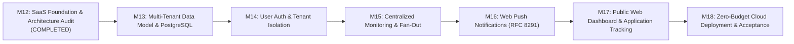

# HawkOffer SaaS Roadmap

**Status:** APPROVED FOR PLANNING  
**Current Phase:** Post-M12 Architecture Transition  
**Target:** Public Multi-User SaaS on Zero-Dollar Cloud Infrastructure  
**Author:** Senior SaaS Architect & Release Engineering  

---

## 1. Roadmap Overview & Phasing

---

## 2. Detailed Milestone Specifications

### Milestone 13: Multi-Tenant Data Model & Dual-Dialect PostgreSQL
*Objective: Upgrade the database schema and ORM layer to support multi-tenancy, subscription mappings, and seamless dual SQLite/PostgreSQL execution.*

- **Scope & Deliverables**:
  1. **New Relational Entities**:
     - `User` model (`id`, `email`, `hashed_password`, `role`, `is_active`, `is_verified`, `created_at`).
     - `UserCompanySubscription` mapping table (`user_id`, `company_id`, unique constraint).
     - `PushSubscription` model (`user_id`, `endpoint`, `p256dh`, `auth`, `failure_count`).
     - `ApplicationTracker` model (`user_id`, `job_id`, `status`, `notes`, `applied_at`).
  2. **Schema Upgrades for Existing Models**:
     - Add `user_id` foreign key to `PreferenceProfile` and `Notification`.
     - Add `is_curated` and `created_by_user_id` to `Company`.
     - Update index definitions to use cross-dialect definitions (`postgresql_where` and `sqlite_where`).
  3. **Dialect Abstraction & Engine Modernization**:
     - Modernize `app/database/session.py` to support `postgresql+asyncpg://` alongside `sqlite+aiosqlite://`.
     - Implement connection pooling configuration (`AsyncAdaptedQueuePool` for PostgreSQL with connection recycling).
     - Replace SQLite-specific `BEGIN IMMEDIATE` and `sqlite_insert` calls with dialect-aware branching (`session.bind.dialect.name == "postgresql"` vs `"sqlite"`).
  4. **Alembic Dual Migrations**:
     - Write migration scripts that apply cleanly on both SQLite and PostgreSQL.
- **Verification Gates**:
  - All existing 323 backend tests pass against SQLite.
  - Test suite passes when pointed to an ephemeral PostgreSQL container/instance.
  - Zero schema drift or unhandled dialect errors in migration roundtrips.

---

### Milestone 14: User Authentication, Security & Tenant Isolation
*Objective: Implement production-grade multi-user authentication, JWT session handling, and rigorous repository-level tenant boundaries.*

- **Scope & Deliverables**:
  1. **Authentication Engine**:
     - Password hashing via `argon2-cffi` or `bcrypt`.
     - JWT token issuance (access tokens + refresh tokens) with configurable expiration.
     - Endpoints: `POST /api/v1/auth/register`, `POST /api/v1/auth/login`, `POST /api/v1/auth/refresh`, `GET /api/v1/auth/me`.
  2. **Tenant Isolation Dependencies**:
     - FastAPI dependency `get_current_user` and `get_current_active_user`.
     - Scoped repositories: `ProfileRepository`, `NotificationRepository`, `SubscriptionRepository` strictly requiring `user_id`.
     - Prohibit any endpoint from returning records belonging to another tenant.
  3. **Role-Based Access Control (RBAC)**:
     - Normal users can manage their own profiles, subscriptions, applications, and notifications.
     - Admin users can manage curated companies and inspect central system monitoring telemetry.
- **Verification Gates**:
  - Multi-tenant security unit & integration test suite verifying User A cannot view, modify, or delete User B's resources (403/404 enforcement).
  - Auth token lifecycle tests (expiration, invalid signature, revoked access).
  - Zero SQL injection or un-scoped queries detected by static analysis.

---

### Milestone 15: Centralized Multi-Tenant Monitoring & Outbox Fan-Out
*Objective: Transform background ingestion into a centralized, efficient 1-to-N fan-out engine that runs on external scheduled triggers.*

- **Scope & Deliverables**:
  1. **Deduplicated Central Scraping**:
     - Query distinct active companies followed by at least one user (or marked `is_curated = True`).
     - Scrape each distinct company exactly once per cycle regardless of subscriber count.
     - Insert new canonical jobs into `jobs` table with fingerprint deduplication.
  2. **Subscription-Aware Outbox Fan-Out**:
     - `JobDiscoveryWorker` claims pending jobs using `FOR UPDATE SKIP LOCKED` (PostgreSQL) or short write locks (SQLite).
     - Resolves subscriber user IDs for `job.company_id`.
     - Evaluates job against the active profiles of subscribers.
     - Commits qualifying candidates to `NotificationBacklog`.
  3. **Headless Cron Endpoint & Security**:
     - Endpoint `POST /api/v1/internal/cron/monitor` protected by shared HMAC signature or `X-Cron-Secret` header.
     - Executes sequential cycle: scrape -> fan-out -> drain backlog -> push dispatch.
     - Returns detailed execution telemetry (`companies_scraped`, `jobs_found`, `candidates_created`, `notifications_delivered`).
- **Verification Gates**:
  - Integration test: 5 users subscribe to 1 company; 1 scrape generates 5 distinct user notifications without duplicate requests to the external career portal.
  - Unauthorized requests to `/api/v1/internal/cron/monitor` receive `401 Unauthorized`.
  - Memory consumption remains under 200MB during heavy batch processing.

---

### Milestone 16: Web Push Notifications (RFC 8291/8292) & Background Dispatch
*Objective: Build an autonomous, zero-cost push notification service delivering immediate job matches to browsers even when offline.*

- **Scope & Deliverables**:
  1. **VAPID Key Generation & Push Infrastructure**:
     - Key pair generation and configuration (`HAWKOFFER_VAPID_PUBLIC_KEY`, `HAWKOFFER_VAPID_PRIVATE_KEY`, `HAWKOFFER_VAPID_CLAIMS_EMAIL`).
     - API endpoint: `GET /api/v1/push/vapid-public-key` for browser initialization.
     - API endpoint: `POST /api/v1/push/subscribe` and `POST /api/v1/push/unsubscribe`.
  2. **Browser Service Worker (`sw.js`)**:
     - Implement standard Service Worker handling `push` events.
     - Render native browser notification cards with title, company, match score, and direct application URL.
     - Handle `notificationclick` events: focus existing tab or open job application page in new tab.
  3. **Async Dispatch Worker & 410 Cleanup**:
     - `WebPushDispatcher` service using `pywebpush` to sign and encrypt payloads.
     - Automatic handling of HTTP `410 Gone` and `404 Not Found` responses from Google FCM / Apple APNs / Mozilla Autopush: automatically deletes dead subscriptions from the database.
- **Verification Gates**:
  - Mocked push gateway tests verifying encryption and VAPID JWT generation.
  - Subscription lifecycle test: subscribe, dispatch, simulate 410 Gone, verify automatic database pruning.
  - Zero paid third-party push dependencies.

---

### Milestone 17: Public SaaS Web Dashboard & Application Tracking
*Objective: Evolve the React + Vite frontend into a multi-user web application with authentication, company discovery, and job pipeline tracking.*

- **Scope & Deliverables**:
  1. **Web Authentication & User Flows**:
     - Login, Registration, and Password Reset screens.
     - Session persistence via secure HTTP-only cookies or encrypted localStorage tokens.
     - Profile onboarding wizard for new signups.
  2. **Company Discovery & Subscription Catalog**:
     - Curated company directory with one-click "Follow" / "Unfollow" toggles.
     - "Add Custom Company" modal with URL auto-detection for Greenhouse/Lever portals.
  3. **Browser Push Opt-In Prompt**:
     - Contextual permission request banner explaining the value of background job alerts.
     - One-click Web Push registration calling Service Worker API.
  4. **Job Application Tracker Kanban / List**:
     - Track matched jobs across statuses: `SAVED`, `APPLIED`, `INTERVIEWING`, `OFFER`, `REJECTED`.
     - Add private notes and application dates.
- **Verification Gates**:
  - Vitest frontend tests cover auth state transitions and company subscriptions.
  - Production build bundle size remains under 500KB gzipped.
  - Responsive UI tested on desktop and mobile viewports.

---

### Milestone 18: Zero-Budget Deployment Automation & Cloud Readiness
*Objective: Package, automate, and verify production deployment across Cloudflare Pages, Render/Fly.io, and Supabase PostgreSQL with $0.00/month operational costs.*

- **Scope & Deliverables**:
  1. **Frontend Edge Deployment**:
     - Cloudflare Pages / Vercel automated CI/CD pipeline building `frontend/` on push to `main`.
     - Environment variable wiring (`VITE_API_BASE_URL` pointing to cloud API).
  2. **Backend Container Deployment**:
     - Production multi-stage `Dockerfile` (optimized Python slim image with non-root user).
     - Deployment configuration for Render / Fly.io free tiers.
     - Automatic database migration execution on container startup.
  3. **Autonomous External Cron Setup**:
     - GitHub Actions scheduled workflow (`.github/workflows/monitor-cron.yml`) running every 30 minutes.
     - Secure webhook call to `/api/v1/internal/cron/monitor` using repository secret `CRON_SECRET`.
     - Secondary heartbeat configuration on `cron-job.org` for redundancy.
  4. **Cold Start & Health Verification**:
     - Verify API wake-up behavior and frontend readiness gates during container spins.
     - End-to-end smoke test on live public URL: register user -> subscribe company -> trigger cron -> receive match.
- **Verification Gates**:
  - Complete live deployment operating on free tiers with verified $0.00 spend.
  - Public web application accessible and functional globally.
  - Zero manual server maintenance required for ongoing monitoring.
