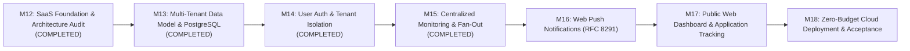

# HawkOffer SaaS Roadmap

**Status:** APPROVED FOR PLANNING  
**Current Phase:** Post-M12 Architecture Transition  
**Target:** Public Multi-User SaaS on Zero-Dollar Cloud Infrastructure  
**Author:** Senior SaaS Architect & Release Engineering  

---

## 1. Roadmap Overview & Phasing

---

## 2. Detailed Milestone Specifications

### Milestone 13: Multi-Tenant Data Model & Dual-Dialect PostgreSQL
*Status: COMPLETED (Verified across 336 backend tests & 34 frontend tests)*
*Objective: Upgrade the database schema and ORM layer to support multi-tenancy, subscription mappings, and seamless dual SQLite/PostgreSQL execution.*

- **Delivered Capabilities**:
  1. **New Relational Entities**:
     - `User` model (`id`, `email`, `hashed_password`, `role`, `is_active`, `is_verified`, `created_at`, `updated_at`).
     - `UserCompanySubscription` mapping table (`user_id`, `company_id`, unique constraint, index).
     - `PushSubscription` model (`user_id`, `endpoint`, `p256dh`, `auth`, `failure_count`, timestamps).
     - `JobApplication` model (`user_id`, `job_id`, `status`, `notes`, `applied_at`, unique constraint).
  2. **Schema Upgrades for Existing Models**:
     - Added `user_id` foreign key (`nullable=True`) to `PreferenceProfile` and `Notification` ensuring complete backward compatibility for desktop mode.
     - Added `is_curated` and `created_by_user_id` to `Company`.
     - Added `postgresql_where` alongside `sqlite_where` to all partial indexes in `outbox.py` and `job.py`.
  3. **Dialect Abstraction & Engine Modernization**:
     - Created `app/database/compat.py` with `get_dialect_name`, `get_upsert_insert`, and `acquire_exclusive_write_lock`.
     - Modernized `app/database/session.py` with PostgreSQL connection pool parameters (`pool_size`, `max_overflow`, `pool_recycle`, `pool_pre_ping`).
     - Modernized `app/core/config.py` to auto-normalize `postgres://` and `postgresql://` connection strings.
  4. **Alembic Dual Migrations**:
     - Created `alembic/versions/b3e4f5a6c7d8_m13_multi_tenant_schema.py` using `batch_alter_table` for 100% SQLite and PostgreSQL parity.
     - Verified full migration upgrade to head, downgrade to m10, and upgrade back to head.
- **Verification Gates Achieved**:
  - 336 backend tests passed (including 13 new M13 schema, uniqueness, and dialect compilation tests).
  - 34 frontend vitest tests passed.
  - Full PostgreSQL DDL compilation verified via mock engine (76 SQL statements compiled cleanly).

---

### Milestone 14: User Authentication, Security & Tenant Isolation
*Status: COMPLETED (Verified across 347 backend tests & 34 frontend tests)*
*Objective: Implement production-grade multi-user authentication, JWT session handling, and rigorous repository-level tenant boundaries.*

- **Delivered Capabilities**:
  1. **Authentication Engine & Cryptography**:
     - Password hashing via `argon2-cffi` (Argon2id, memory_cost=65536, time_cost=2, parallelism=1).
     - Timing-safe dummy password verification mitigating user-enumeration attacks.
     - Email normalization (whitespace trimmed, lowercased).
     - Password complexity validation (minimum 8 chars, maximum 128, containing letters and digits/symbols).
     - JWT token lifecycle via `PyJWT` (30m access token with `type: access`, 14d refresh token with `type: refresh` and unique UUID4 `jti`).
     - Persistent token revocation and rotation in `refresh_tokens` database table.
     - Endpoints: `POST /api/v1/auth/register`, `POST /api/v1/auth/login`, `POST /api/v1/auth/refresh`, `POST /api/v1/auth/logout`, `GET /api/v1/auth/me`.
  2. **FastAPI Auth Dependencies & Dual Compatibility**:
     - `get_current_user`: Bearer JWT decoding, subject resolution, and active user verification.
     - `get_current_active_user`: Enforces `is_active` status.
     - `get_optional_user`: Supports unauthenticated desktop mode (`auth_required=False`) while strictly enforcing authenticated tenant isolation when tokens are provided or `auth_required=True`.
     - `require_role(role)`: RBAC enforcement for admin capabilities.
  3. **Strict Multi-Tenant Isolation**:
     - Preference Profiles: Filtered by `user_id`. Attempting to access, modify, or delete another user's profile returns `404 Not Found`.
     - Company Subscriptions: Filtered by `user_id`. Attempting to delete another user's subscription returns `404 Not Found`.
     - Job Applications: Filtered by `user_id`. Attempting to access, update, or delete another user's application returns `404 Not Found`.
     - Notifications: Scoped to `user_id`. Cross-user notification deduplication via `uq_notifications_job_user_type` index on `(job_id, user_id, notification_type)`. Multiple users can receive alerts for the same job, but a single user cannot receive duplicates.
     - Companies: Curated companies require admin role to modify or delete. Custom companies can only be modified or deleted by their creator or an admin (403 Forbidden).
  4. **Frontend API Groundwork**:
     - Exported TypeScript contracts: `UserRead`, `UserRegisterRequest`, `UserLoginRequest`, `TokenResponse`, `ApplicationRead`, `ApplicationCreate`, `ApplicationUpdate`, `CompanySubscriptionRead`, `CompanySubscriptionCreate`.
     - Added `authApi`, `applicationsApi`, and `subscriptionsApi` clients with automatic `Authorization: Bearer <token>` header injection.
  5. **Alembic Migration & Schema Parity**:
     - Migration `c4d5e6f7a8b9_m14_auth_and_security.py` creating `refresh_tokens` and adding `uq_notifications_job_user_type`. Verified clean upgrade, downgrade, and upgrade roundtrip.
- **Verification Gates Achieved**:
  - 347 backend pytest tests passed (including 11 comprehensive M14 security, auth, and tenant isolation tests).
  - 34 frontend vitest tests passed.
  - Zero Ruff linting issues (`ruff check app tests` passed).
  - Zero MyPy typing errors (`mypy app tests` passed on 115 files).
  - Production frontend build cleanly generated (`tsc && vite build`).

---

### Milestone 15: Centralized Multi-Tenant Monitoring & Outbox Fan-Out
*Status: COMPLETED (Verified across 357 backend tests & 34 frontend tests)*
*Objective: Transform background ingestion into a centralized, efficient 1-to-N fan-out engine that runs on external scheduled triggers.*

- **Delivered Capabilities**:
  1. **Deduplicated Central Scraping**:
     - Query distinct active companies followed by at least one active user (or marked `is_curated = True`) via `CompanyRepository.list_active_monitored_targets()`.
     - Scrape each distinct company exactly once per cycle regardless of subscriber count.
     - Single-user desktop mode falls back to all active companies if 0 subscriptions exist.
  2. **Subscription-Aware Outbox Fan-Out**:
     - `JobDiscoveryWorker` evaluates claimed jobs against active profiles of users subscribed to `job.company_id` (plus legacy desktop profiles where `user_id IS NULL`).
     - Non-subscribers and users without active profiles are never evaluated.
     - Candidates generated with target `user_id` and committed to `NotificationBacklog`.
  3. **Multi-Tenant Notification Promotion & Deduplication**:
     - `BacklogDrainWorker` promotes candidates into `Notification` entries deduplicating by `(job_id, user_id, notification_type)`.
     - Cross-cycle idempotency: repeated runs yield 0 duplicates.
  4. **Scoped Historical Reevaluation**:
     - `ReevaluationWorker` scopes historical job queries to companies subscribed by `profile.user_id`.
  5. **Headless Cron Endpoint & Concurrency Lock**:
     - Endpoint `POST /api/v1/internal/cron/monitor` protected by constant-time `HAWKOFFER_CRON_SECRET` validation (`X-Cron-Secret` or `Bearer` token).
     - Async lock prevents concurrent execution, returning `409 Conflict`.
     - Comprehensive execution telemetry returned in `CronMonitoringResponse`.
- **Verification Gates Achieved**:
  - 10 comprehensive M15 tests passed (`tests/test_m15_centralized_monitoring.py`).
  - Single scrape per company verified across multiple subscribers.
  - Per-user role filtering criteria validated.
  - Desktop legacy profile backward compatibility verified.
  - Zero linting or typing regressions (`ruff check` and `mypy` passed clean).

---

### Milestone 16: Web Push Notifications (RFC 8291/8292) & Background Dispatch
*Objective: Build an autonomous, zero-cost push notification service delivering immediate job matches to browsers even when offline.*

- **Scope & Deliverables**:
  1. **VAPID Key Generation & Push Infrastructure**:
     - Key pair generation and configuration (`HAWKOFFER_VAPID_PUBLIC_KEY`, `HAWKOFFER_VAPID_PRIVATE_KEY`, `HAWKOFFER_VAPID_CLAIMS_EMAIL`).
     - API endpoint: `GET /api/v1/push/vapid-public-key` for browser initialization.
     - API endpoint: `POST /api/v1/push/subscribe` and `POST /api/v1/push/unsubscribe`.
  2. **Browser Service Worker (`sw.js`)**:
     - Implement standard Service Worker handling `push` events.
     - Render native browser notification cards with title, company, match score, and direct application URL.
     - Handle `notificationclick` events: focus existing tab or open job application page in new tab.
  3. **Async Dispatch Worker & 410 Cleanup**:
     - `WebPushDispatcher` service using `pywebpush` to sign and encrypt payloads.
     - Automatic handling of HTTP `410 Gone` and `404 Not Found` responses from Google FCM / Apple APNs / Mozilla Autopush: automatically deletes dead subscriptions from the database.
- **Verification Gates**:
  - Mocked push gateway tests verifying encryption and VAPID JWT generation.
  - Subscription lifecycle test: subscribe, dispatch, simulate 410 Gone, verify automatic database pruning.
  - Zero paid third-party push dependencies.

---

### Milestone 17: Public SaaS Web Dashboard & Application Tracking
*Objective: Evolve the React + Vite frontend into a multi-user web application with authentication, company discovery, and job pipeline tracking.*

- **Scope & Deliverables**:
  1. **Web Authentication & User Flows**:
     - Login, Registration, and Password Reset screens.
     - Session persistence via secure HTTP-only cookies or encrypted localStorage tokens.
     - Profile onboarding wizard for new signups.
  2. **Company Discovery & Subscription Catalog**:
     - Curated company directory with one-click "Follow" / "Unfollow" toggles.
     - "Add Custom Company" modal with URL auto-detection for Greenhouse/Lever portals.
  3. **Browser Push Opt-In Prompt**:
     - Contextual permission request banner explaining the value of background job alerts.
     - One-click Web Push registration calling Service Worker API.
  4. **Job Application Tracker Kanban / List**:
     - Track matched jobs across statuses: `SAVED`, `APPLIED`, `INTERVIEWING`, `OFFER`, `REJECTED`.
     - Add private notes and application dates.
- **Verification Gates**:
  - Vitest frontend tests cover auth state transitions and company subscriptions.
  - Production build bundle size remains under 500KB gzipped.
  - Responsive UI tested on desktop and mobile viewports.

---

### Milestone 18: Zero-Budget Deployment Automation & Cloud Readiness
*Objective: Package, automate, and verify production deployment across Cloudflare Pages, Render/Fly.io, and Supabase PostgreSQL with $0.00/month operational costs.*

- **Scope & Deliverables**:
  1. **Frontend Edge Deployment**:
     - Cloudflare Pages / Vercel automated CI/CD pipeline building `frontend/` on push to `main`.
     - Environment variable wiring (`VITE_API_BASE_URL` pointing to cloud API).
  2. **Backend Container Deployment**:
     - Production multi-stage `Dockerfile` (optimized Python slim image with non-root user).
     - Deployment configuration for Render / Fly.io free tiers.
     - Automatic database migration execution on container startup.
  3. **Autonomous External Cron Setup**:
     - GitHub Actions scheduled workflow (`.github/workflows/monitor-cron.yml`) running every 30 minutes.
     - Secure webhook call to `/api/v1/internal/cron/monitor` using repository secret `CRON_SECRET`.
     - Secondary heartbeat configuration on `cron-job.org` for redundancy.
  4. **Cold Start & Health Verification**:
     - Verify API wake-up behavior and frontend readiness gates during container spins.
     - End-to-end smoke test on live public URL: register user -> subscribe company -> trigger cron -> receive match.
- **Verification Gates**:
  - Complete live deployment operating on free tiers with verified $0.00 spend.
  - Public web application accessible and functional globally.
  - Zero manual server maintenance required for ongoing monitoring.
